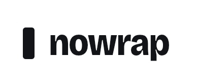
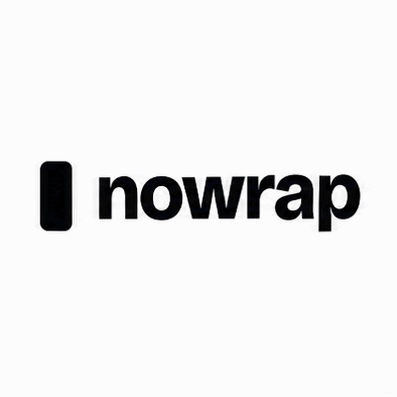
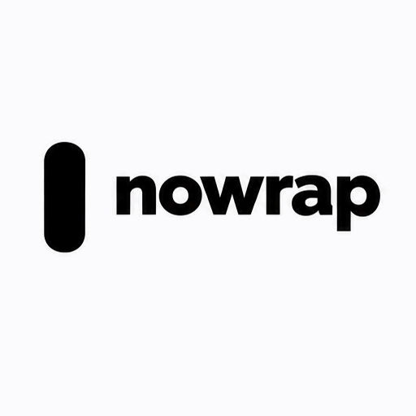
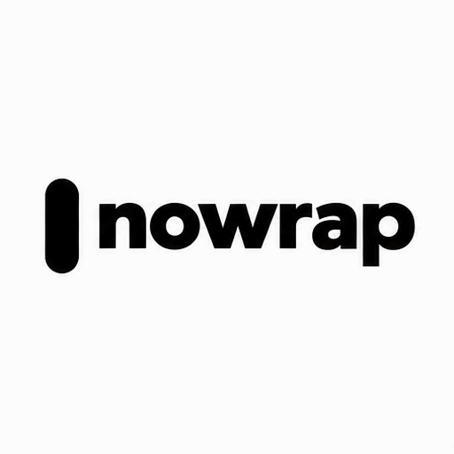

<!-- Generated by scripts/build_readme.py. Edit source data, locale catalogs and generator scripts. -->

# Nowrap logo motion comparison

[← Back to all cases](../../README.md#all-cases)

 

**Creator-reported model · Source-only; not independently reproduced**

Prompt coverage: source-only applies to the exact app instruction only; the full API logo description is absent from the reviewed source. Input mismatch: only the app received the original logo image; API models received a written description calling the bar a fully rounded pill. Exact app instruction is public, but full API logo description is not reproduced. This is not a controlled image-reference comparison. Flare bar is taller and swings; Sunburst motion is subtle. One run per prompt/surface in a small publisher test, not a benchmark. Exact public instructions remain at source; no generations were run. App model must not be inferred from API labels. Offline recovery recheck on 2026-11-08 confirms retained source mapping and original file integrity, not backend execution or current availability.

## Images / GIFs

**Reference/input image, not a generated output.**

- [Original input reference: The original Nowrap logo: a black rounded rectangle followed by the lowercase word nowrap](https://nowrap.ai/reviews/chatgpt-images-2-6/logo-original-reference.jpg) · image
  - Credit: Nowrap
  - Reuse: source-attributed. Unmodified public-source archival copy. No explicit redistribution license verified. Attribution is not permission; repository MIT licensing does not cover this media.
  - [Provenance / rights evidence](https://nowrap.ai/tools/chatgpt-images-2-6)

- [ChatGPT app (underlying variant unspecified): ChatGPT app GIF: the nowrap logo, a black rounded bar and the lowercase word nowrap, tilting gently](https://nowrap.ai/reviews/chatgpt-images-2-6/app-logo.gif) · gif
  - Credit: Nowrap
  - Reuse: source-attributed. Unmodified public-source archival copy. No explicit redistribution license verified. Attribution is not permission; repository MIT licensing does not cover this media.
  - [Provenance / rights evidence](https://nowrap.ai/tools/chatgpt-images-2-6)

- [API Flare: API Flare GIF: a black pill-shaped bar swinging beside the word nowrap, with the bar drawn too tall](https://nowrap.ai/reviews/chatgpt-images-2-6/api-flare-logo.gif) · gif
  - Credit: Nowrap
  - Reuse: source-attributed. Unmodified public-source archival copy. No explicit redistribution license verified. Attribution is not permission; repository MIT licensing does not cover this media.
  - [Provenance / rights evidence](https://nowrap.ai/tools/chatgpt-images-2-6)

- [API Sunburst: API Sunburst GIF: a black pill-shaped bar and the word nowrap, drifting slightly](https://nowrap.ai/reviews/chatgpt-images-2-6/api-sunburst-logo.gif) · gif
  - Credit: Nowrap
  - Reuse: source-attributed. Unmodified public-source archival copy. No explicit redistribution license verified. Attribution is not permission; repository MIT licensing does not cover this media.
  - [Provenance / rights evidence](https://nowrap.ai/tools/chatgpt-images-2-6)

## Source-page and media access

- Checked: 2026-11-05 (UTC)
- Original page: Accessible. Historical source access is recorded for 2026-11-05. Retained original source evidence was rechecked offline on 2026-11-08; no current availability check was made.
- Media: Archived locally. Retained original bytes were rechecked by SHA-256, byte length and full decoding on 2026-11-08. Every GIF frame and each distinct MP4 frame was inspected as still frames; this is not new timed playback or an online access test.
- [Per-file attempts and results](../../docs/NOWRAP_CELLCOG_TOONDERLY_RECOVERY_AUDIT_2026-11-08.md)

## Original prompt

[Original prompt at source](https://nowrap.ai/tools/chatgpt-images-2-6)

The source publishes the actual prompt. This repository links to it rather than inventing or republishing the full text. Required inputs and parameters remain at the source.

## Attribution and verification

- ID: nowrap-logo-motion
- Author: Nowrap
- [Original source](https://nowrap.ai/tools/chatgpt-images-2-6)
- Model: GPT Image 2.6
- Variant: Flare / Sunburst
- Evidence: Nowrap’s November 5, 2026 hands-on test labels API outputs Flare and Sunburst. These known variants apply only to API media; the ChatGPT Plus app’s underlying variant is explicitly unknown. Publisher attribution, not independent generation verification.
- Collected: 2026-11-05 (UTC)
- Source checked: 2026-11-08 (UTC)

Attribution does not grant a media license. Repository MIT terms do not cover third-party outputs. Local files record provenance and reuse status; source-attributed does not mean open-licensed.
