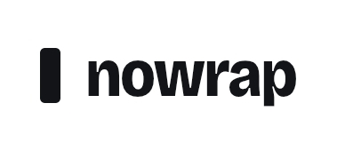
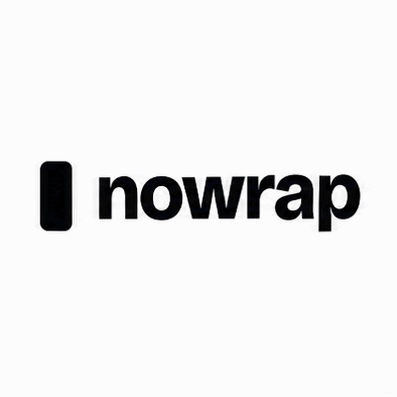
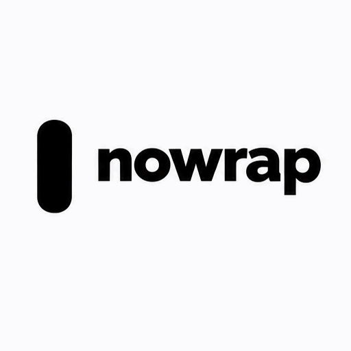
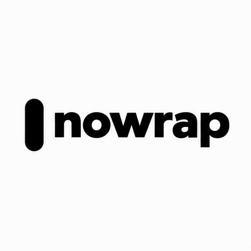

<!-- Generated by scripts/build_readme.py. Edit source data, locale catalogs and generator scripts. -->

# Nowrap 标志动态对比

[← 返回全部案例](../../README.zh-CN.md#all-cases)

 

**作者自报模型 · 仅核对来源；未独立复现**

提示词覆盖范围：source-only 仅适用于应用的准确指令；已复核来源未提供完整 API 标志描述。输入不一致：仅应用获得原标志图，API 接收将竖条描述为完全圆角胶囊的文字。应用精确指令公开，但 API 标志描述全文未公开，不是受控图像参考对比。Flare 竖条更高且摇摆，Sunburst 动作较轻。 这是出版方每提示词/平台一次的小型测试，非基准测试。精确公开指令保留在来源；未执行生成。不得从 API 标签推断应用模型。 2026-11-08 的离线恢复复核确认留存来源映射与原文件完整性，不证明后台执行或当前可访问性。

## 图片 / GIF

**参考 / 输入图，不是生成结果。**

- [原始输入参考：Nowrap 标志动态对比（1 帧，388×161）](https://nowrap.ai/reviews/chatgpt-images-2-6/logo-original-reference.jpg) · image
  - 署名：Nowrap
  - 使用条件：source-attributed. 原样存档公开来源文件；未核实明确转载许可。署名不等于授权，仓库 MIT 许可不涵盖此媒体。
  - [来源 / 权利依据](https://nowrap.ai/tools/chatgpt-images-2-6)

- [ChatGPT 应用（底层变体未披露）：Nowrap 标志动态对比（10 帧，397×397）](https://nowrap.ai/reviews/chatgpt-images-2-6/app-logo.gif) · gif
  - 署名：Nowrap
  - 使用条件：source-attributed. 原样存档公开来源文件；未核实明确转载许可。署名不等于授权，仓库 MIT 许可不涵盖此媒体。
  - [来源 / 权利依据](https://nowrap.ai/tools/chatgpt-images-2-6)

- [API Flare：Nowrap 标志动态对比（9 帧，512×512）](https://nowrap.ai/reviews/chatgpt-images-2-6/api-flare-logo.gif) · gif
  - 署名：Nowrap
  - 使用条件：source-attributed. 原样存档公开来源文件；未核实明确转载许可。署名不等于授权，仓库 MIT 许可不涵盖此媒体。
  - [来源 / 权利依据](https://nowrap.ai/tools/chatgpt-images-2-6)

- [API Sunburst：Nowrap 标志动态对比（9 帧，512×512）](https://nowrap.ai/reviews/chatgpt-images-2-6/api-sunburst-logo.gif) · gif
  - 署名：Nowrap
  - 使用条件：source-attributed. 原样存档公开来源文件；未核实明确转载许可。署名不等于授权，仓库 MIT 许可不涵盖此媒体。
  - [来源 / 权利依据](https://nowrap.ai/tools/chatgpt-images-2-6)

## 原帖与素材获取状态

- 核对日期：2026-11-05 (UTC)
- 原帖：可打开. 历史来源访问记录日期为 2026-11-05；2026-11-08 离线复核保留的原始来源证据，未检查当前可访问性。
- 素材：已存入仓库. 2026-11-08 复核留存原文件的 SHA-256、字节数与完整解码，以静帧检查每个 GIF 帧及 MP4 的各个不同帧；不等于新的实时播放或在线访问测试。
- [逐项尝试与结果](../../docs/NOWRAP_CELLCOG_TOONDERLY_RECOVERY_AUDIT_2026-11-08.md)

## 原始提示词

[原提示词见来源](https://nowrap.ai/tools/chatgpt-images-2-6)

来源公开了真实提示词。本仓库链接原文，不伪造或转载完整长提示词；所需输入与参数请在原文查看。

## 来源与核对信息

- ID: nowrap-logo-motion
- 作者：Nowrap
- [原始来源](https://nowrap.ai/tools/chatgpt-images-2-6)
- 模型：GPT Image 2.6
- 版本：Flare / Sunburst
- 依据：Nowrap 2026 年 11 月 5 日亲测将 API 结果标为 Flare 和 Sunburst；这两个已知变体仅适用于 API 媒体，ChatGPT Plus 应用底层变体明确未知。归属依据出版方陈述，非独立生成验证。
- 收录：2026-11-05 (UTC)
- 来源核对：2026-11-08 (UTC)

标注来源不等于取得素材许可。仓库 MIT 协议不覆盖第三方输出；本地素材逐项记录来源与使用状态，source-attributed 不代表开放许可。
