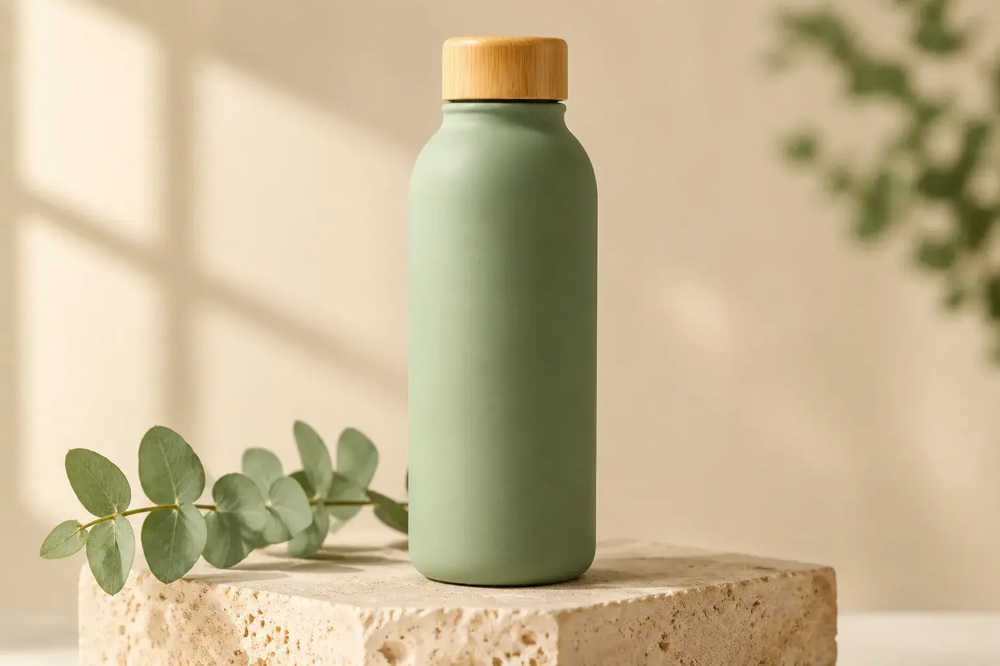
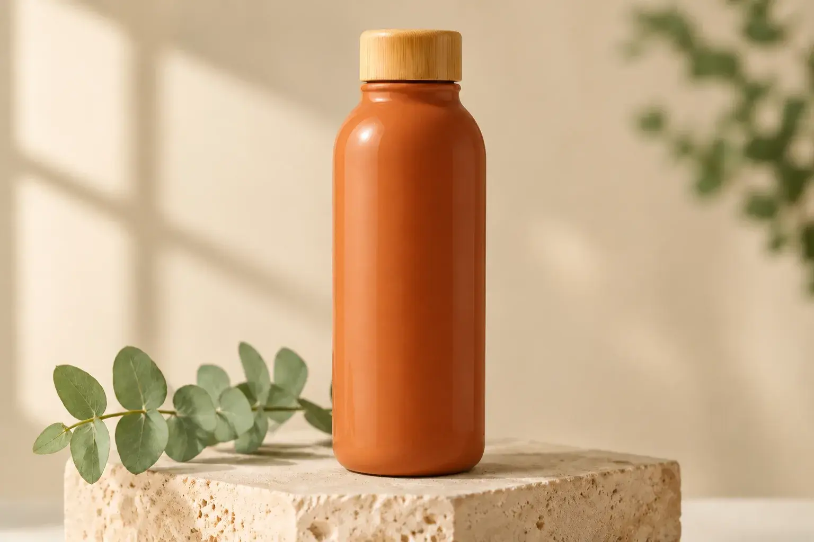

<!-- Generated by scripts/build_readme.py. Edit source data, locale catalogs and generator scripts. -->

# Sage-green to terracotta bottle edit

[← Back to all cases](../../README.md#all-cases)

 

**Creator-reported model · Source-only; not independently reproduced**

Source describes the creation and edit instructions but does not provide verbatim full prompts. The green Flare image is a reference, not an extra output. Both displayed WebPs are 1536×1024. Broad composition is retained; source reports background SSIM 0.94/0.96, not pixel identity. Those SSIM figures were not independently reproduced. No generation was run. Here, not-public records that the reviewed source does not provide the exact original prompt; availability elsewhere and the creator’s intent are not established. Offline recovery review on 2026-11-08 checked retained original HTML. Provider results and measurements are not independent benchmarks.

## Images / GIFs

**Reference/input image, not a generated output.**

- [Flare input: matte sage-green bottle with bamboo cap on travertine.](https://omniakey.com/_img/blog/gpt-image-2-6-review/bottle-original.a6b5c48a.1536.webp) · image
  - Credit: Kiki / OmniaKey
  - Reuse: source-attributed. Unmodified public-source archival copy. No explicit redistribution license verified. Attribution is not permission; repository MIT licensing does not cover this media.
  - [Provenance / rights evidence](https://omniakey.com/blog/gpt-image-2-6-review)

- [Sunburst edit: glossy terracotta bottle in the same composition.](https://omniakey.com/_img/blog/gpt-image-2-6-review/bottle-terracotta.7b882db3.1536.webp) · image
  - Credit: Kiki / OmniaKey
  - Reuse: source-attributed. Unmodified public-source archival copy. No explicit redistribution license verified. Attribution is not permission; repository MIT licensing does not cover this media.
  - [Provenance / rights evidence](https://omniakey.com/blog/gpt-image-2-6-review)

## Source-page and media access

- Checked: 2026-11-05 (UTC)
- Original page: Accessible. Original page evidence collected on 2026-11-05 was rechecked offline on 2026-11-08. Current access was not tested.
- Media: Archived locally. Original bytes, SHA-256, byte counts, formats and full decoding were rechecked. Every static image and GIF frame was visually reviewed; no new timed playback or generation was performed.
- [Per-file attempts and results](../../docs/SOGNI_OMNIAKEY_SANDBASE_RECOVERY_AUDIT_2026-11-08.md)

## Original prompt

**PLACEHOLDER: prompt not publicly provided.**

## Attribution and verification

- ID: omniakey-bottle-color-edit
- Author: Kiki, COO / OmniaKey
- [Original source](https://omniakey.com/blog/gpt-image-2-6-review)
- Model: GPT Image 2.6
- Variant: Flare / Sunburst
- Evidence: The original review explicitly identifies Flare as creator of the input and Sunburst as the editor changing the bottle to glossy terracotta orange on November 5. This is the creator’s attribution, not independent reproduction.
- Collected: 2026-11-05 (UTC)
- Source checked: 2026-11-08 (UTC)

Attribution does not grant a media license. Repository MIT terms do not cover third-party outputs. Local files record provenance and reuse status; source-attributed does not mean open-licensed.
