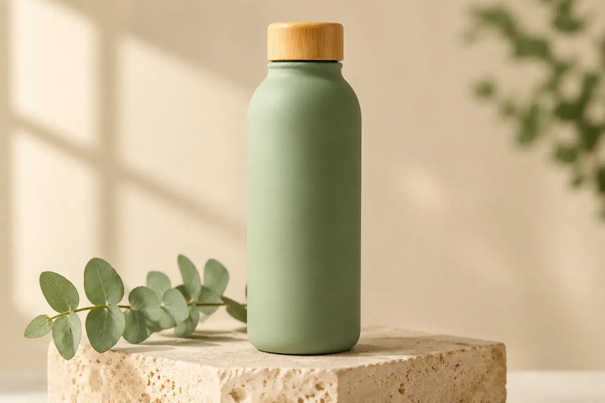
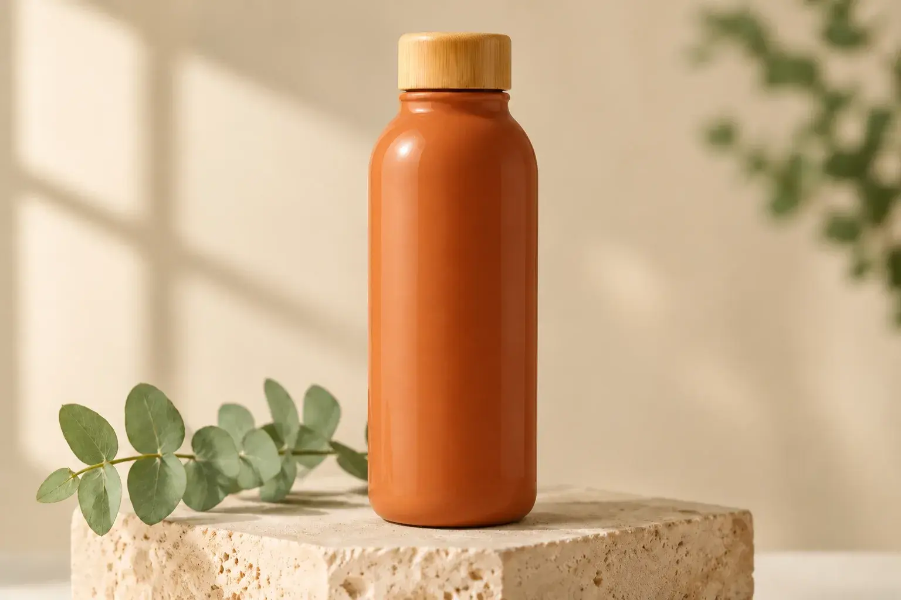

<!-- Generated by scripts/build_readme.py. Edit source data, locale catalogs and generator scripts. -->

# 鼠尾草绿到陶土橙瓶子编辑

[← 返回全部案例](../../README.zh-CN.md#all-cases)

 

**作者自报模型 · 仅核对来源；未独立复现**

来源描述生成与编辑要求，但未提供逐字完整提示词。绿色 Flare 图为参考输入，不另算输出。两份公开 WebP 均为 1536×1024。整体构图保留；来源称背景 SSIM 为 0.94/0.96，并非像素完全一致；未独立复现这些 SSIM 数值。未执行生成。 此处 not-public 仅表示已复核来源未提供准确原始提示词，不判断其他地方是否公开或创作者意图。 2026-11-08离线恢复审核核对了保留的一手页面证据。提供方结果与测量不是独立基准测试。

## 图片 / GIF

**参考 / 输入图，不是生成结果。**

- [Flare 输入图：洞石台上的哑光鼠尾草绿瓶子与竹盖。](https://omniakey.com/_img/blog/gpt-image-2-6-review/bottle-original.a6b5c48a.1536.webp) · image
  - 署名：Kiki / OmniaKey
  - 使用条件：source-attributed. 原样存档公开来源文件，未核实明确转载许可。署名不等于授权；仓库 MIT 许可不涵盖此媒体。
  - [来源 / 权利依据](https://omniakey.com/blog/gpt-image-2-6-review)

- [Sunburst 编辑图：相似构图中的亮面陶土橙瓶子。](https://omniakey.com/_img/blog/gpt-image-2-6-review/bottle-terracotta.7b882db3.1536.webp) · image
  - 署名：Kiki / OmniaKey
  - 使用条件：source-attributed. 原样存档公开来源文件，未核实明确转载许可。署名不等于授权；仓库 MIT 许可不涵盖此媒体。
  - [来源 / 权利依据](https://omniakey.com/blog/gpt-image-2-6-review)

## 原帖与素材获取状态

- 核对日期：2026-11-05 (UTC)
- 原帖：可打开. 2026-11-08离线复核了2026-11-05保留的原页证据，未测试当前访问。
- 素材：已存入仓库. 已重新核对原字节、SHA-256、大小、格式和完整解码，查看每张静图与GIF全部帧；未进行新的实时播放或模型生成。
- [逐项尝试与结果](../../docs/SOGNI_OMNIAKEY_SANDBASE_RECOVERY_AUDIT_2026-11-08.md)

## 原始提示词

**占位：原作者未公开提示词。**

## 来源与核对信息

- ID: omniakey-bottle-color-edit
- 作者：Kiki, COO / OmniaKey
- [原始来源](https://omniakey.com/blog/gpt-image-2-6-review)
- 模型：GPT Image 2.6
- 版本：Flare / Sunburst
- 依据：原创评测明确标明输入由 Flare 生成，11 月 5 日由 Sunburst 编辑为亮面陶土橙色瓶子。模型归因来自创作者，未独立复现。
- 收录：2026-11-05 (UTC)
- 来源核对：2026-11-08 (UTC)

标注来源不等于取得素材许可。仓库 MIT 协议不覆盖第三方输出；本地素材逐项记录来源与使用状态，source-attributed 不代表开放许可。
