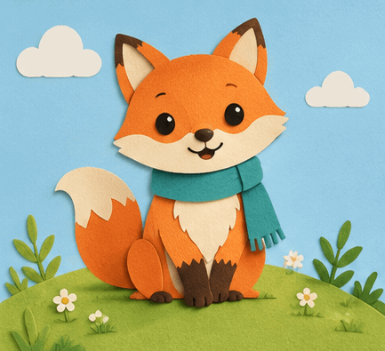

<!-- Generated by scripts/build_readme.py. Edit source data, locale catalogs and generator scripts. -->

# Paper-cut fox waving loop

[← Back to all cases](../../README.md#all-cases)

 

**Creator-reported model · Source-only; not independently reproduced**

Exact prompt is public at source. Independently verified GIF89a: 433×395, 9 frames, 180 ms each, infinite loop, 669,897 bytes; requested duration was 200 ms. A waving paw and blink are visible; all nine frames decoded and inspected. No generation was run. Offline recovery review on 2026-11-08 checked retained original HTML. Provider results and measurements are not independent benchmarks.

## Images / GIFs

- [Paper-cut fox in a teal scarf waving on a grassy hill.](https://omniakey.com/blog/gpt-image-2-6-review/paper-fox.gif) · gif
  - Credit: Kiki / OmniaKey
  - Reuse: source-attributed. Unmodified public-source archival copy. No explicit redistribution license verified. Attribution is not permission; repository MIT licensing does not cover this media.
  - [Provenance / rights evidence](https://omniakey.com/blog/gpt-image-2-6-review)

## Source-page and media access

- Checked: 2026-11-05 (UTC)
- Original page: Accessible. Original page evidence collected on 2026-11-05 was rechecked offline on 2026-11-08. Current access was not tested.
- Media: Archived locally. Original bytes, SHA-256, byte counts, formats and full decoding were rechecked. Every static image and GIF frame was visually reviewed; no new timed playback or generation was performed.
- [Per-file attempts and results](../../docs/SOGNI_OMNIAKEY_SANDBASE_RECOVERY_AUDIT_2026-11-08.md)

## Original prompt

[Original prompt at source](https://omniakey.com/blog/gpt-image-2-6-review)

The source publishes the actual prompt. This repository links to it rather than inventing or republishing the full text. Required inputs and parameters remain at the source.

## Attribution and verification

- ID: omniakey-paper-fox-loop
- Author: Kiki, COO / OmniaKey
- [Original source](https://omniakey.com/blog/gpt-image-2-6-review)
- Model: GPT Image 2.6
- Variant: Sunburst
- Evidence: Kiki’s November 5 original review shows the request naming gpt-image-2.6-sunburst and attributes this exact returned GIF to it. Creator claim, not independently reproduced.
- Collected: 2026-11-05 (UTC)
- Source checked: 2026-11-08 (UTC)

Attribution does not grant a media license. Repository MIT terms do not cover third-party outputs. Local files record provenance and reuse status; source-attributed does not mean open-licensed.
