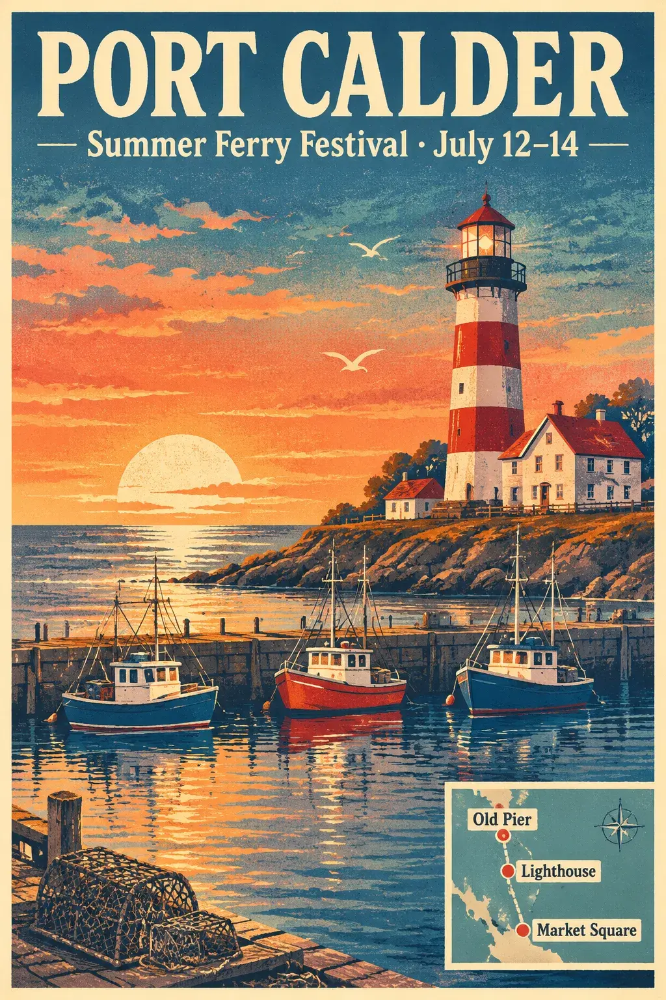
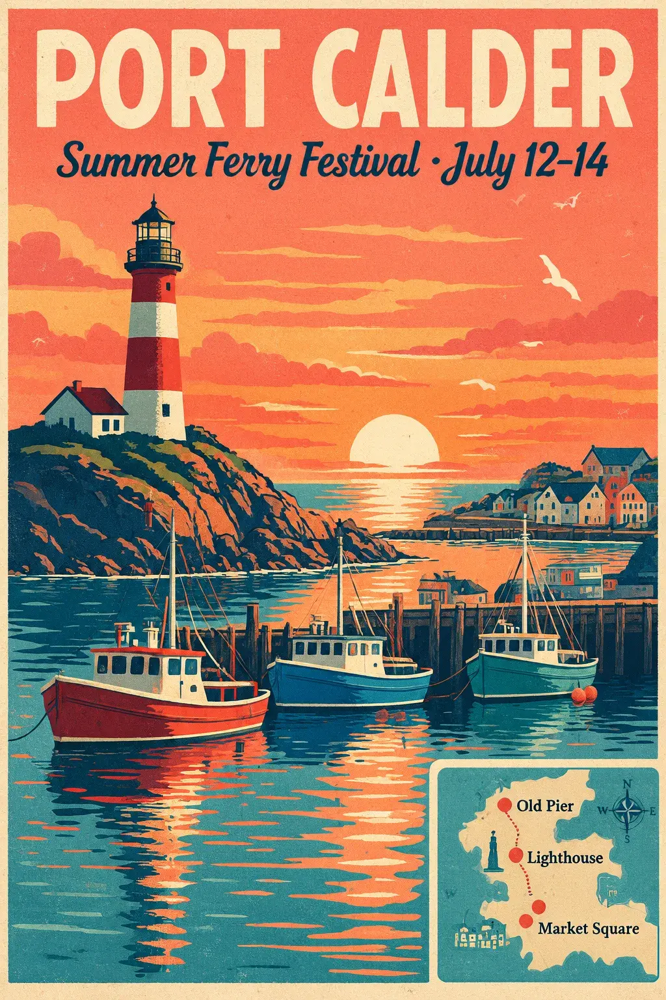
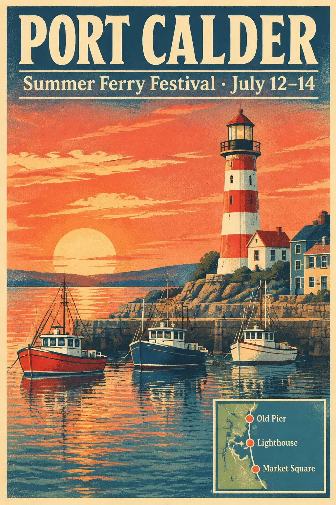

<!-- Generated by scripts/build_readme.py. Edit source data, locale catalogs and generator scripts. -->

# Port Calder poster complexity comparison

[← Back to all cases](../../README.md#all-cases)

 

**Creator-reported model · Source-only; not independently reproduced**

One comparison case, three outputs with the same exact public prompt. All are 1024×1536 WebP files. Headline, festival date and inset map are visible; Sunburst high has two nearby red map dots at Market Square. One run per setting cannot establish causation or a benchmark. Timing and text-accuracy judgments are source claims. No generation was run. Offline recovery review on 2026-11-08 checked retained original HTML. Provider results and measurements are not independent benchmarks.

## Images / GIFs

- [Sunburst low-complexity Port Calder travel poster.](https://omniakey.com/_img/blog/gpt-image-2-6-review/poster-sunburst-low.9ad4e5d5.1024.webp) · image
  - Credit: Kiki / OmniaKey
  - Reuse: source-attributed. Unmodified public-source archival copy. No explicit redistribution license verified. Attribution is not permission; repository MIT licensing does not cover this media.
  - [Provenance / rights evidence](https://omniakey.com/blog/gpt-image-2-6-review)

- [Sunburst high-complexity Port Calder travel poster.](https://omniakey.com/_img/blog/gpt-image-2-6-review/poster-sunburst-high.f8d6eeab.1024.webp) · image
  - Credit: Kiki / OmniaKey
  - Reuse: source-attributed. Unmodified public-source archival copy. No explicit redistribution license verified. Attribution is not permission; repository MIT licensing does not cover this media.
  - [Provenance / rights evidence](https://omniakey.com/blog/gpt-image-2-6-review)

- [Flare high-complexity Port Calder travel poster.](https://omniakey.com/_img/blog/gpt-image-2-6-review/poster-flare-high.8799a409.1024.webp) · image
  - Credit: Kiki / OmniaKey
  - Reuse: source-attributed. Unmodified public-source archival copy. No explicit redistribution license verified. Attribution is not permission; repository MIT licensing does not cover this media.
  - [Provenance / rights evidence](https://omniakey.com/blog/gpt-image-2-6-review)

## Source-page and media access

- Checked: 2026-11-05 (UTC)
- Original page: Accessible. Original page evidence collected on 2026-11-05 was rechecked offline on 2026-11-08. Current access was not tested.
- Media: Archived locally. Original bytes, SHA-256, byte counts, formats and full decoding were rechecked. Every static image and GIF frame was visually reviewed; no new timed playback or generation was performed.
- [Per-file attempts and results](../../docs/SOGNI_OMNIAKEY_SANDBASE_RECOVERY_AUDIT_2026-11-08.md)

## Original prompt

[Original prompt at source](https://omniakey.com/blog/gpt-image-2-6-review)

The source publishes the actual prompt. This repository links to it rather than inventing or republishing the full text. Required inputs and parameters remain at the source.

## Attribution and verification

- ID: omniakey-port-calder-comparison
- Author: Kiki, COO / OmniaKey
- [Original source](https://omniakey.com/blog/gpt-image-2-6-review)
- Model: GPT Image 2.6
- Variant: Sunburst / Flare
- Evidence: The original review labels run A Sunburst/low complexity, B Sunburst/high, and C Flare/high, all 1024×1536 medium quality, once each on November 5. Attribution and settings are author claims.
- Collected: 2026-11-05 (UTC)
- Source checked: 2026-11-08 (UTC)

Attribution does not grant a media license. Repository MIT terms do not cover third-party outputs. Local files record provenance and reuse status; source-attributed does not mean open-licensed.
