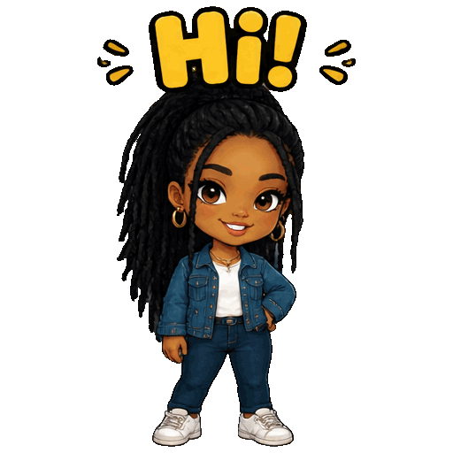

<!-- Generated by scripts/build_readme.py. Edit source data, locale catalogs and generator scripts. -->

# Q 版问候贴纸挥手

[← 返回全部案例](../../README.zh-CN.md#all-cases)

 

**作者自报模型 · 仅核对来源；未独立复现**

每个既有案例对应一份发布方生成GIF，原始紧邻提示词仅链接，不转载。保留全部8帧，不按帧拆分计数。网站将公开X帖文列为创意来源；本记录把实际提供的GIF归于Opusly，不假定它们就是这些用户的原文件。未独立生成或进行耗时基准测试。该提示词所用参考照片未提供，不推断人物身份。

## 图片 / GIF

- [Q版问候角色在Hi文字下挥手。](https://www.opusly.ai/sample/gpt-image-2-6-hi.gif) · gif
  - 署名：Opusly / Lunonia Inc
  - 使用条件：source-attributed. 保留发布方提供的原始字节。未验证明确转载许可，公开访问及署名不等于授权；仓库MIT不覆盖此素材。
  - [来源 / 权利依据](https://www.opusly.ai/gpt-image-2-6)

## 原帖与素材获取状态

- 核对日期：2026-11-08 (UTC)
- 原帖：可打开. 重新打开已知一手来源，为既有候选核对具体示例标签、提示词与素材地址，未搜索新案例。
- 素材：已存入仓库. 成功取得发布方提供的文件并原样保留，检查格式、尺寸、哈希、完整逐帧解码与视觉内容。Opusly历史GIF哈希一致，其余九份文件本次从既有候选原页补取。
- [逐项尝试与结果](../../docs/MODEL_HOLDS_RECOVERY_AUDIT_2026-11-08.md)

## 原始提示词

[原提示词见来源](https://www.opusly.ai/gpt-image-2-6)

来源公开了真实提示词。本仓库链接原文，不伪造或转载完整长提示词；所需输入与参数请在原文查看。

## 来源与核对信息

- ID: opusly-hi-loop
- 作者：Opusly / Lunonia Inc
- [原始来源](https://www.opusly.ai/gpt-image-2-6)
- 模型：GPT Image 2.6
- 版本：Flare
- 依据：已知原页明确称每份展示GIF均是该工具按紧邻提示词生成的实际结果，并说明工具使用GPT Image 2.6 Flare、medium质量，记录六次测试。原GIF地址及历史文件哈希一致。此为发布方归因，并非独立验证后端调用。
- 收录：2026-11-05 (UTC)
- 来源核对：2026-11-08 (UTC)

标注来源不等于取得素材许可。仓库 MIT 协议不覆盖第三方输出；本地素材逐项记录来源与使用状态，source-attributed 不代表开放许可。
