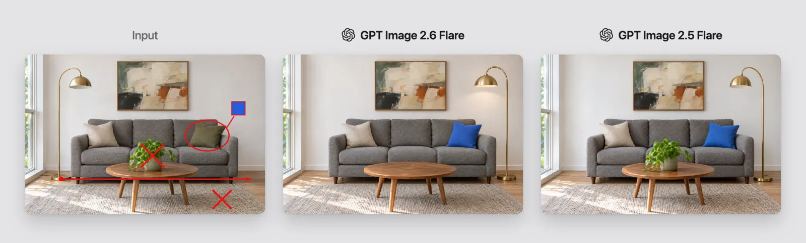
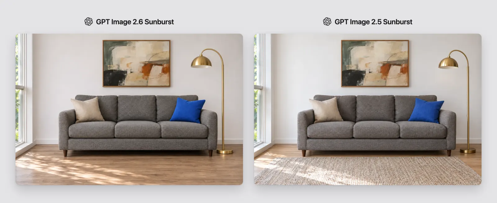

<!-- Generated by scripts/build_readme.py. Edit source data, locale catalogs and generator scripts. -->

# Living-room markup: Flare and Sunburst comparisons

[← Back to all cases](../../README.md#all-cases)

 

**Creator-reported model · Source-only; not independently reproduced**

Creator/publisher-reported example, not independently reproduced. First collage: marked reference, 2.6 Flare, then 2.5 Flare. Second collage: 2.6 Sunburst then 2.5 Sunburst. Only the labeled 2.6 panels are target-model outputs. One room-edit workflow; exact prompt is public.

## Images / GIFs

- [Living-room markup: Flare and Sunburst comparisons — Marked input + 2.6 Flare + 2.5 Flare](https://cdn.prod.website-files.com/67b459f31ecf92c899354e98/6aecf00e2f91a8a41f4e836a_6aecf0077ee834ad25c1d5f4_gpt-image-2-6-vs-gpt-image-2-5-01-room-flare.webp) · image
  - Credit: Ivan Zalesskiy / Overchat AI
  - Reuse: source-attributed. Original public-source media retained unchanged with attribution. No independent redistribution license has been verified. Attribution is not permission, and the repository MIT license does not cover this file.
  - [Provenance / rights evidence](https://overchat.ai/ai-hub/gpt-image-2-6-vs-gpt-image-2-5)

- [Living-room markup: Flare and Sunburst comparisons — 2.6 Sunburst + 2.5 Sunburst](https://cdn.prod.website-files.com/67b459f31ecf92c899354e98/6aecf00e2f91a8a41f4e8370_6aecf008ba37cf1b77947d23_gpt-image-2-6-vs-gpt-image-2-5-02-room-sunburst.webp) · image
  - Credit: Ivan Zalesskiy / Overchat AI
  - Reuse: source-attributed. Original public-source media retained unchanged with attribution. No independent redistribution license has been verified. Attribution is not permission, and the repository MIT license does not cover this file.
  - [Provenance / rights evidence](https://overchat.ai/ai-hub/gpt-image-2-6-vs-gpt-image-2-5)

## Source-page and media access

- Checked: 2026-11-08 (UTC)
- Original page: Accessible. Directly revisited the known original public page and matched each archived media URL to the current HTML or embedded prediction record. No new-case search was performed.
- Media: Archived locally. Retained original bytes were checked against recorded SHA-256 and size, fully decoded and visually inspected, including every animation/video frame. No new generation or media download was performed.
- [Per-file attempts and results](../../docs/FIVE_SOURCES_BACKLOG_AUDIT_2026-11-08.md)

## Original prompt

[Original prompt at source](https://overchat.ai/ai-hub/gpt-image-2-6-vs-gpt-image-2-5)

The source publishes the actual prompt. This repository links to it rather than inventing or republishing the full text. Required inputs and parameters remain at the source.

## Attribution and verification

- ID: overchat-room-markup
- Author: Ivan Zalesskiy / Overchat AI
- [Original source](https://overchat.ai/ai-hub/gpt-image-2-6-vs-gpt-image-2-5)
- Model: GPT Image 2.6
- Variant: Flare / Sunburst
- Evidence: Ivan Zalesskiy’s Overchat comparison labels separate GPT Image 2.6 Flare and Sunburst API results beside their 2.5 counterparts.
- Collected: 2026-11-06 (UTC)
- Source checked: 2026-11-08 (UTC)

Attribution does not grant a media license. Repository MIT terms do not cover third-party outputs. Local files record provenance and reuse status; source-attributed does not mean open-licensed.
