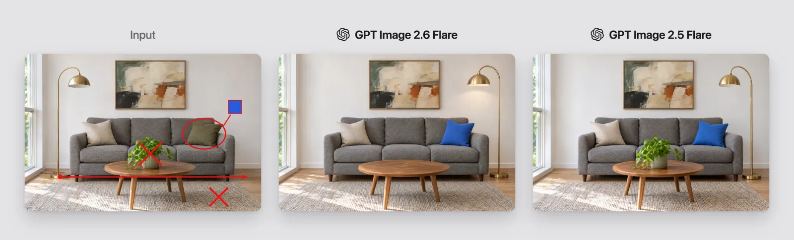
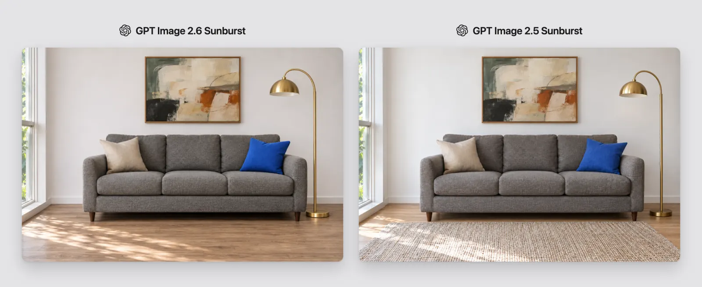

<!-- Generated by scripts/build_readme.py. Edit source data, locale catalogs and generator scripts. -->

# 客厅标注编辑：Flare 与 Sunburst 对照

[← 返回全部案例](../../README.zh-CN.md#all-cases)

 

**作者自报模型 · 仅核对来源；未独立复现**

案例依据创作者或发布方自述，未经独立复现。首张拼图依次为标注参考图、2.6 Flare、2.5 Flare；第二张为 2.6 Sunburst、2.5 Sunburst。只有明确标注 2.6 的面板属于目标模型结果。一个客厅编辑工作流，准确提示词已公开。

## 图片 / GIF

- [客厅标注编辑：Flare 与 Sunburst 对照：标注输入 + 2.6 Flare + 2.5 Flare](https://cdn.prod.website-files.com/67b459f31ecf92c899354e98/6aecf00e2f91a8a41f4e836a_6aecf0077ee834ad25c1d5f4_gpt-image-2-6-vs-gpt-image-2-5-01-room-flare.webp) · image
  - 署名：Ivan Zalesskiy / Overchat AI
  - 使用条件：source-attributed. 公开来源素材原样保留并署名。未核实独立转载许可证；署名不构成授权，仓库 MIT 许可不覆盖此文件。
  - [来源 / 权利依据](https://overchat.ai/ai-hub/gpt-image-2-6-vs-gpt-image-2-5)

- [客厅标注编辑：Flare 与 Sunburst 对照：2.6 Sunburst + 2.5 Sunburst](https://cdn.prod.website-files.com/67b459f31ecf92c899354e98/6aecf00e2f91a8a41f4e8370_6aecf008ba37cf1b77947d23_gpt-image-2-6-vs-gpt-image-2-5-02-room-sunburst.webp) · image
  - 署名：Ivan Zalesskiy / Overchat AI
  - 使用条件：source-attributed. 公开来源素材原样保留并署名。未核实独立转载许可证；署名不构成授权，仓库 MIT 许可不覆盖此文件。
  - [来源 / 权利依据](https://overchat.ai/ai-hub/gpt-image-2-6-vs-gpt-image-2-5)

## 原帖与素材获取状态

- 核对日期：2026-11-08 (UTC)
- 原帖：可打开. 直接复核已知原始公开页面，将每个存档素材地址与当前 HTML 或内嵌预测记录对应。未搜索新案例。
- 素材：已存入仓库. 留存原件已核对 SHA-256 与大小、完整解码并视觉检查，包含全部动画和视频帧。未重新生成或下载媒体。
- [逐项尝试与结果](../../docs/FIVE_SOURCES_BACKLOG_AUDIT_2026-11-08.md)

## 原始提示词

[原提示词见来源](https://overchat.ai/ai-hub/gpt-image-2-6-vs-gpt-image-2-5)

来源公开了真实提示词。本仓库链接原文，不伪造或转载完整长提示词；所需输入与参数请在原文查看。

## 来源与核对信息

- ID: overchat-room-markup
- 作者：Ivan Zalesskiy / Overchat AI
- [原始来源](https://overchat.ai/ai-hub/gpt-image-2-6-vs-gpt-image-2-5)
- 模型：GPT Image 2.6
- 版本：Flare / Sunburst
- 依据：Ivan Zalesskiy 的 Overchat 对照明确标出 GPT Image 2.6 Flare 与 Sunburst API 结果，并列展示各自的 2.5 对照。
- 收录：2026-11-06 (UTC)
- 来源核对：2026-11-08 (UTC)

标注来源不等于取得素材许可。仓库 MIT 协议不覆盖第三方输出；本地素材逐项记录来源与使用状态，source-attributed 不代表开放许可。
