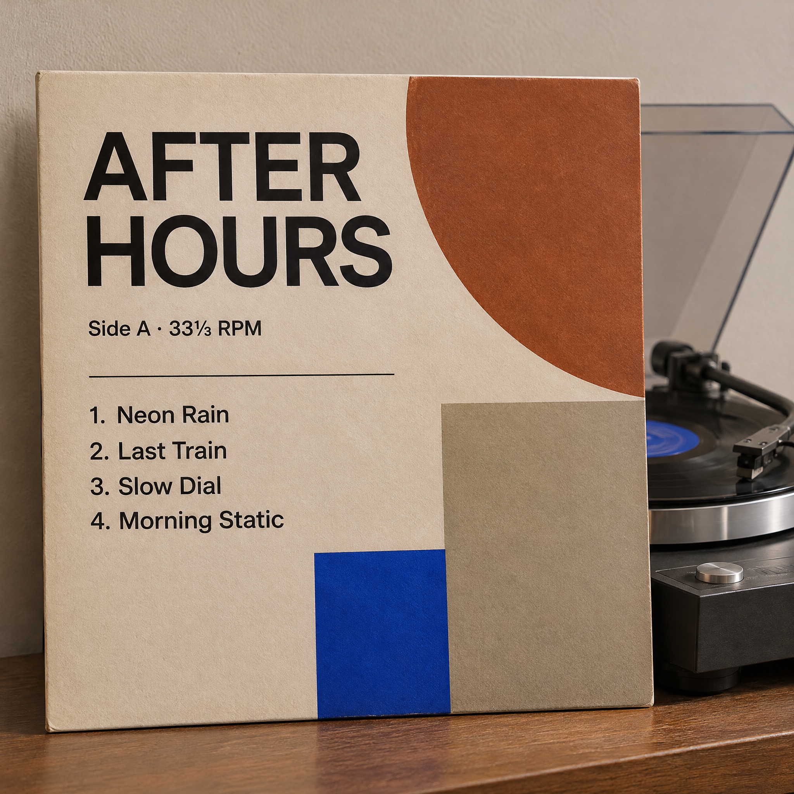

<!-- Generated by scripts/build_readme.py. Edit source data, locale catalogs and generator scripts. -->

<a id="case-recreated-after-hours-record-sleeve"></a>

# AFTER HOURS 唱片封套 · 独立生成

[返回合集](../../README.zh-CN.md)

**整理者已实测**

靠在唱机上的 AFTER HOURS 唱片封套与四行曲目。



[原始来源](https://www.made.app/models/gpt-image-2-6-sunburst#examples-heading) · 作者: Made / Made Inc.

预览图署名: 原始提示词：Made / Made Inc.；本次生成图片：RaphaelAI-OpenLab，经 Raphael GPT Image 2.6 Sunburst 生成。

**原始提示词**

```text
Square vinyl record sleeve leaning on a turntable, minimal Swiss design, title reading exactly "AFTER HOURS" with a smaller line "Side A · 33⅓ RPM" and a four-line tracklist: "1. Neon Rain", "2. Last Train", "3. Slow Dial", "4. Morning Static". Clean editorial design, muted earth tones with one cobalt accent, subtle paper texture, sharp legible type, no other words or logos.
```

**已记录参数**

| 项目 | 内容 |
| --- | --- |
| 模型系列 | GPT Image 2.6 |
| 版本 | sunburst |
| size | 2048x2048 |
| output_format | png |
| UI aspect ratio | 1:1 |
| UI resolution | 2K |
| UI quality | Standard |
| UI planning intensity | Medium |
| History quality label | Medium |
| Output count | 1 |
| AI Enhance | False |

**操作步骤**

1. 在 Raphael 文生图界面选择 GPT Image 2.6 Sunburst。
2. 粘贴原始提示词，不上传参考图，关闭 AI Enhance。
3. 选择 1:1、2K、Standard、Medium planning intensity，生成一张图片。
4. 下载 PNG 原图并检查；仓库展示副本使用像素一致的无损 WebP。

**实测说明**

Raphael web UI · GPT Image 2.6 Sunburst · 2026-11-13

标题、Side A · 33⅓ RPM 和四行曲目均可辨且匹配，封套采用几何色块与纸纹，未发现明显额外文字。

**补充说明**

完整来源原词未改写，未上传外站原图；生成证据与哈希见 cases/recreated-after-hours-record-sleeve/generation.json。无损 WebP 与原始 PNG 像素一致。来源署名不构成提示词使用授权，仓库 MIT 协议不覆盖该提示词或生成图。界面参数按观察记录，不推定 API 模型 ID 或官方参数映射。
