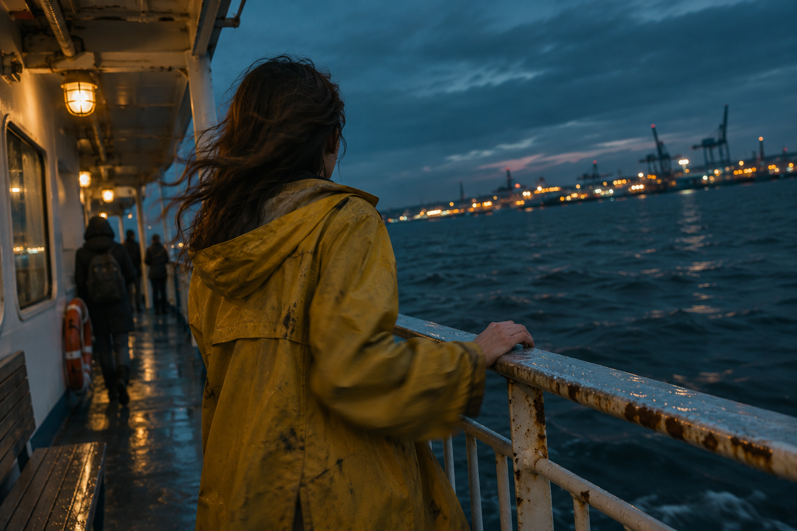

<!-- Generated by scripts/build_readme.py. Edit source data, locale catalogs and generator scripts. -->

<a id="case-recreated-blue-hour-ferry"></a>

# Ferry at blue hour · independent generation

[Back to the collection](../../README.md)

**Tested by the curator**

A yellow-raincoat figure at a ferry rail at blue hour.



[Original source](https://yir.ai/models/gpt-image-2-6) · Author: Yir / Sungerine Labs LLC

Preview credit: 原始提示词：Yir / Sungerine Labs LLC；本次生成图片：RaphaelAI-OpenLab，使用 Codex 内置 image_gen。

**Original prompt**

```text
Film still on a commuter ferry at blue hour, 35mm lens. A woman in a worn yellow raincoat seen from behind at the rail, hood down, hair blown across her shoulder, one hand on the wet railing. Beyond her, dark water and a blurred line of harbor lights. Low-saturation teal and amber, uneven deck lighting, slight motion softness in her sleeve, rust spots on the rail, frame tilted a little to the right.
```

**Recorded settings**

| Setting | Value |
| --- | --- |
| Model family | Not specified by source |
| Variant | Not specified by source |
| size | 1536x1024 |
| output_format | png |
| Generation tool | Codex built-in image_gen |
| Exact model returned | Not exposed |
| Output count | 1 |
| Transparent background | False |

**Workflow**

1. 通过 Codex 内置 image_gen 工具创建新图。
2. 传入完整来源原词，不添加参考图；未指定工具未暴露的尺寸或质量参数。
3. 保存工具返回的 PNG，检查文字、构图与主体；以像素一致的无损 WebP 入库。

**Test notes**

Codex built-in image_gen · exact model not exposed · 2026-11-13

The rear view, lowered hood, windblown hair, hand contact, rusty wet rail and harbor lights match. The tilt and muted palette are present; an actual 35mm focal length cannot be verified from a generated image. Generated with Codex built-in image_gen; the tool did not return the exact model family, variant or API model ID.

**Notes**

The complete source prompt was used unchanged without source images. Evidence and hashes: cases/recreated-blue-hour-ferry/generation.json. The lossless WebP preserves the original PNG pixels. Source attribution does not grant a prompt reuse license; the repository MIT license does not cover the prompt or generated image. The built-in tool did not expose its exact model; this is a prompt execution record, not verified evidence of GPT Image 2.6 output.
