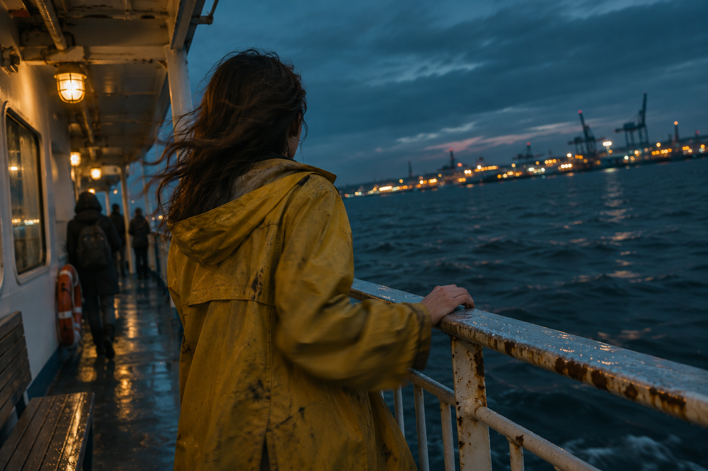

<!-- Generated by scripts/build_readme.py. Edit source data, locale catalogs and generator scripts. -->

<a id="case-recreated-blue-hour-ferry"></a>

# 蓝调时刻渡轮 · 独立生成

[返回合集](../../README.zh-CN.md)

**整理者已实测**

蓝调渡轮栏杆旁穿旧黄雨衣的人物背影。



[原始来源](https://yir.ai/models/gpt-image-2-6) · 作者: Yir / Sungerine Labs LLC

预览图署名: 原始提示词：Yir / Sungerine Labs LLC；本次生成图片：RaphaelAI-OpenLab，使用 Codex 内置 image_gen。

**原始提示词**

```text
Film still on a commuter ferry at blue hour, 35mm lens. A woman in a worn yellow raincoat seen from behind at the rail, hood down, hair blown across her shoulder, one hand on the wet railing. Beyond her, dark water and a blurred line of harbor lights. Low-saturation teal and amber, uneven deck lighting, slight motion softness in her sleeve, rust spots on the rail, frame tilted a little to the right.
```

**已记录参数**

| 项目 | 内容 |
| --- | --- |
| 模型系列 | 来源未注明 |
| 版本 | 来源未注明 |
| size | 1536x1024 |
| output_format | png |
| Generation tool | Codex built-in image_gen |
| Exact model returned | Not exposed |
| Output count | 1 |
| Transparent background | False |

**操作步骤**

1. 通过 Codex 内置 image_gen 工具创建新图。
2. 传入完整来源原词，不添加参考图；未指定工具未暴露的尺寸或质量参数。
3. 保存工具返回的 PNG，检查文字、构图与主体；以像素一致的无损 WebP 入库。

**实测说明**

Codex built-in image_gen · exact model not exposed · 2026-11-13

背影、放下的帽兜、风吹头发、湿栏杆锈迹、手部接触及港口灯光可见；画面倾斜与低饱和氛围匹配。提示词指定 35mm，实际无法从生成图证实镜头焦距。 本次使用 Codex 内置 image_gen；工具未返回具体模型系列、版本或 API 模型 ID。

**补充说明**

完整来源原词未改写，未上传外站原图；生成证据与哈希见 cases/recreated-blue-hour-ferry/generation.json。无损 WebP 与原始 PNG 像素一致。来源署名不构成提示词使用授权，仓库 MIT 协议不覆盖该提示词或生成图。内置工具未回传具体模型，本条是该提示词的执行记录，不作为已核验 GPT Image 2.6 模型输出。
