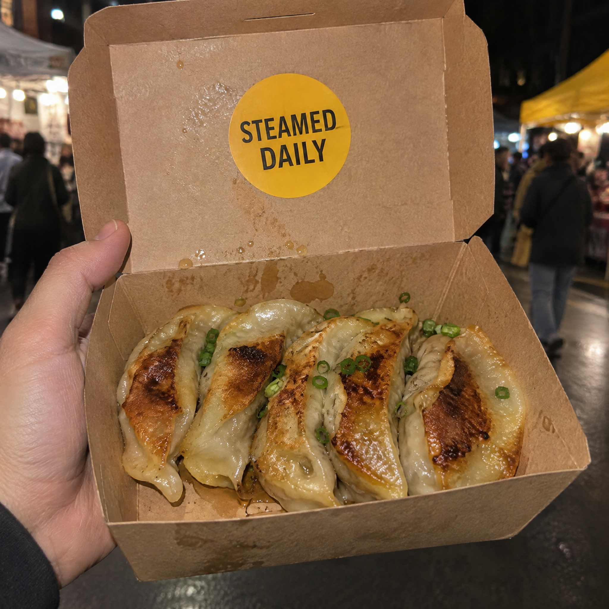

<!-- Generated by scripts/build_readme.py. Edit source data, locale catalogs and generator scripts. -->

<a id="case-recreated-dumpling-takeaway-box"></a>

# Dumpling takeaway box · independent generation

[Back to the collection](../../README.md)

**Tested by the curator**

A hand-held kraft dumpling box with a STEAMED DAILY lid sticker.



[Original source](https://www.made.app/models/gpt-image-2-6-flare#examples-heading) · Author: Made / Made Inc.

Preview credit: 原始提示词：Made / Made Inc.；本次生成图片：RaphaelAI-OpenLab，经 Raphael GPT Image 2.6 Sunburst 生成。

**Original prompt**

```text
Close-up of a hand holding an open kraft takeaway box of pan-fried dumplings toward the camera at a night market, a round sticker on the lid reading exactly "STEAMED DAILY". Shot on a phone with direct on-camera flash, crisp grease sheen, slight grain, muted true color with one mustard accent, sharp legible sticker, no other words or logos.
```

**Recorded settings**

| Setting | Value |
| --- | --- |
| Model family | GPT Image 2.6 |
| Variant | sunburst |
| size | 2048x2048 |
| output_format | png |
| UI aspect ratio | 1:1 |
| UI resolution | 2K |
| UI quality | Standard |
| UI planning intensity | Medium |
| History quality label | Medium |
| Output count | 1 |
| AI Enhance | False |

**Workflow**

1. 在 Raphael 文生图界面选择 GPT Image 2.6 Sunburst。
2. 粘贴原始提示词，不上传参考图，关闭 AI Enhance。
3. 选择 1:1、2K、Standard、Medium planning intensity，生成一张图片。
4. 下载 PNG 原图并检查；仓库展示副本使用像素一致的无损 WebP。

**Test notes**

Raphael web UI · GPT Image 2.6 Sunburst · 2026-11-13

The sticker text, flash-lit dumplings and night-market background match. Only part of the hand is shown, so full hand anatomy is not assessed.

**Notes**

The complete source prompt was used unchanged without source images. Evidence and hashes: cases/recreated-dumpling-takeaway-box/generation.json. The lossless WebP preserves the original PNG pixels. Source attribution does not grant a prompt reuse license; the repository MIT license does not cover the prompt or generated image. UI labels are recorded as observed; the API model ID and official parameter mappings remain unverified.
