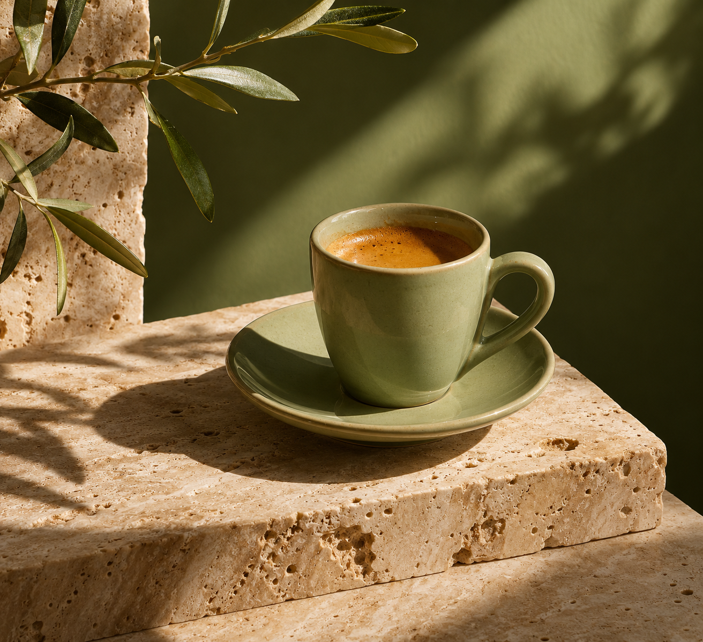

<!-- Generated by scripts/build_readme.py. Edit source data, locale catalogs and generator scripts. -->

<a id="case-recreated-espresso-cup-still-life"></a>

# 浅绿浓缩咖啡杯静物 · 独立生成

[返回合集](../../README.zh-CN.md)

**整理者已实测**

洞石与定向阳光中的浅绿浓缩咖啡杯静物。



[原始来源](https://cubistai.app/zh/ai-models/gpt-image-2-6) · 作者: CubistAI

预览图署名: 原始提示词：CubistAI；本次生成图片：RaphaelAI-OpenLab，使用 Codex 内置 image_gen。

**原始提示词**

```text
Editorial still life photograph of a pale green ceramic espresso cup on travertine, sculptural sunlight, olive green background, refined art direction, no text.
```

**已记录参数**

| 项目 | 内容 |
| --- | --- |
| 模型系列 | 来源未注明 |
| 版本 | 来源未注明 |
| size | 1312x1199 |
| output_format | png |
| Generation tool | Codex built-in image_gen |
| Exact model returned | Not exposed |
| Output count | 1 |
| Transparent background | False |

**操作步骤**

1. 通过 Codex 内置 image_gen 工具创建新图。
2. 传入完整来源原词，不添加参考图；未指定工具未暴露的尺寸或质量参数。
3. 保存工具返回的 PNG，检查文字、构图与主体；以像素一致的无损 WebP 入库。

**实测说明**

Codex built-in image_gen · exact model not exposed · 2026-11-13

浅绿咖啡杯、洞石、橄榄绿背景与清晰投影匹配；附加杯碟和橄榄枝，原词未禁止额外道具。 本次使用 Codex 内置 image_gen；工具未返回具体模型系列、版本或 API 模型 ID。

**补充说明**

完整来源原词未改写，未上传外站原图；生成证据与哈希见 cases/recreated-espresso-cup-still-life/generation.json。无损 WebP 与原始 PNG 像素一致。来源署名不构成提示词使用授权，仓库 MIT 协议不覆盖该提示词或生成图。内置工具未回传具体模型，本条是该提示词的执行记录，不作为已核验 GPT Image 2.6 模型输出。
