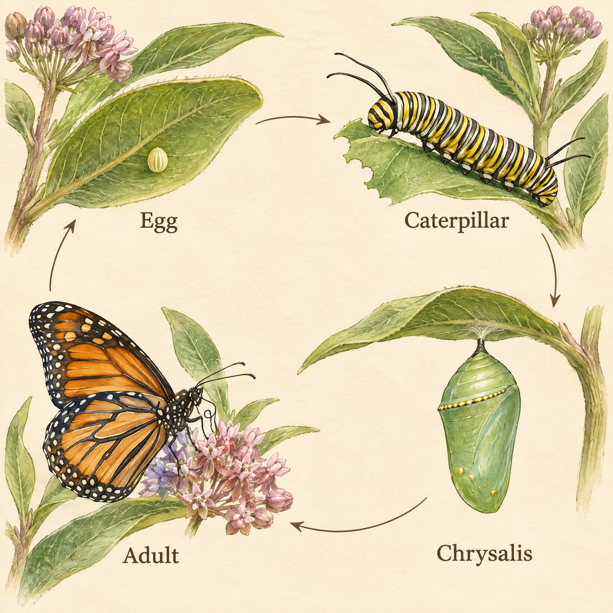

<!-- Generated by scripts/build_readme.py. Edit source data, locale catalogs and generator scripts. -->

<a id="case-recreated-monarch-life-cycle"></a>

# Monarch butterfly life cycle · independent generation

[Back to the collection](../../README.md)

**Tested by the curator**

A watercolor butterfly life-cycle plate with four labelled stages and clockwise arrows.



[Original source](https://www.analyticsvidhya.com/blog/2026/11/gpt-image-2-6-review/#h-4-a-scientific-field-guide-illustration) · Author: Vasu Deo Sankrityayan / Analytics Vidhya

Preview credit: 原始提示词：Vasu Deo Sankrityayan / Analytics Vidhya；本次生成图片：RaphaelAI-OpenLab，经 Raphael GPT Image 2.6 Sunburst 生成。

**Original prompt**

```text
Create an elegant natural-history field-guide plate showing the monarch butterfly life cycle, on warm ivory paper, with meticulous watercolor and fine ink detail. Four clearly separated stages arranged clockwise: upper left one tiny egg on the underside of a milkweed leaf; upper right a yellow-black-white striped monarch caterpillar eating milkweed; lower right a green chrysalis with delicate gold accents attached by its tip; lower left an adult orange-and-black monarch with white-dotted wing edges resting on milkweed. Thin unobtrusive clockwise arrows must connect egg to caterpillar to chrysalis to adult and back to egg. Exactly four labels: Egg, Caterpillar, Chrysalis, Adult. No other text. Show biologically plausible proportions and plant structures; avoid decorative butterflies or extra stages. Use only this standalone brief. Keep all outputs anonymous: no personal names, account data, contact details, signatures or references to any user. Generate the actual image, not a prompt or code.
```

**Recorded settings**

| Setting | Value |
| --- | --- |
| Model family | GPT Image 2.6 |
| Variant | sunburst |
| size | 2048x2048 |
| output_format | png |
| UI aspect ratio | 1:1 |
| UI resolution | 2K |
| UI quality | Standard |
| UI planning intensity | Medium |
| History quality label | Medium |
| Output count | 1 |
| AI Enhance | False |

**Workflow**

1. 在 Raphael 文生图界面选择 GPT Image 2.6 Sunburst。
2. 粘贴原始提示词，不上传参考图，关闭 AI Enhance。
3. 选择 1:1、2K、Standard、Medium planning intensity，生成一张图片。
4. 下载 PNG 原图并检查；仓库展示副本使用像素一致的无损 WebP。

**Test notes**

Raphael web UI · GPT Image 2.6 Sunburst · 2026-11-13

Four stages occupy the requested quadrants, with the labels Egg, Caterpillar, Chrysalis and Adult and a clockwise arrow cycle. The egg is enlarged for visibility, so the plate does not establish consistent biological scale. Species morphology and host-plant anatomy have not been reviewed by an entomologist; this is a visual-layout example.

**Notes**

The source prompt was used unchanged, without the source image. Generation evidence and hashes: cases/recreated-monarch-life-cycle/generation.json. The displayed WebP preserves the original PNG pixels. Third-party prompt reuse terms were not independently licensed; attribution does not grant permission. The repository MIT license does not cover this prompt or generated image. UI labels are recorded as observed; no API model ID or official parameter mapping is inferred.
