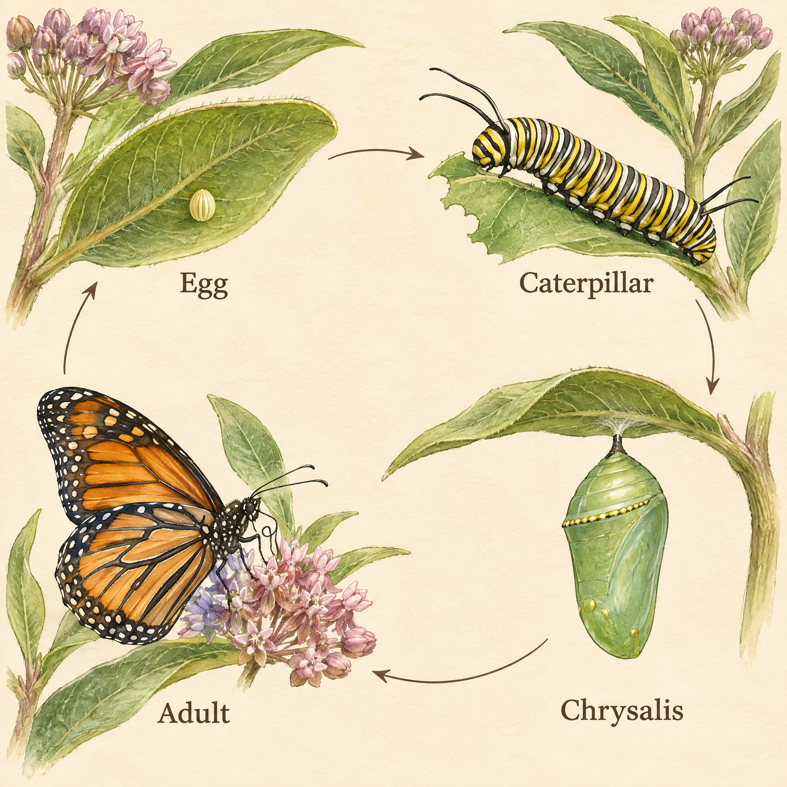

<!-- Generated by scripts/build_readme.py. Edit source data, locale catalogs and generator scripts. -->

<a id="case-recreated-monarch-life-cycle"></a>

# 帝王蝶四阶段图谱 · 独立生成

[返回合集](../../README.zh-CN.md)

**整理者已实测**

用四个英文标签和顺时针箭头组织的水彩蝴蝶生命周期图谱。



[原始来源](https://www.analyticsvidhya.com/blog/2026/11/gpt-image-2-6-review/#h-4-a-scientific-field-guide-illustration) · 作者: Vasu Deo Sankrityayan / Analytics Vidhya

预览图署名: 原始提示词：Vasu Deo Sankrityayan / Analytics Vidhya；本次生成图片：RaphaelAI-OpenLab，经 Raphael GPT Image 2.6 Sunburst 生成。

**原始提示词**

```text
Create an elegant natural-history field-guide plate showing the monarch butterfly life cycle, on warm ivory paper, with meticulous watercolor and fine ink detail. Four clearly separated stages arranged clockwise: upper left one tiny egg on the underside of a milkweed leaf; upper right a yellow-black-white striped monarch caterpillar eating milkweed; lower right a green chrysalis with delicate gold accents attached by its tip; lower left an adult orange-and-black monarch with white-dotted wing edges resting on milkweed. Thin unobtrusive clockwise arrows must connect egg to caterpillar to chrysalis to adult and back to egg. Exactly four labels: Egg, Caterpillar, Chrysalis, Adult. No other text. Show biologically plausible proportions and plant structures; avoid decorative butterflies or extra stages. Use only this standalone brief. Keep all outputs anonymous: no personal names, account data, contact details, signatures or references to any user. Generate the actual image, not a prompt or code.
```

**已记录参数**

| 项目 | 内容 |
| --- | --- |
| 模型系列 | GPT Image 2.6 |
| 版本 | sunburst |
| size | 2048x2048 |
| output_format | png |
| UI aspect ratio | 1:1 |
| UI resolution | 2K |
| UI quality | Standard |
| UI planning intensity | Medium |
| History quality label | Medium |
| Output count | 1 |
| AI Enhance | False |

**操作步骤**

1. 在 Raphael 文生图界面选择 GPT Image 2.6 Sunburst。
2. 粘贴原始提示词，不上传参考图，关闭 AI Enhance。
3. 选择 1:1、2K、Standard、Medium planning intensity，生成一张图片。
4. 下载 PNG 原图并检查；仓库展示副本使用像素一致的无损 WebP。

**实测说明**

Raphael web UI · GPT Image 2.6 Sunburst · 2026-11-13

四阶段位于指定象限，Egg、Caterpillar、Chrysalis、Adult 四个标签及顺时针循环箭头均可见。卵被放大展示，不宣称各阶段具有一致的生物尺度。物种形态及寄主植物结构未经昆虫学专家审校，仅作为视觉排版案例。

**补充说明**

原始提示词逐字使用，未上传外站原图。生成证据与哈希见 cases/recreated-monarch-life-cycle/generation.json。展示用无损 WebP 与原始 PNG 像素一致。未核实第三方提示词的独立转载许可证，署名不构成授权，仓库 MIT 协议不覆盖该提示词或生成图。界面参数按实际标签记录，不推定 API 模型 ID 或官方参数映射。
