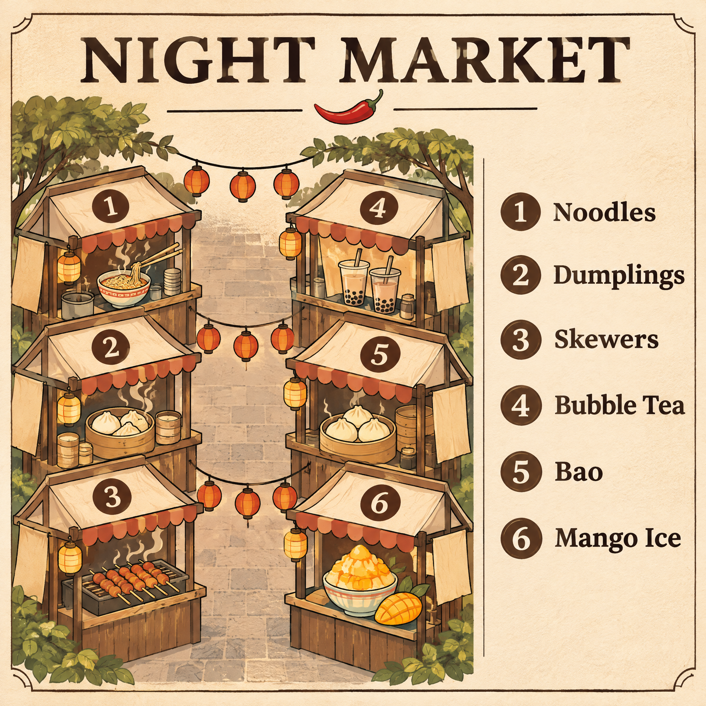

<!-- Generated by scripts/build_readme.py. Edit source data, locale catalogs and generator scripts. -->

<a id="case-recreated-night-market-map"></a>

# Six-stall night-market map · independent generation

[Back to the collection](../../README.md)

**Tested by the curator**

A six-stall illustrated night-market map with a readable title and food legend.



[Original source](https://www.made.app/models/gpt-image-2-6-flare#examples-heading) · Author: Made / Made Inc.

Preview credit: 原始提示词：Made / Made Inc.；本次生成图片：RaphaelAI-OpenLab，经 Raphael GPT Image 2.6 Sunburst 生成。

**Original prompt**

```text
Illustrated map poster of a night market on cream paper, titled exactly "NIGHT MARKET", six numbered stalls drawn along two aisles, with a legend reading exactly "1 Noodles", "2 Dumplings", "3 Skewers", "4 Bubble Tea", "5 Bao", "6 Mango Ice". Clean editorial design, muted earth tones with one chili red accent, subtle paper texture, sharp legible type, no other words or logos.
```

**Recorded settings**

| Setting | Value |
| --- | --- |
| Model family | GPT Image 2.6 |
| Variant | sunburst |
| size | 2048x2048 |
| output_format | png |
| UI aspect ratio | 1:1 |
| UI resolution | 2K |
| UI quality | Standard |
| UI planning intensity | Medium |
| History quality label | Medium |
| Output count | 1 |
| AI Enhance | False |

**Workflow**

1. 在 Raphael 文生图界面选择 GPT Image 2.6 Sunburst。
2. 粘贴原始提示词，不上传参考图，关闭 AI Enhance。
3. 选择 1:1、2K、Standard、Medium planning intensity，生成一张图片。
4. 下载 PNG 原图并检查；仓库展示副本使用像素一致的无损 WebP。

**Test notes**

Raphael web UI · GPT Image 2.6 Sunburst · 2026-11-13

The title NIGHT MARKET, all six legend strings and stall numbers 1–6 are readable and match the brief. The stalls form two columns around one central aisle; the requested two aisles were not achieved. The original Made example used Flare; this new image was generated with Sunburst.

**Notes**

The source prompt was used unchanged, without the source image. Generation evidence and hashes: cases/recreated-night-market-map/generation.json. The displayed WebP preserves the original PNG pixels. Third-party prompt reuse terms were not independently licensed; attribution does not grant permission. The repository MIT license does not cover this prompt or generated image. UI labels are recorded as observed; no API model ID or official parameter mapping is inferred.
