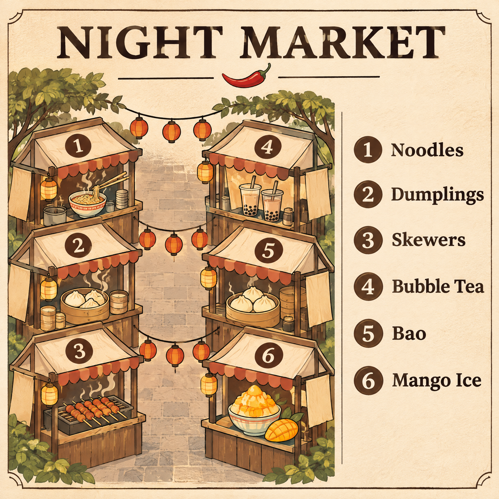

<!-- Generated by scripts/build_readme.py. Edit source data, locale catalogs and generator scripts. -->

<a id="case-recreated-night-market-map"></a>

# 六摊位夜市地图 · 独立生成

[返回合集](../../README.zh-CN.md)

**整理者已实测**

包含六个编号摊位、清晰英文标题与食物图例的夜市插画地图。



[原始来源](https://www.made.app/models/gpt-image-2-6-flare#examples-heading) · 作者: Made / Made Inc.

预览图署名: 原始提示词：Made / Made Inc.；本次生成图片：RaphaelAI-OpenLab，经 Raphael GPT Image 2.6 Sunburst 生成。

**原始提示词**

```text
Illustrated map poster of a night market on cream paper, titled exactly "NIGHT MARKET", six numbered stalls drawn along two aisles, with a legend reading exactly "1 Noodles", "2 Dumplings", "3 Skewers", "4 Bubble Tea", "5 Bao", "6 Mango Ice". Clean editorial design, muted earth tones with one chili red accent, subtle paper texture, sharp legible type, no other words or logos.
```

**已记录参数**

| 项目 | 内容 |
| --- | --- |
| 模型系列 | GPT Image 2.6 |
| 版本 | sunburst |
| size | 2048x2048 |
| output_format | png |
| UI aspect ratio | 1:1 |
| UI resolution | 2K |
| UI quality | Standard |
| UI planning intensity | Medium |
| History quality label | Medium |
| Output count | 1 |
| AI Enhance | False |

**操作步骤**

1. 在 Raphael 文生图界面选择 GPT Image 2.6 Sunburst。
2. 粘贴原始提示词，不上传参考图，关闭 AI Enhance。
3. 选择 1:1、2K、Standard、Medium planning intensity，生成一张图片。
4. 下载 PNG 原图并检查；仓库展示副本使用像素一致的无损 WebP。

**实测说明**

Raphael web UI · GPT Image 2.6 Sunburst · 2026-11-13

标题 NIGHT MARKET、六条英文图例及摊位编号 1–6 均清晰且与原词一致。摊位围绕一条中央通道排列成两列，未满足原词要求的两条通道。Made 原示例使用 Flare，本次新图使用 Sunburst。

**补充说明**

原始提示词逐字使用，未上传外站原图。生成证据与哈希见 cases/recreated-night-market-map/generation.json。展示用无损 WebP 与原始 PNG 像素一致。未核实第三方提示词的独立转载许可证，署名不构成授权，仓库 MIT 协议不覆盖该提示词或生成图。界面参数按实际标签记录，不推定 API 模型 ID 或官方参数映射。
