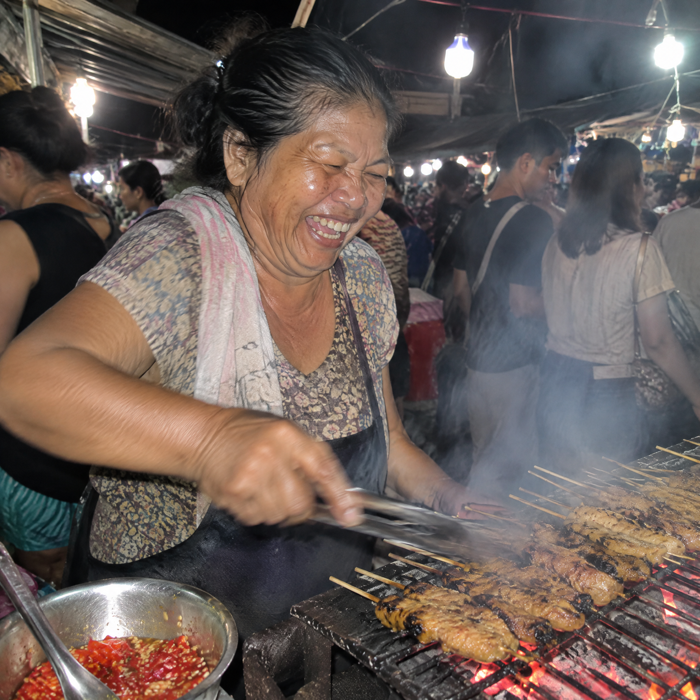

<!-- Generated by scripts/build_readme.py. Edit source data, locale catalogs and generator scripts. -->

<a id="case-recreated-night-market-vendor"></a>

# Night-market vendor portrait · independent generation

[Back to the collection](../../README.md)

**Tested by the curator**

A candid night-market portrait with direct flash, smoke, visible skin texture and motion blur.



[Original source](https://www.made.app/models/gpt-image-2-6-flare#examples-heading) · Author: Made / Made Inc.

Preview credit: 原始提示词：Made / Made Inc.；本次生成图片：RaphaelAI-OpenLab，经 Raphael GPT Image 2.6 Sunburst 生成。

**Original prompt**

```text
Candid photo of a street food vendor in her fifties laughing mid-flip as she turns skewers over a charcoal grill at a crowded night market, smoke rising through strings of bare bulbs. Shot on a phone with direct on-camera flash, real skin texture, slight motion blur, muted true color with one chili red accent, candid and unposed, no text, logos, or watermark.
```

**Recorded settings**

| Setting | Value |
| --- | --- |
| Model family | GPT Image 2.6 |
| Variant | sunburst |
| size | 2048x2048 |
| output_format | png |
| UI aspect ratio | 1:1 |
| UI resolution | 2K |
| UI quality | Standard |
| UI planning intensity | Medium |
| History quality label | Medium |
| Output count | 1 |
| AI Enhance | False |

**Workflow**

1. 在 Raphael 文生图界面选择 GPT Image 2.6 Sunburst。
2. 粘贴原始提示词，不上传参考图，关闭 AI Enhance。
3. 选择 1:1、2K、Standard、Medium planning intensity，生成一张图片。
4. 下载 PNG 原图并检查；仓库展示副本使用像素一致的无损 WebP。

**Test notes**

Raphael web UI · GPT Image 2.6 Sunburst · 2026-11-13

The laughing vendor, charcoal skewers, smoke and bare bulbs are visible. Motion blur obscures fine hand detail, so finger anatomy is not certified. This is a new Sunburst output from a prompt originally shown with Flare, not a reproduction of the original image or a model comparison.

**Notes**

The source prompt was used unchanged, without the source image. Generation evidence and hashes: cases/recreated-night-market-vendor/generation.json. The displayed WebP preserves the original PNG pixels. Third-party prompt reuse terms were not independently licensed; attribution does not grant permission. The repository MIT license does not cover this prompt or generated image. UI labels are recorded as observed; no API model ID or official parameter mapping is inferred.
