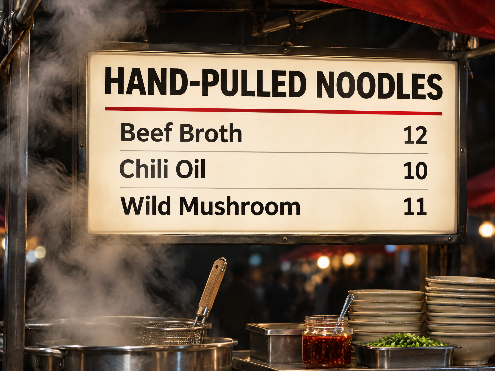

<!-- Generated by scripts/build_readme.py. Edit source data, locale catalogs and generator scripts. -->

<a id="case-recreated-noodle-lightbox-menu"></a>

# Noodle-stall lightbox menu · independent generation

[Back to the collection](../../README.md)

**Tested by the curator**

A night-market lightbox with an exact title and three menu items and prices.



[Original source](https://www.made.app/models/gpt-image-2-6-flare#examples-heading) · Author: Made / Made Inc.

Preview credit: 原始提示词：Made / Made Inc.；本次生成图片：RaphaelAI-OpenLab，经 Raphael GPT Image 2.6 Sunburst 生成。

**Original prompt**

```text
Glowing lightbox menu above a night market noodle stall, reading exactly "HAND-PULLED NOODLES" with three lines below: "Beef Broth 12", "Chili Oil 10", "Wild Mushroom 11". Steam drifting past the sign. Clean editorial design, muted true color with one chili red accent, sharp legible type, no other words or logos.
```

**Recorded settings**

| Setting | Value |
| --- | --- |
| Model family | GPT Image 2.6 |
| Variant | sunburst |
| size | 2048x1536 |
| output_format | png |
| UI aspect ratio | 4:3 |
| UI resolution | 2K |
| UI quality | Standard |
| UI planning intensity | Medium |
| History quality label | Medium |
| Output count | 1 |
| AI Enhance | False |

**Workflow**

1. 在 Raphael 文生图界面选择 GPT Image 2.6 Sunburst。
2. 粘贴原始提示词，不上传参考图，关闭 AI Enhance。
3. 选择 4:3、2K、Standard、Medium planning intensity，生成一张图片。
4. 下载 PNG 原图并检查；仓库展示副本使用像素一致的无损 WebP。

**Test notes**

Raphael web UI · GPT Image 2.6 Sunburst · 2026-11-13

The headline and all three menu strings and prices match the brief; steam is visible.

**Notes**

The complete source prompt was used unchanged without source images. Evidence and hashes: cases/recreated-noodle-lightbox-menu/generation.json. The lossless WebP preserves the original PNG pixels. Source attribution does not grant a prompt reuse license; the repository MIT license does not cover the prompt or generated image. UI labels are recorded as observed; the API model ID and official parameter mappings remain unverified.
