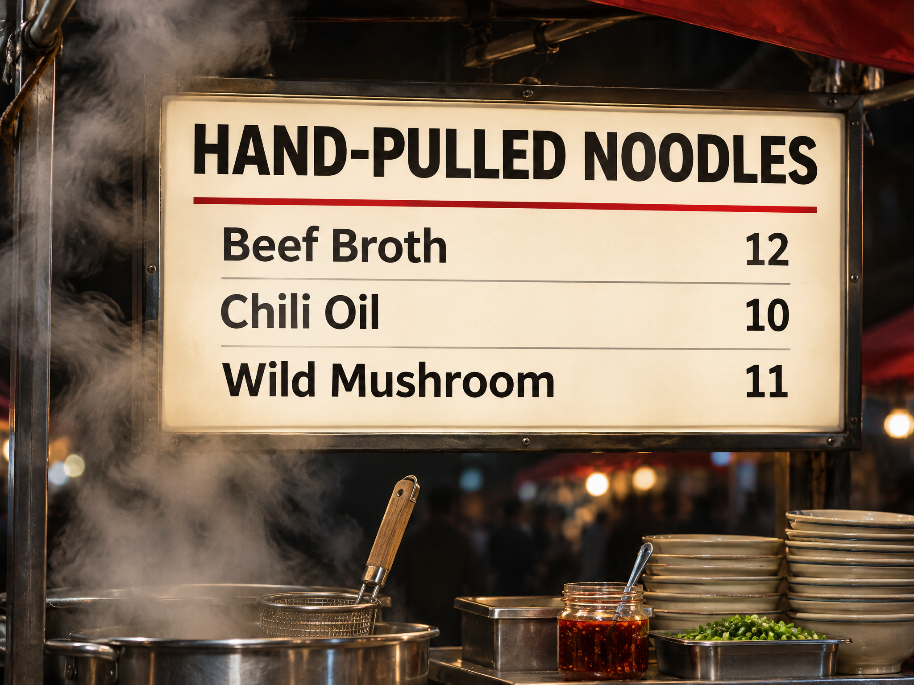

<!-- Generated by scripts/build_readme.py. Edit source data, locale catalogs and generator scripts. -->

<a id="case-recreated-noodle-lightbox-menu"></a>

# 面摊灯箱菜单 · 独立生成

[返回合集](../../README.zh-CN.md)

**整理者已实测**

直闪夜市面摊灯箱，包含标题及三道菜名与价格。



[原始来源](https://www.made.app/models/gpt-image-2-6-flare#examples-heading) · 作者: Made / Made Inc.

预览图署名: 原始提示词：Made / Made Inc.；本次生成图片：RaphaelAI-OpenLab，经 Raphael GPT Image 2.6 Sunburst 生成。

**原始提示词**

```text
Glowing lightbox menu above a night market noodle stall, reading exactly "HAND-PULLED NOODLES" with three lines below: "Beef Broth 12", "Chili Oil 10", "Wild Mushroom 11". Steam drifting past the sign. Clean editorial design, muted true color with one chili red accent, sharp legible type, no other words or logos.
```

**已记录参数**

| 项目 | 内容 |
| --- | --- |
| 模型系列 | GPT Image 2.6 |
| 版本 | sunburst |
| size | 2048x1536 |
| output_format | png |
| UI aspect ratio | 4:3 |
| UI resolution | 2K |
| UI quality | Standard |
| UI planning intensity | Medium |
| History quality label | Medium |
| Output count | 1 |
| AI Enhance | False |

**操作步骤**

1. 在 Raphael 文生图界面选择 GPT Image 2.6 Sunburst。
2. 粘贴原始提示词，不上传参考图，关闭 AI Enhance。
3. 选择 4:3、2K、Standard、Medium planning intensity，生成一张图片。
4. 下载 PNG 原图并检查；仓库展示副本使用像素一致的无损 WebP。

**实测说明**

Raphael web UI · GPT Image 2.6 Sunburst · 2026-11-13

已核对 HAND-PULLED NOODLES 与 Beef Broth 12、Chili Oil 10、Wild Mushroom 11，文字及价格匹配，蒸汽可见。

**补充说明**

完整来源原词未改写，未上传外站原图；生成证据与哈希见 cases/recreated-noodle-lightbox-menu/generation.json。无损 WebP 与原始 PNG 像素一致。来源署名不构成提示词使用授权，仓库 MIT 协议不覆盖该提示词或生成图。界面参数按观察记录，不推定 API 模型 ID 或官方参数映射。
