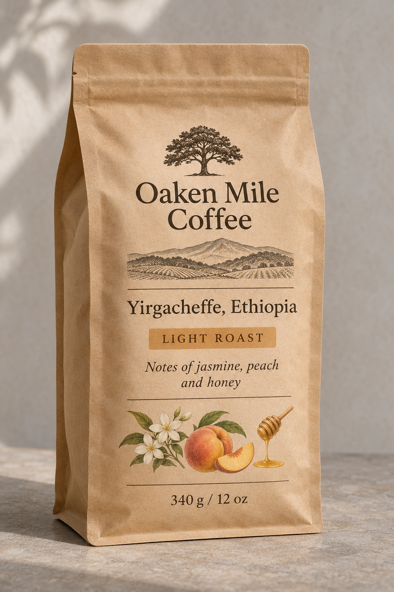

<!-- Generated by scripts/build_readme.py. Edit source data, locale catalogs and generator scripts. -->

<a id="case-recreated-oaken-mile-coffee-label"></a>

# Oaken Mile coffee-bag label · independent generation

[Back to the collection](../../README.md)

**Tested by the curator**

An Oaken Mile kraft coffee bag with origin and tasting-note typography.



[Original source](https://mossimage.studio/blog/gpt-image-2-6#round-3-a-product-label) · Author: MossImage Studio Team

Preview credit: 原始提示词：MossImage Studio Team；本次生成图片：RaphaelAI-OpenLab，使用 Codex 内置 image_gen。

**Original prompt**

```text
A studio product photo of a matte kraft paper coffee bag standing on a plain stone surface, soft daylight. The printed label reads: "Oaken Mile Coffee", "Yirgacheffe, Ethiopia", "Light Roast", "Notes of jasmine, peach and honey", "340 g / 12 oz".
```

**Recorded settings**

| Setting | Value |
| --- | --- |
| Model family | Not specified by source |
| Variant | Not specified by source |
| size | 1024x1536 |
| output_format | png |
| Generation tool | Codex built-in image_gen |
| Exact model returned | Not exposed |
| Output count | 1 |
| Transparent background | False |

**Workflow**

1. 通过 Codex 内置 image_gen 工具创建新图。
2. 传入完整来源原词，不添加参考图；未指定工具未暴露的尺寸或质量参数。
3. 保存工具返回的 PNG，检查文字、构图与主体；以像素一致的无损 WebP 入库。

**Test notes**

Codex built-in image_gen · exact model not exposed · 2026-11-13

The brand, origin, tasting notes and weight are readable. Light Roast was changed to LIGHT ROAST. Added tree, landscape and ingredient illustrations were not prohibited by the prompt. Generated with Codex built-in image_gen; the tool did not return the exact model family, variant or API model ID.

**Notes**

The complete source prompt was used unchanged without source images. Evidence and hashes: cases/recreated-oaken-mile-coffee-label/generation.json. The lossless WebP preserves the original PNG pixels. Source attribution does not grant a prompt reuse license; the repository MIT license does not cover the prompt or generated image. The built-in tool did not expose its exact model; this is a prompt execution record, not verified evidence of GPT Image 2.6 output.
