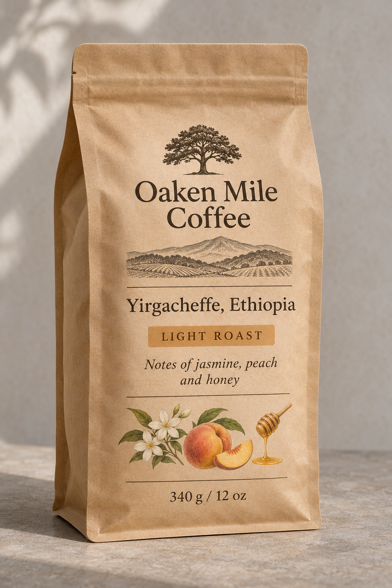

<!-- Generated by scripts/build_readme.py. Edit source data, locale catalogs and generator scripts. -->

<a id="case-recreated-oaken-mile-coffee-label"></a>

# Oaken Mile 咖啡袋标签 · 独立生成

[返回合集](../../README.zh-CN.md)

**整理者已实测**

石面上的 Oaken Mile 牛皮纸咖啡袋与产地风味标签。



[原始来源](https://mossimage.studio/blog/gpt-image-2-6#round-3-a-product-label) · 作者: MossImage Studio Team

预览图署名: 原始提示词：MossImage Studio Team；本次生成图片：RaphaelAI-OpenLab，使用 Codex 内置 image_gen。

**原始提示词**

```text
A studio product photo of a matte kraft paper coffee bag standing on a plain stone surface, soft daylight. The printed label reads: "Oaken Mile Coffee", "Yirgacheffe, Ethiopia", "Light Roast", "Notes of jasmine, peach and honey", "340 g / 12 oz".
```

**已记录参数**

| 项目 | 内容 |
| --- | --- |
| 模型系列 | 来源未注明 |
| 版本 | 来源未注明 |
| size | 1024x1536 |
| output_format | png |
| Generation tool | Codex built-in image_gen |
| Exact model returned | Not exposed |
| Output count | 1 |
| Transparent background | False |

**操作步骤**

1. 通过 Codex 内置 image_gen 工具创建新图。
2. 传入完整来源原词，不添加参考图；未指定工具未暴露的尺寸或质量参数。
3. 保存工具返回的 PNG，检查文字、构图与主体；以像素一致的无损 WebP 入库。

**实测说明**

Codex built-in image_gen · exact model not exposed · 2026-11-13

品牌、产地、风味和净重可读；原词 Light Roast 被改成 LIGHT ROAST。额外加入树木、山景及风味插画，原词未禁止这些装饰。 本次使用 Codex 内置 image_gen；工具未返回具体模型系列、版本或 API 模型 ID。

**补充说明**

完整来源原词未改写，未上传外站原图；生成证据与哈希见 cases/recreated-oaken-mile-coffee-label/generation.json。无损 WebP 与原始 PNG 像素一致。来源署名不构成提示词使用授权，仓库 MIT 协议不覆盖该提示词或生成图。内置工具未回传具体模型，本条是该提示词的执行记录，不作为已核验 GPT Image 2.6 模型输出。
