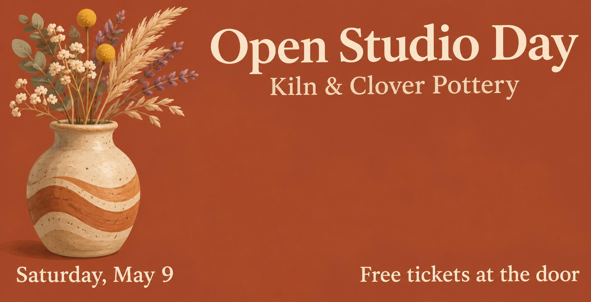

<!-- Generated by scripts/build_readme.py. Edit source data, locale catalogs and generator scripts. -->

<a id="case-recreated-pottery-open-studio-banner"></a>

# Pottery open-studio banner · independent generation

[Back to the collection](../../README.md)

**Tested by the curator**

A terracotta open-studio banner with a vase and four groups of event text.



[Original source](https://mossimage.studio/blog/gpt-image-2-6#round-5-exact-layout) · Author: MossImage Studio Team

Preview credit: 原始提示词：MossImage Studio Team；本次生成图片：RaphaelAI-OpenLab，使用 Codex 内置 image_gen。

**Original prompt**

```text
A wide event banner for a pottery studio open day, flat illustrated style, warm terracotta background. A large ceramic vase with dried flowers on the left side, filling the left third from near the top to about three quarters of the way down. In the upper right, a large cream serif title: "Open Studio Day", and right below it the smaller text "Kiln & Clover Pottery". In the bottom left corner: "Saturday, May 9". In the bottom right corner: "Free tickets at the door".
```

**Recorded settings**

| Setting | Value |
| --- | --- |
| Model family | Not specified by source |
| Variant | Not specified by source |
| size | 1752x897 |
| output_format | png |
| Generation tool | Codex built-in image_gen |
| Exact model returned | Not exposed |
| Output count | 1 |
| Transparent background | False |

**Workflow**

1. 通过 Codex 内置 image_gen 工具创建新图。
2. 传入完整来源原词，不添加参考图；未指定工具未暴露的尺寸或质量参数。
3. 保存工具返回的 PNG，检查文字、构图与主体；以像素一致的无损 WebP 入库。

**Test notes**

Codex built-in image_gen · exact model not exposed · 2026-11-13

All four text groups match the wording and assigned corners. The vase extends to about 85% of the image height rather than the requested 75%, with shaded volume rather than a strictly flat illustration. Generated with Codex built-in image_gen; the tool did not return the exact model family, variant or API model ID.

**Notes**

The complete source prompt was used unchanged without source images. Evidence and hashes: cases/recreated-pottery-open-studio-banner/generation.json. The lossless WebP preserves the original PNG pixels. Source attribution does not grant a prompt reuse license; the repository MIT license does not cover the prompt or generated image. The built-in tool did not expose its exact model; this is a prompt execution record, not verified evidence of GPT Image 2.6 output.
