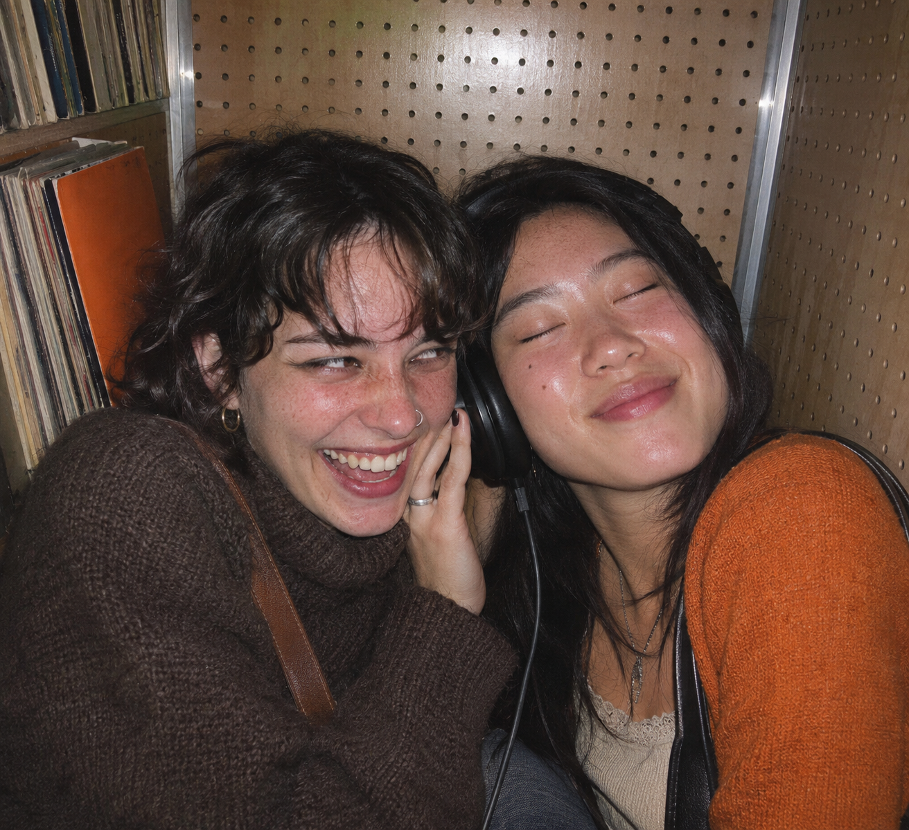

<!-- Generated by scripts/build_readme.py. Edit source data, locale catalogs and generator scripts. -->

<a id="case-recreated-record-listening-booth"></a>

# Two friends in a record-store listening booth · independent generation

[Back to the collection](../../README.md)

**Tested by the curator**

Two friends in a record-store listening corner with direct flash and visible skin texture.



[Original source](https://www.made.app/models/gpt-image-2-6-sunburst#examples-heading) · Author: Made / Made Inc.

Preview credit: 原始提示词：Made / Made Inc.；本次生成图片：RaphaelAI-OpenLab，使用 Codex 内置 image_gen。

**Original prompt**

```text
Two friends squeezed into a narrow record store listening booth sharing one pair of over-ear headphones, one laughing, one with eyes closed, tight framing against pegboard walls. Shot on a phone with direct on-camera flash, real skin texture, slight grain, muted true color with one orange accent, candid and unposed, no readable text, logos, or watermark.
```

**Recorded settings**

| Setting | Value |
| --- | --- |
| Model family | Not specified by source |
| Variant | Not specified by source |
| size | 1312x1199 |
| output_format | png |
| Generation tool | Codex built-in image_gen |
| Exact model returned | Not exposed |
| Output count | 1 |
| Transparent background | False |

**Workflow**

1. 通过 Codex 内置 image_gen 工具创建新图。
2. 传入完整来源原词，不添加参考图；未指定工具未暴露的尺寸或质量参数。
3. 保存工具返回的 PNG，检查文字、构图与主体；以像素一致的无损 WebP 入库。

**Test notes**

Codex built-in image_gen · exact model not exposed · 2026-11-13

One friend laughs and one has closed eyes against pegboard walls. One headset is visible, partly around the neck; simultaneous listening by both people is not established. Generated with Codex built-in image_gen; the tool did not return the exact model family, variant or API model ID.

**Notes**

The complete source prompt was used unchanged without source images. Evidence and hashes: cases/recreated-record-listening-booth/generation.json. The lossless WebP preserves the original PNG pixels. Source attribution does not grant a prompt reuse license; the repository MIT license does not cover the prompt or generated image. The built-in tool did not expose its exact model; this is a prompt execution record, not verified evidence of GPT Image 2.6 output.
