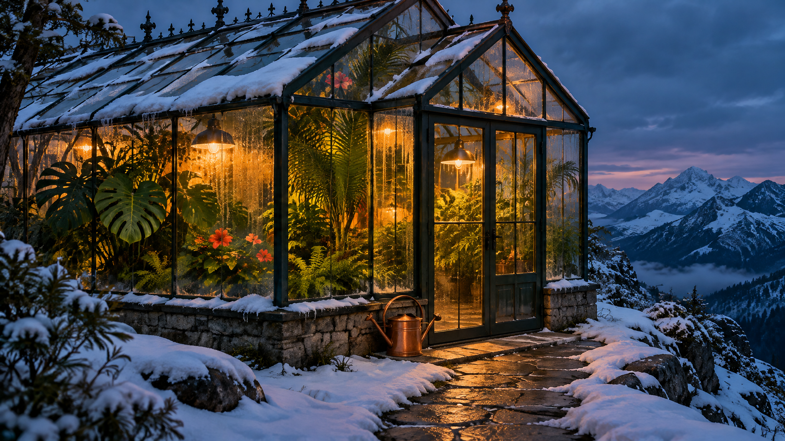

<!-- Generated by scripts/build_readme.py. Edit source data, locale catalogs and generator scripts. -->

<a id="case-recreated-snowy-greenhouse"></a>

# Snowy mountain greenhouse · independent generation

[Back to the collection](../../README.md)

**Tested by the curator**

A blue-hour mountain greenhouse with tropical plants, warm lights and one copper watering can.



[Original source](https://www.analyticsvidhya.com/blog/2026/11/gpt-image-2-6-review/#h-1-a-cinematic-editorial-photograph) · Author: Vasu Deo Sankrityayan / Analytics Vidhya

Preview credit: 原始提示词：Vasu Deo Sankrityayan / Analytics Vidhya；本次生成图片：RaphaelAI-OpenLab，经 Raphael GPT Image 2.6 Sunburst 生成。

**Original prompt**

```text
Create a wide cinematic editorial photograph of a glass greenhouse on a snowy mountain ridge at blue hour. Inside, lush tropical plants glow under warm amber lights. Outside, snow rests naturally on the glass roof and a narrow stone path leads to the entrance. Show realistic condensation, convincing glass reflections, and physically coherent architecture. Exactly one copper watering can sits beside the door. Rich emerald and amber palette, restrained film grain. No people, text, logos, or watermark. Use only this brief. Keep the output anonymous: no personal names, account information, contact details, signatures, or references to any user. Generate the actual image, not a written prompt.
```

**Recorded settings**

| Setting | Value |
| --- | --- |
| Model family | GPT Image 2.6 |
| Variant | sunburst |
| size | 2048x1152 |
| output_format | png |
| UI aspect ratio | 16:9 |
| UI resolution | 2K |
| UI quality | Standard |
| UI planning intensity | Medium |
| History quality label | Medium |
| Output count | 1 |
| AI Enhance | False |

**Workflow**

1. 在 Raphael 文生图界面选择 GPT Image 2.6 Sunburst。
2. 粘贴原始提示词，不上传参考图，关闭 AI Enhance。
3. 选择 16:9、2K、Standard、Medium planning intensity，生成一张图片。
4. 下载 PNG 原图并检查；仓库展示副本使用像素一致的无损 WebP。

**Test notes**

Raphael web UI · GPT Image 2.6 Sunburst · 2026-11-13

Snow, warm interior lights, tropical foliage, glass condensation, a stone entrance path and one copper watering can are visible. The near roof is cropped by the upper frame; this is an atmospheric architectural image, not a structural or thermal feasibility study.

**Notes**

The source prompt was used unchanged, without the source image. Generation evidence and hashes: cases/recreated-snowy-greenhouse/generation.json. The displayed WebP preserves the original PNG pixels. Third-party prompt reuse terms were not independently licensed; attribution does not grant permission. The repository MIT license does not cover this prompt or generated image. UI labels are recorded as observed; no API model ID or official parameter mapping is inferred.
