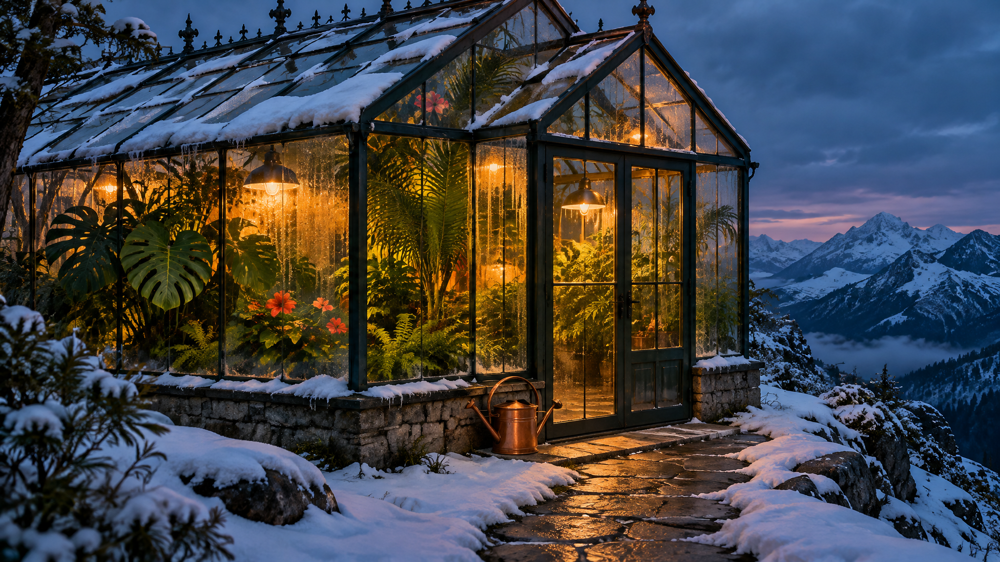

<!-- Generated by scripts/build_readme.py. Edit source data, locale catalogs and generator scripts. -->

<a id="case-recreated-snowy-greenhouse"></a>

# 雪山玻璃温室 · 独立生成

[返回合集](../../README.zh-CN.md)

**整理者已实测**

雪山蓝调时刻的玻璃温室，内有热带植物与暖光，门边放置一只铜壶。



[原始来源](https://www.analyticsvidhya.com/blog/2026/11/gpt-image-2-6-review/#h-1-a-cinematic-editorial-photograph) · 作者: Vasu Deo Sankrityayan / Analytics Vidhya

预览图署名: 原始提示词：Vasu Deo Sankrityayan / Analytics Vidhya；本次生成图片：RaphaelAI-OpenLab，经 Raphael GPT Image 2.6 Sunburst 生成。

**原始提示词**

```text
Create a wide cinematic editorial photograph of a glass greenhouse on a snowy mountain ridge at blue hour. Inside, lush tropical plants glow under warm amber lights. Outside, snow rests naturally on the glass roof and a narrow stone path leads to the entrance. Show realistic condensation, convincing glass reflections, and physically coherent architecture. Exactly one copper watering can sits beside the door. Rich emerald and amber palette, restrained film grain. No people, text, logos, or watermark. Use only this brief. Keep the output anonymous: no personal names, account information, contact details, signatures, or references to any user. Generate the actual image, not a written prompt.
```

**已记录参数**

| 项目 | 内容 |
| --- | --- |
| 模型系列 | GPT Image 2.6 |
| 版本 | sunburst |
| size | 2048x1152 |
| output_format | png |
| UI aspect ratio | 16:9 |
| UI resolution | 2K |
| UI quality | Standard |
| UI planning intensity | Medium |
| History quality label | Medium |
| Output count | 1 |
| AI Enhance | False |

**操作步骤**

1. 在 Raphael 文生图界面选择 GPT Image 2.6 Sunburst。
2. 粘贴原始提示词，不上传参考图，关闭 AI Enhance。
3. 选择 16:9、2K、Standard、Medium planning intensity，生成一张图片。
4. 下载 PNG 原图并检查；仓库展示副本使用像素一致的无损 WebP。

**实测说明**

Raphael web UI · GPT Image 2.6 Sunburst · 2026-11-13

已目视核对积雪、温室暖光、热带绿植、玻璃凝露、入口石径与门旁的一只铜质浇水壶。近处屋顶被画面上缘裁切；本图是建筑氛围示例，未验证结构或保温可行性。

**补充说明**

原始提示词逐字使用，未上传外站原图。生成证据与哈希见 cases/recreated-snowy-greenhouse/generation.json。展示用无损 WebP 与原始 PNG 像素一致。未核实第三方提示词的独立转载许可证，署名不构成授权，仓库 MIT 协议不覆盖该提示词或生成图。界面参数按实际标签记录，不推定 API 模型 ID 或官方参数映射。
