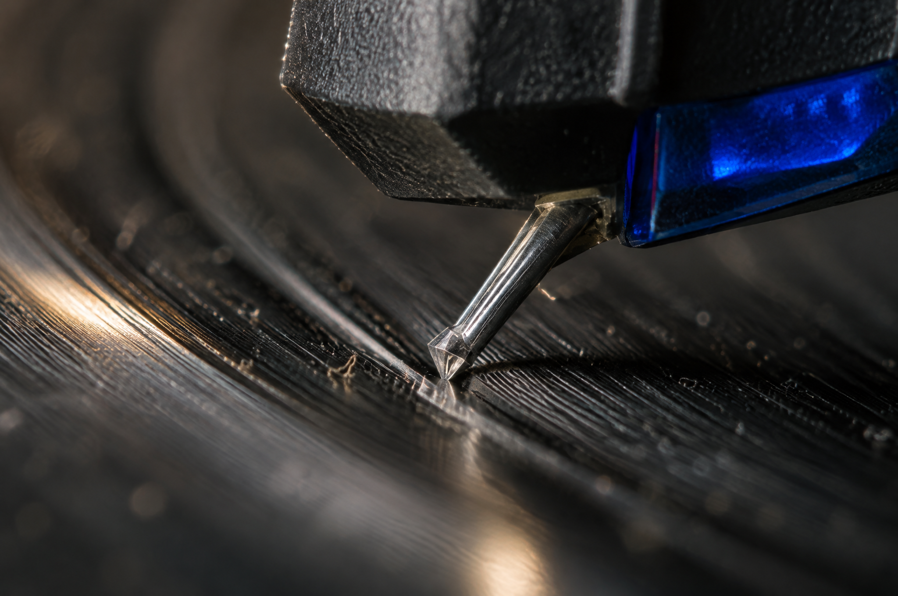

<!-- Generated by scripts/build_readme.py. Edit source data, locale catalogs and generator scripts. -->

<a id="case-recreated-vinyl-stylus-macro"></a>

# 黑胶唱针微距 · 独立生成

[返回合集](../../README.zh-CN.md)

**整理者已实测**

以钴蓝色点缀、展示唱针、唱片沟槽与灰尘的极微距画面。



[原始来源](https://www.made.app/models/gpt-image-2-6-sunburst#examples-heading) · 作者: Made / Made Inc.

预览图署名: 原始提示词：Made / Made Inc.；本次生成图片：RaphaelAI-OpenLab，经 Raphael GPT Image 2.6 Sunburst 生成。

**原始提示词**

```text
Extreme macro of a turntable stylus riding a vinyl groove, dust specks, groove walls and the cantilever sharply resolved, a sliver of light glancing across the record. Muted true color with one cobalt accent, shallow depth of field, subtle grain, no text, logos, or watermark.
```

**已记录参数**

| 项目 | 内容 |
| --- | --- |
| 模型系列 | GPT Image 2.6 |
| 版本 | sunburst |
| size | 2048x1360 |
| output_format | png |
| UI aspect ratio | 3:2 |
| UI resolution | 2K |
| UI quality | Standard |
| UI planning intensity | Medium |
| History quality label | Medium |
| Output count | 1 |
| AI Enhance | False |

**操作步骤**

1. 在 Raphael 文生图界面选择 GPT Image 2.6 Sunburst。
2. 粘贴原始提示词，不上传参考图，关闭 AI Enhance。
3. 选择 3:2、2K、Standard、Medium planning intensity，生成一张图片。
4. 下载 PNG 原图并检查；仓库展示副本使用像素一致的无损 WebP。

**实测说明**

Raphael web UI · GPT Image 2.6 Sunburst · 2026-11-13

已目视核对唱针、悬臂、沟槽、灰尘与浅景深。唱针几何与视觉尺度仅作图像示例，未对照真实唱头或实测微距照片验证。网页选择 3:2，实际下载尺寸为 2048×1360。

**补充说明**

原始提示词逐字使用，未上传外站原图。生成证据与哈希见 cases/recreated-vinyl-stylus-macro/generation.json。展示用无损 WebP 与原始 PNG 像素一致。未核实第三方提示词的独立转载许可证，署名不构成授权，仓库 MIT 协议不覆盖该提示词或生成图。界面参数按实际标签记录，不推定 API 模型 ID 或官方参数映射。
