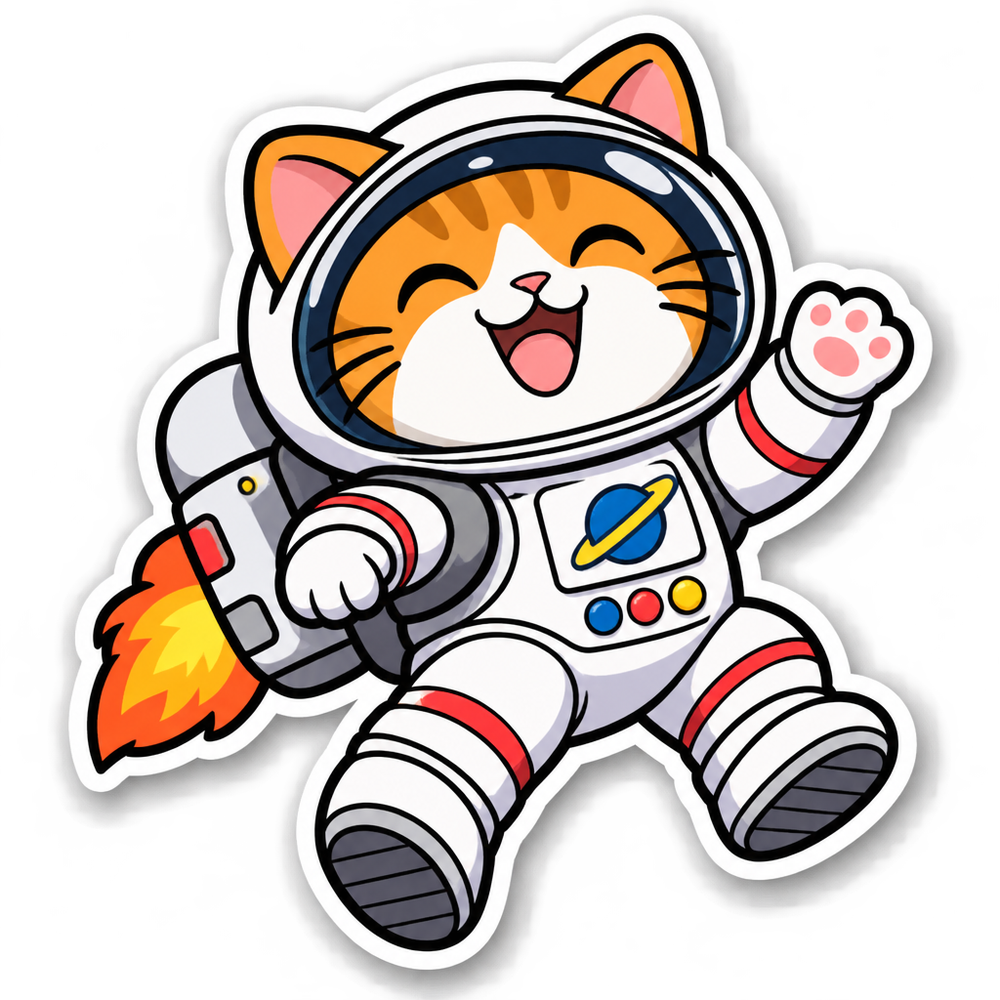

<!-- Generated by scripts/build_readme.py. Edit source data, locale catalogs and generator scripts. -->

# 背喷气背包的宇航猫贴纸

[← 返回全部案例](../../README.zh-CN.md#all-cases)

 

**作者自报模型 · 仅核对来源；未独立复现**

原始 1024 × 1024 RGBA PNG，alpha 值范围为 0 至 254。来源记录要求透明背景，但不宣称前景像素完全不透明。来源记录为 medium 质量与复杂度。本案例为来源自述结果，并非独立 API 测试。

## 图片 / GIF

- [橙色宇航猫背着喷气背包，带白色贴纸边缘和柔和阴影。](https://replicate.delivery/xezq/c4C3tbIuQQZzJVAAJ5fuSsJGnnGuAePKsNfA8UkP8w6iDz8uA/tmpougq7_hv.png) · image
  - 署名：lucataco / Replicate public example
  - 使用条件：source-attributed. 公开来源素材原样保留并署名。未核实独立转载许可证；署名不构成授权，仓库 MIT 许可不覆盖此文件。
  - [来源 / 权利依据](https://replicate.com/openai/gpt-image-2.6-flare/examples)

## 原帖与素材获取状态

- 核对日期：2026-11-08 (UTC)
- 原帖：可打开. 直接复核已知原始公开页面，将每个存档素材地址与当前 HTML 或内嵌预测记录对应。未搜索新案例。
- 素材：已存入仓库. 留存原件已核对 SHA-256 与大小、完整解码并视觉检查，包含全部动画和视频帧。未重新生成或下载媒体。
- [逐项尝试与结果](../../docs/FIVE_SOURCES_BACKLOG_AUDIT_2026-11-08.md)

## 原始提示词

[原提示词见来源](https://replicate.com/openai/gpt-image-2.6-flare/examples)

来源公开了真实提示词。本仓库链接原文，不伪造或转载完整长提示词；所需输入与参数请在原文查看。

## 来源与核对信息

- ID: replicate-flare-astronaut-cat-sticker
- 作者：lucataco / Replicate
- [原始来源](https://replicate.com/openai/gpt-image-2.6-flare/examples)
- 模型：GPT Image 2.6
- 版本：Flare
- 依据：Replicate 公开示例页内嵌已完成预测 85bvkc8ds1rmy0d1n5y8kwb4hc；同一记录包含输入、准确输出链接、创作者账号 lucataco、ran_on 模型 openai/gpt-image-2.6-flare 及匹配的模型日志。这支持来源自述归因，不等于独立复现。
- 收录：2026-11-06 (UTC)
- 来源核对：2026-11-08 (UTC)

标注来源不等于取得素材许可。仓库 MIT 协议不覆盖第三方输出；本地素材逐项记录来源与使用状态，source-attributed 不代表开放许可。
