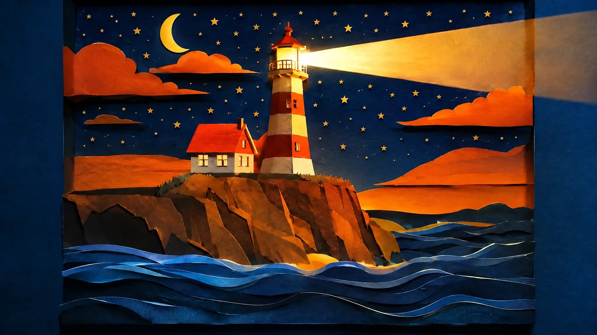
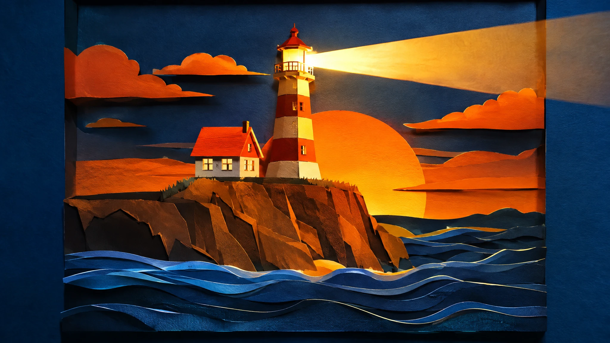

<!-- Generated by scripts/build_readme.py. Edit source data, locale catalogs and generator scripts. -->

# Paper-cut lighthouse sky changed from sunset to stars

[← Back to all cases](../../README.md#all-cases)

 

**Creator-reported model · Source-only; not independently reproduced**

Both files are 2048 × 1152 WebP. The sunset composition is the input reference, not another GPT Image 2.6 output; its original model is not established. The edit replaces the large sunset disk with stars and a crescent while retaining the lighthouse composition. The source reports medium quality and low complexity. This still-image edit is distinct from the historical lighthouse GIF. No pixel-identical preservation or independently reproduced API call is claimed.

## Images / GIFs

- [Paper-cut lighthouse and waves with a night sky, small stars and a crescent moon.](https://replicate.delivery/xezq/o5DJf9L5JSW1dazYm3vIuWAblMq0TyeOeQ9RTsPXXibnDz8uA/tmp0m1lujj0.webp) · image
  - Credit: lucataco / Replicate public example
  - Reuse: source-attributed. Original public-source media retained unchanged with attribution. No independent redistribution license has been verified. Attribution is not permission, and the repository MIT license does not cover this file.
  - [Provenance / rights evidence](https://replicate.com/openai/gpt-image-2.6-flare/examples)

**Reference/input image, not a generated output.**

- [Input reference: paper-cut lighthouse with a large orange sunset disk, layered waves and a beam of light.](https://tjzk.replicate.delivery/models_models_cover_image/3e40f4c7-a017-4bf7-b903-a7b1f842098e/tmpcq71379w.webp) · image
  - Credit: Public input reference in lucataco’s Replicate prediction; original creator not separately established
  - Reuse: source-attributed. Original public-source media retained unchanged with attribution. No independent redistribution license has been verified. Attribution is not permission, and the repository MIT license does not cover this file.
  - [Provenance / rights evidence](https://replicate.com/openai/gpt-image-2.6-flare/examples)

## Source-page and media access

- Checked: 2026-11-08 (UTC)
- Original page: Accessible. Directly revisited the known original public page and matched each archived media URL to the current HTML or embedded prediction record. No new-case search was performed.
- Media: Archived locally. Retained original bytes were checked against recorded SHA-256 and size, fully decoded and visually inspected, including every animation/video frame. No new generation or media download was performed.
- [Per-file attempts and results](../../docs/FIVE_SOURCES_BACKLOG_AUDIT_2026-11-08.md)

## Original prompt

[Original prompt at source](https://replicate.com/openai/gpt-image-2.6-flare/examples)

The source publishes the actual prompt. This repository links to it rather than inventing or republishing the full text. Required inputs and parameters remain at the source.

## Attribution and verification

- ID: replicate-flare-lighthouse-sky-edit
- Author: lucataco / Replicate
- [Original source](https://replicate.com/openai/gpt-image-2.6-flare/examples)
- Model: GPT Image 2.6
- Variant: Flare
- Evidence: The public Replicate examples page embeds completed prediction 83apwsrdp9rmr0d1n5y90f1p3w. Its input, exact output URL, creator account lucataco, ran_on model openai/gpt-image-2.6-flare and matching model log occur in the same record. This establishes source-reported attribution, not independent reproduction.
- Collected: 2026-11-06 (UTC)
- Source checked: 2026-11-08 (UTC)

Attribution does not grant a media license. Repository MIT terms do not cover third-party outputs. Local files record provenance and reuse status; source-attributed does not mean open-licensed.
