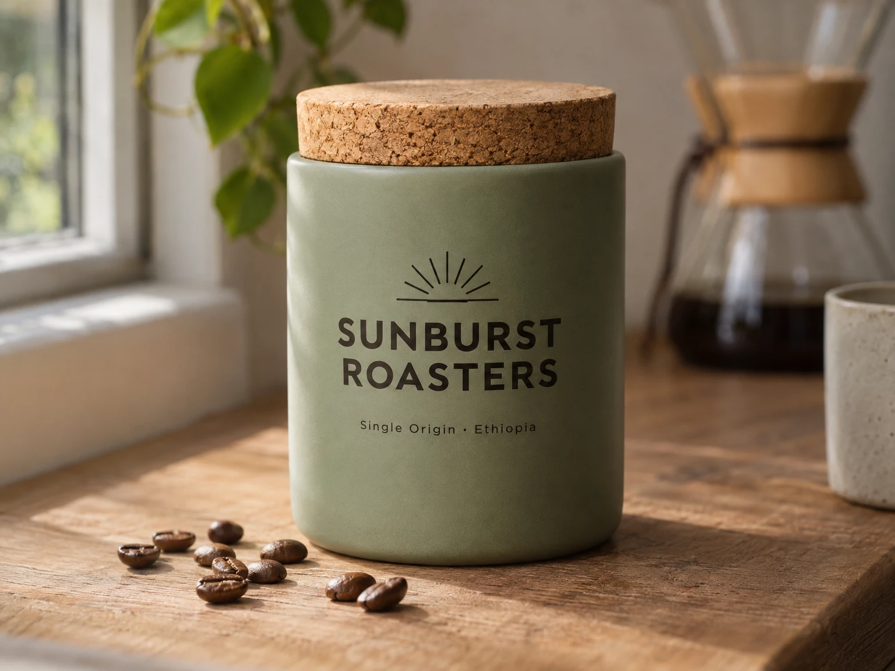

<!-- Generated by scripts/build_readme.py. Edit source data, locale catalogs and generator scripts. -->

# Sunburst Roasters ceramic coffee canister

[← Back to all cases](../../README.md#all-cases)

 

**Creator-reported model · Source-only; not independently reproduced**

Existing historical case, now tied to its exact original prediction and recorded creator. The unchanged 1536 × 1152 WebP depicts a sage-green ceramic canister with cork lid and SUNBURST ROASTERS lettering. The source records high quality, medium complexity and no input image. No new generation or media download was performed.

## Images / GIFs

- [Sage-green ceramic coffee canister with cork lid and SUNBURST ROASTERS lettering on a wooden counter.](https://replicate.delivery/xezq/Ce1jGkRcxOVqHCgjFubtdY1NMBsHmtm2MafjgK4lL9XrwZeuA/tmpvn4bact0.webp) · image
  - Credit: lucataco / Replicate public example
  - Reuse: source-attributed. Original public-source media retained unchanged with attribution. No independent redistribution license has been verified. Attribution is not permission, and the repository MIT license does not cover this file.
  - [Provenance / rights evidence](https://replicate.com/openai/gpt-image-2.6-sunburst/examples)

## Source-page and media access

- Checked: 2026-11-08 (UTC)
- Original page: Accessible. Directly revisited the known original public page and matched each archived media URL to the current HTML or embedded prediction record. No new-case search was performed.
- Media: Archived locally. Retained original bytes were checked against recorded SHA-256 and size, fully decoded and visually inspected, including every animation/video frame. No new generation or media download was performed.
- [Per-file attempts and results](../../docs/FIVE_SOURCES_BACKLOG_AUDIT_2026-11-08.md)

## Original prompt

[Original prompt at source](https://replicate.com/openai/gpt-image-2.6-sunburst/examples)

The source publishes the actual prompt. This repository links to it rather than inventing or republishing the full text. Required inputs and parameters remain at the source.

## Attribution and verification

- ID: replicate-sunburst-coffee-canister
- Author: lucataco / Replicate
- [Original source](https://replicate.com/openai/gpt-image-2.6-sunburst/examples)
- Model: GPT Image 2.6
- Variant: Sunburst
- Evidence: The original public examples page embeds completed prediction mzvqv6an0srmr0d1n658s1mgc0, naming creator lucataco, served model openai/gpt-image-2.6-sunburst, matching model log, original prompt and the exact historical output URL. This is source-reported execution evidence, not an independently rerun API request.
- Collected: 2026-11-05 (UTC)
- Source checked: 2026-11-08 (UTC)

Attribution does not grant a media license. Repository MIT terms do not cover third-party outputs. Local files record provenance and reuse status; source-attributed does not mean open-licensed.
