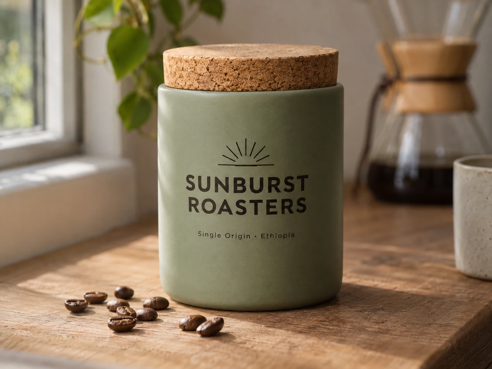

<!-- Generated by scripts/build_readme.py. Edit source data, locale catalogs and generator scripts. -->

# Sunburst Roasters 陶瓷咖啡罐

[← 返回全部案例](../../README.zh-CN.md#all-cases)

 

**作者自报模型 · 仅核对来源；未独立复现**

已有历史案例，现与准确原始预测及记录中的创作者关联。原样 1536 × 1152 WebP 展示带软木盖及 SUNBURST ROASTERS 字样的鼠尾草绿陶瓷罐。来源记录为 high 质量、medium 复杂度且无输入图像。未进行新的生成或素材下载。

## 图片 / GIF

- [木质台面上的鼠尾草绿陶瓷咖啡罐，配软木盖和 SUNBURST ROASTERS 字样。](https://replicate.delivery/xezq/Ce1jGkRcxOVqHCgjFubtdY1NMBsHmtm2MafjgK4lL9XrwZeuA/tmpvn4bact0.webp) · image
  - 署名：lucataco / Replicate public example
  - 使用条件：source-attributed. 公开来源素材原样保留并署名。未核实独立转载许可证；署名不构成授权，仓库 MIT 许可不覆盖此文件。
  - [来源 / 权利依据](https://replicate.com/openai/gpt-image-2.6-sunburst/examples)

## 原帖与素材获取状态

- 核对日期：2026-11-08 (UTC)
- 原帖：可打开. 直接复核已知原始公开页面，将每个存档素材地址与当前 HTML 或内嵌预测记录对应。未搜索新案例。
- 素材：已存入仓库. 留存原件已核对 SHA-256 与大小、完整解码并视觉检查，包含全部动画和视频帧。未重新生成或下载媒体。
- [逐项尝试与结果](../../docs/FIVE_SOURCES_BACKLOG_AUDIT_2026-11-08.md)

## 原始提示词

[原提示词见来源](https://replicate.com/openai/gpt-image-2.6-sunburst/examples)

来源公开了真实提示词。本仓库链接原文，不伪造或转载完整长提示词；所需输入与参数请在原文查看。

## 来源与核对信息

- ID: replicate-sunburst-coffee-canister
- 作者：lucataco / Replicate
- [原始来源](https://replicate.com/openai/gpt-image-2.6-sunburst/examples)
- 模型：GPT Image 2.6
- 版本：Sunburst
- 依据：原始公开示例页内嵌已完成预测 mzvqv6an0srmr0d1n658s1mgc0，记录创作者 lucataco、所用模型 openai/gpt-image-2.6-sunburst、匹配的模型日志、原始提示词及准确历史输出地址。这是来源公开的执行证据，并非独立重跑 API 请求。
- 收录：2026-11-05 (UTC)
- 来源核对：2026-11-08 (UTC)

标注来源不等于取得素材许可。仓库 MIT 协议不覆盖第三方输出；本地素材逐项记录来源与使用状态，source-attributed 不代表开放许可。
