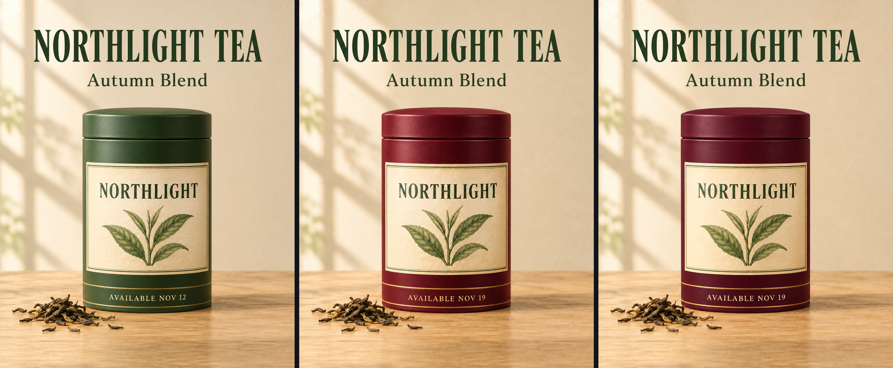

<!-- Generated by scripts/build_readme.py. Edit source data, locale catalogs and generator scripts. -->

# NORTHLIGHT TEA 颜色及日期编辑

[← 返回全部案例](../../README.zh-CN.md#all-cases)

 

**作者自报模型 · 仅核对来源；未独立复现**

原始三联图：Flare 底图、Flare 编辑、Sunburst 编辑。两张编辑图将茶罐由绿色改为酒红色，日期由 11 月 12 日改为 19 日。底图重复海报测试，仅作输入上下文，不另计结果。所查文章未提供完整原始编辑提示词。 2026-11-08离线恢复审核核对了保留的一手页面证据。提供方结果与测量不是独立基准测试。 存档原始PNG为发布方对比拼图，不是一次独立生成的单图：原始1024×1280面板加16像素间隔。保留的浏览器提取含对应WebP预览与Original PNG链接文字；准确PNG地址和哈希依据当日采集清单。

## 图片 / GIF

- [原始三联图：Flare 底图、Flare 编辑、Sunburst 编辑。两张编辑图将茶罐由绿色改为酒红色，日期由 11 月 12 日改为 19 日。底图重复海报测试，仅作输入上下文，不另计结果。所查文章未提供完整原始编辑提示词。](https://static.sandbase.ai/blog/screenshots/gpt-image-2-6-flare-sunburst-api-2026/edit-triptych-23b40a05d8d5.png) · image
  - 署名：Evelyn Park / SandBase
  - 使用条件：source-attributed. 公开来源副本，保留原作者署名。未核实明确转载许可证。公开可见及署名不构成授权，仓库 MIT 许可证不覆盖此媒体。
  - [来源 / 权利依据](https://blog.sandbase.ai/gpt-image-2-6-flare-sunburst-api-2026/)

## 原帖与素材获取状态

- 核对日期：2026-11-05 (UTC)
- 原帖：可打开. 2026-11-08离线复核了2026-11-05保留的原页证据，未测试当前访问。
- 素材：已存入仓库. 已重新核对原字节、SHA-256、大小、格式和完整解码，查看每张静图与GIF全部帧；未进行新的实时播放或模型生成。
- [逐项尝试与结果](../../docs/SOGNI_OMNIAKEY_SANDBASE_RECOVERY_AUDIT_2026-11-08.md)

## 原始提示词

**占位：原作者未公开提示词。**

## 来源与核对信息

- ID: sandbase-northlight-tea-edits
- 作者：Evelyn Park / SandBase
- [原始来源](https://blog.sandbase.ai/gpt-image-2-6-flare-sunburst-api-2026/)
- 模型：GPT Image 2.6
- 版本：Flare / Sunburst
- 依据：SandBase 将自己的中等画质 API 测试明确标为 GPT Image 2.6 Flare 与 Sunburst，并说明面板顺序。这是提供方归因，不是对实际调用模型的独立验证。
- 收录：2026-11-05 (UTC)
- 来源核对：2026-11-08 (UTC)

标注来源不等于取得素材许可。仓库 MIT 协议不覆盖第三方输出；本地素材逐项记录来源与使用状态，source-attributed 不代表开放许可。
