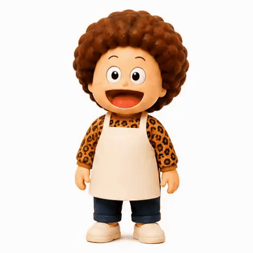

<!-- Generated by scripts/build_readme.py. Edit source data, locale catalogs and generator scripts. -->

# Character waving and laughing

[← Back to all cases](../../README.md#all-cases)

<a href="README.md"></a> <a href="README.zh-CN.md"></a>

**Creator-reported model · Source-only; not independently reproduced**

Original prompt wording is preserved.  See the precise source and item-level media notes; requested parameters are not independently verified output properties.

## Images / animation files

[Open local video file](../../assets/examples/social-character-wave-laugh/source-01.mp4)

- [Character waving and laughing](https://video.twimg.com/tweet_video/HWVdGeda4AAyrwo.mp4) · video
  - Credit: okan_aitool
  - Reuse: source-attributed. Public source attachment with creator credit; no redistribution licence was located. Repository MIT terms do not cover this media.
  - [Provenance / rights evidence](https://x.com/okan_aitool/status/2118201578406772887)


- [Character waving and laughing — derived GIF viewing copy](https://x.com/okan_aitool/status/2118201578406772887) · gif
  - Credit: okan_aitool
  - Reuse: source-attributed. Derived GIF viewing copy made from the archived source MP4. Not an original GIF attachment; source MP4 remains unchanged.
  - [Provenance / rights evidence](https://x.com/okan_aitool/status/2118201578406772887)

## Source-page and media access

- Checked: 2026-11-09 (UTC)
- Original page: Accessible. Read the original post and source-shared instructions; attribution remains creator-reported.
- Media: Archived locally. All selected public source attachments are archived. Original MP4s and separately labelled derived GIF viewing copies are stored with hashes. Viewer JPEGs use their actual download URLs.
- [Per-file attempts and results](../../cases/social-character-wave-laugh/source.json)

## Original prompt

```text
このキャラをGIFで動かして。手を振って笑う
```

[Original prompt (.txt)](../../cases/social-character-wave-laugh/prompt.txt)

Original prompt wording is preserved.  See the precise source and item-level media notes; requested parameters are not independently verified output properties.

[Original prompt at source](https://x.com/okan_aitool/status/2118201578406772887)

## Attribution and verification

- ID: social-character-wave-laugh
- Author: okan_aitool
- [Original source](https://x.com/okan_aitool/status/2118201578406772887)
- Model: GPT Image 2.6
- Variant: Variant unspecified
- Evidence: The creator explicitly identifies GPT Image 2.6 for this work. Source excerpt: ＼ChatGPTのImage 2.6アプデ！！／ Creator-reported only; not independently reproduced.
- Collected: 2026-11-09 (UTC)
- Source checked: 2026-11-09 (UTC)

Attribution does not grant a media license. Repository MIT terms do not cover third-party outputs. Local files record provenance and reuse status; source-attributed does not mean open-licensed.
