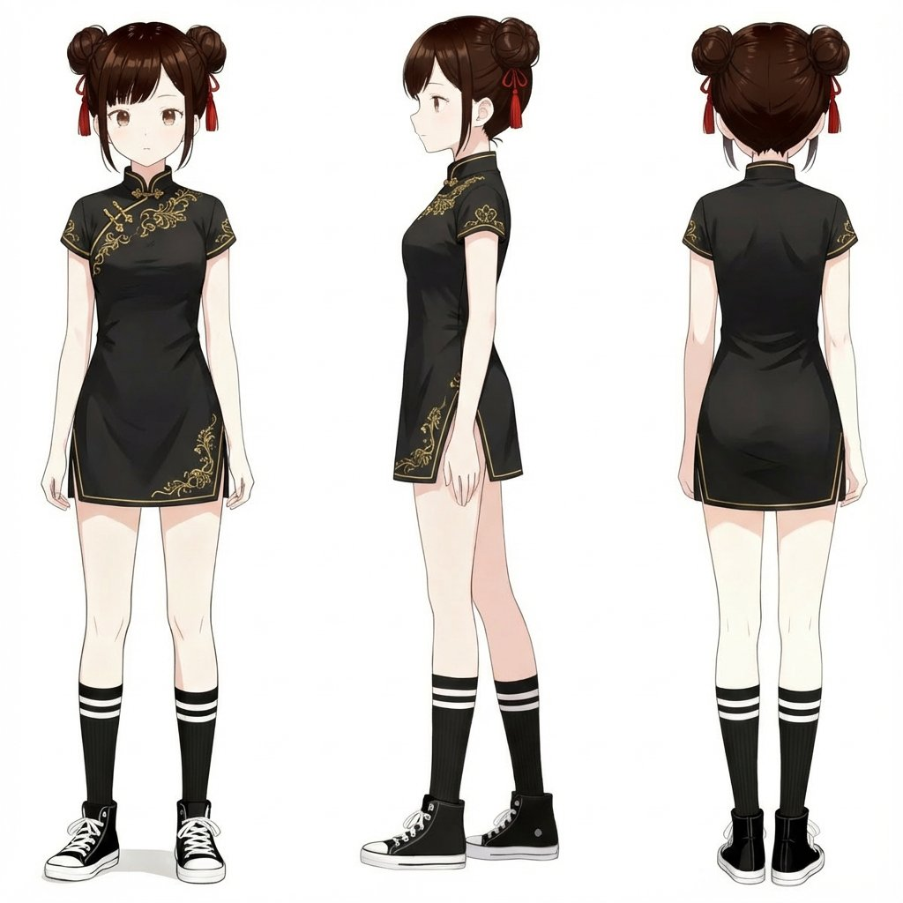

<!-- Generated by scripts/build_readme.py. Edit source data, locale catalogs and generator scripts. -->

# Chibi cheongsam girl performs a cute jump sequence

[← Back to all cases](../../README.md#all-cases)

<a href="README.md"></a> <a href="README.zh-CN.md"></a>

**Creator-reported model · Source-only; not independently reproduced**

Published by shinshin86 on Thu Nov 05 06:14:31 +0000 2026. The original prompt is reproduced without rewriting. X serves animated GIF posts as MP4. Both the original animation and a GIF viewing copy are included. 1 original reference input(s) are included.

## Images / animation files

[Open local video file](../../assets/examples/social-chibi-cheongsam-girl-gif/source-01.mp4)

- [Chibi cheongsam girl performs a cute jump sequence](https://video.twimg.com/tweet_video/HWVxx9TbkAAqtms.mp4) · video
  - Credit: shinshin86
  - Reuse: source-attributed. Original public post attachment, preserved with creator credit. No open licence is asserted; repository MIT terms do not cover this media.
  - [Provenance / rights evidence](https://x.com/shinshin86/status/2118225428976705908)


- [Chibi cheongsam girl performs a cute jump sequence](https://x.com/shinshin86/status/2118225428976705908) · gif
  - Credit: shinshin86
  - Reuse: source-attributed. GIF viewing copy converted from the original X MP4 retained at assets/examples/social-chibi-cheongsam-girl-gif/source-01.mp4. This is a format conversion, not a newly generated result.
  - [Provenance / rights evidence](https://x.com/shinshin86/status/2118225428976705908)


**Reference/input image, not a generated output.**

- [Reference input: Chibi cheongsam girl performs a cute jump sequence](https://pbs.twimg.com/media/HWVyU-YbIAAli3u.jpg?name=orig) · image
  - Credit: shinshin86
  - Reuse: source-attributed. Original public post attachment, preserved with creator credit. No open licence is asserted; repository MIT terms do not cover this media.
  - [Provenance / rights evidence](https://x.com/shinshin86/status/2118225428976705908)

## Source-page and media access

- Checked: 2026-11-09 (UTC)
- Original page: Accessible. Read the original public social post, creator model statement and public prompt.
- Media: Archived locally. Original attachments are stored locally; file types, sizes and SHA-256 values were checked. Any GIF viewing copy is labelled separately.
- [Per-file attempts and results](../../cases/social-chibi-cheongsam-girl-gif/source.json)

## Original prompt

```text
このキャラクターをちびキャラ化して、何か可愛らしい動きをしているところをGIF画像にしてください。
```

[Original prompt (.txt)](../../cases/social-chibi-cheongsam-girl-gif/prompt.txt)

[Original prompt at source](https://x.com/shinshin86/status/2118225428976705908)

## Attribution and verification

- ID: social-chibi-cheongsam-girl-gif
- Author: shinshin86
- [Original source](https://x.com/shinshin86/status/2118225428976705908)
- Model: GPT Image 2.6
- Variant: Variant unspecified
- Evidence: The creator explicitly identifies GPT Image 2.6 in the original social post: ChatGPT Images 2.6を試してみたけど、サクッとカワイイGIFが作れた！ Model attribution is creator-reported; this is not an independent reproduction.
- Collected: 2026-11-09 (UTC)
- Source checked: 2026-11-09 (UTC)

Attribution does not grant a media license. Repository MIT terms do not cover third-party outputs. Local files record provenance and reuse status; source-attributed does not mean open-licensed.
