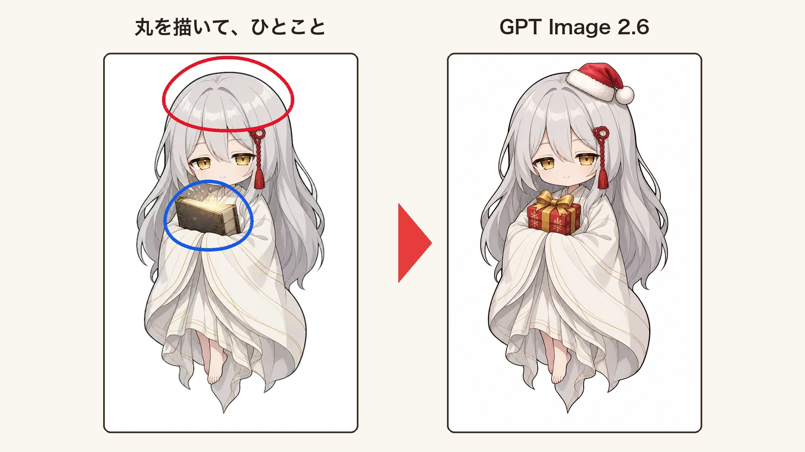

<!-- Generated by scripts/build_readme.py. Edit source data, locale catalogs and generator scripts. -->

# Circle markup edit adding Santa hat and gift

[← Back to all cases](../../README.md#all-cases)

<a href="README.md"></a> <a href="README.zh-CN.md"></a>

**Creator-reported model · Source-only; not independently reproduced**

Original prompt wording is preserved.  See the precise source and item-level media notes; requested parameters are not independently verified output properties.

## Images / GIFs



- [Circle markup edit adding Santa hat and gift](https://pbs.twimg.com/media/HWUvnunaQAA2gbE?format=jpg&name=large) · image
  - Credit: IHayato
  - Reuse: source-attributed. JPEG provided by the original post image viewer, saved through the normal browser download flow. Direct HTTP retrieval returned 403. Creator credit retained; no redistribution licence asserted; MIT excludes this media.
  - [Provenance / rights evidence](https://x.com/IHayato/status/2118151619212890291)

## Source-page and media access

- Checked: 2026-11-09 (UTC)
- Original page: Accessible. Read the original post and source-shared instructions; attribution remains creator-reported.
- Media: Archived locally. All selected public source attachments are archived. Original MP4s and separately labelled derived GIF viewing copies are stored with hashes. Viewer JPEGs use their actual download URLs.
- [Per-file attempts and results](../../cases/social-circle-markup-santa-gift-edit/source.json)

## Original prompt

```text
赤丸にサンタ帽、青丸の本はプレゼントに
```

[Original prompt (.txt)](../../cases/social-circle-markup-santa-gift-edit/prompt.txt)

Original prompt wording is preserved.  See the precise source and item-level media notes; requested parameters are not independently verified output properties.

[Original prompt at source](https://x.com/IHayato/status/2118151619212890291)

## Attribution and verification

- ID: social-circle-markup-santa-gift-edit
- Author: IHayato
- [Original source](https://x.com/IHayato/status/2118151619212890291)
- Model: GPT Image 2.6
- Variant: Variant unspecified
- Evidence: The creator explicitly identifies GPT Image 2.6 for this work. Source excerpt: GPT Image 2.6が出たので、さっそく試してみました。 Creator-reported only; not independently reproduced.
- Collected: 2026-11-09 (UTC)
- Source checked: 2026-11-09 (UTC)

Attribution does not grant a media license. Repository MIT terms do not cover third-party outputs. Local files record provenance and reuse status; source-attributed does not mean open-licensed.
