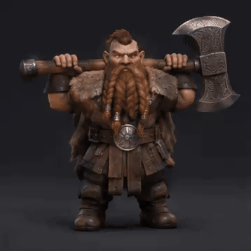

<!-- Generated by scripts/build_readme.py. Edit source data, locale catalogs and generator scripts. -->

# 持巨斧矮人360度旋转

[← 返回全部案例](../../README.zh-CN.md#all-cases)

<a href="README.md"></a> <a href="README.zh-CN.md"></a>

**作者自报模型 · 仅核对来源；未独立复现**

提示词按原文保存；同一工作流的多张结果与展示副本合并计数。

## 图片 / 动画文件

[打开仓库内视频文件](../../assets/examples/social-dwarf-360-turntable/source-01.mp4)

- [持巨斧矮人360度旋转](https://video.twimg.com/tweet_video/HWYWl_RaIAA6hH9.mp4) · video
  - 署名：xikhar
  - 使用条件：source-attributed. 公开来源附件，保留作者署名，未找到转载许可证；仓库MIT协议不覆盖此素材。
  - [来源 / 权利依据](https://x.com/xikhar/status/2118407355859878352)


- [持巨斧矮人360度旋转——由原MP4转码的GIF展示副本](https://x.com/xikhar/status/2118407355859878352) · gif
  - 署名：xikhar
  - 使用条件：source-attributed. 由已存档原MP4转码的GIF展示副本，不冒充原始GIF附件；原MP4保持不变。
  - [来源 / 权利依据](https://x.com/xikhar/status/2118407355859878352)

## 原帖与素材获取状态

- 核对日期：2026-11-09 (UTC)
- 原帖：可打开. 已读取原帖及公开指令；模型归因为作者自报。
- 素材：已存入仓库. 本例选定的公开附件均已存档；原MP4与明确标注的GIF转码副本分别保存并记录哈希，查看器JPEG使用实际下载地址。
- [逐项尝试与结果](../../cases/social-dwarf-360-turntable/source.json)

## 原始提示词

```text
create a gif of a "3d dwarf game model carrying a huge axe on his shoulders" spinning full 360 degrees
```

[原始提示词 (.txt)](../../cases/social-dwarf-360-turntable/prompt.txt)

提示词按原文保存；同一工作流的多张结果与展示副本合并计数。

[原提示词见来源](https://x.com/xikhar/status/2118409026044403849)

## 来源与核对信息

- ID: social-dwarf-360-turntable
- 作者：xikhar
- [原始来源](https://x.com/xikhar/status/2118407355859878352)
- 模型：GPT Image 2.6
- 版本：版本未注明
- 依据：作者在原帖明确说明本作品使用GPT Image 2.6。原文摘录：GPT Image 2.6 is pretty cool. 。依据为作者自报；本仓库未独立复现。
- 收录：2026-11-09 (UTC)
- 来源核对：2026-11-09 (UTC)

标注来源不等于取得素材许可。仓库 MIT 协议不覆盖第三方输出；本地素材逐项记录来源与使用状态，source-attributed 不代表开放许可。
