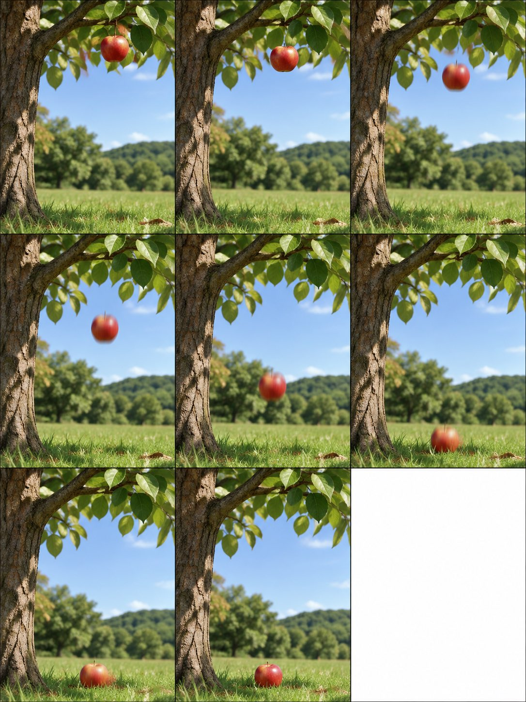
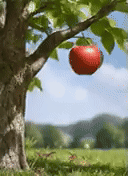
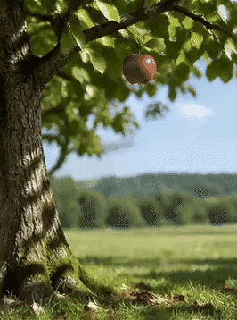
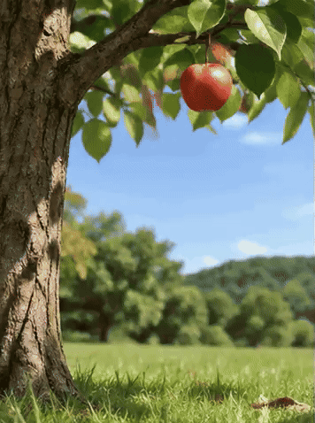

<!-- Generated by scripts/build_readme.py. Edit source data, locale catalogs and generator scripts. -->

# Falling apple GIF frame-count comparison

[← Back to all cases](../../README.md#all-cases)

<a href="README.md"></a> <a href="README.zh-CN.md"></a>

**Creator-reported model · Source-only; not independently reproduced**

Original prompt wording is preserved.  See the precise source and item-level media notes; requested parameters are not independently verified output properties.

## Images / animation files

[Open local video file](../../assets/examples/social-falling-apple-frame-comparison/source-01.mp4)

- [Falling apple GIF frame-count comparison](https://video.twimg.com/tweet_video/HWWErSWbsAEwvwQ.mp4) · video
  - Credit: rei_aitech
  - Reuse: source-attributed. Public source attachment with creator credit; no redistribution licence was located. Repository MIT terms do not cover this media.
  - [Provenance / rights evidence](https://x.com/rei_aitech/status/2118245102409908571)
[Open local video file](../../assets/examples/social-falling-apple-frame-comparison/source-02.mp4)

- [Falling apple GIF frame-count comparison](https://video.twimg.com/tweet_video/HWWErSWaQAAO2KF.mp4) · video
  - Credit: rei_aitech
  - Reuse: source-attributed. Public source attachment with creator credit; no redistribution licence was located. Repository MIT terms do not cover this media.
  - [Provenance / rights evidence](https://x.com/rei_aitech/status/2118245102409908571)
[Open local video file](../../assets/examples/social-falling-apple-frame-comparison/source-03.mp4)

- [Falling apple GIF frame-count comparison](https://video.twimg.com/tweet_video/HWWErSpbgAAtKyV.mp4) · video
  - Credit: rei_aitech
  - Reuse: source-attributed. Public source attachment with creator credit; no redistribution licence was located. Repository MIT terms do not cover this media.
  - [Provenance / rights evidence](https://x.com/rei_aitech/status/2118245102409908571)


- [Falling apple GIF frame-count comparison](https://pbs.twimg.com/media/HWWErSobsAAdu5M?format=jpg&name=large) · image
  - Credit: rei_aitech
  - Reuse: source-attributed. JPEG provided by the original post image viewer, saved through the normal browser download flow. Direct HTTP retrieval returned 403. Creator credit retained; no redistribution licence asserted; MIT excludes this media.
  - [Provenance / rights evidence](https://x.com/rei_aitech/status/2118245102409908571)


- [Falling apple GIF frame-count comparison — derived GIF viewing copy](https://x.com/rei_aitech/status/2118245102409908571) · gif
  - Credit: rei_aitech
  - Reuse: source-attributed. Derived GIF viewing copy made from the archived source MP4. Not an original GIF attachment; source MP4 remains unchanged.
  - [Provenance / rights evidence](https://x.com/rei_aitech/status/2118245102409908571)


- [Falling apple GIF frame-count comparison — derived GIF viewing copy](https://x.com/rei_aitech/status/2118245102409908571) · gif
  - Credit: rei_aitech
  - Reuse: source-attributed. Derived GIF viewing copy made from the archived source MP4. Not an original GIF attachment; source MP4 remains unchanged.
  - [Provenance / rights evidence](https://x.com/rei_aitech/status/2118245102409908571)


- [Falling apple GIF frame-count comparison — derived GIF viewing copy](https://x.com/rei_aitech/status/2118245102409908571) · gif
  - Credit: rei_aitech
  - Reuse: source-attributed. Derived GIF viewing copy made from the archived source MP4. Not an original GIF attachment; source MP4 remains unchanged.
  - [Provenance / rights evidence](https://x.com/rei_aitech/status/2118245102409908571)

## Source-page and media access

- Checked: 2026-11-09 (UTC)
- Original page: Accessible. Read the original post and source-shared instructions; attribution remains creator-reported.
- Media: Archived locally. All selected public source attachments are archived. Original MP4s and separately labelled derived GIF viewing copies are stored with hashes. Viewer JPEGs use their actual download URLs.
- [Per-file attempts and results](../../cases/social-falling-apple-frame-comparison/source.json)

## Original prompt

**64-frame original instruction**

```text
3:4.
GIF生成
frame_count = 64
frame_duration_ms = 30
3:4で木からりんごが落ちる差分
```

[Original prompt (.txt)](../../cases/social-falling-apple-frame-comparison/prompt-01.txt)

**32-frame parameter change**

```text
frame_count = 32
frame_duration_ms = 60
```

[Original prompt (.txt)](../../cases/social-falling-apple-frame-comparison/prompt-02.txt)

**8-frame parameter change**

```text
frame_count = 8
frame_duration_ms = 120
```

[Original prompt (.txt)](../../cases/social-falling-apple-frame-comparison/prompt-03.txt)

Original prompt wording is preserved.  See the precise source and item-level media notes; requested parameters are not independently verified output properties.

[Original prompt at source](https://x.com/rei_aitech/status/2118245102409908571)

## Attribution and verification

- ID: social-falling-apple-frame-comparison
- Author: rei_aitech
- [Original source](https://x.com/rei_aitech/status/2118245102409908571)
- Model: GPT Image 2.6
- Variant: Variant unspecified
- Evidence: The creator explicitly identifies GPT Image 2.6 for this work. Source excerpt: ChatGPT Images 2.6 が登場しました🩵 Creator-reported only; not independently reproduced.
- Collected: 2026-11-09 (UTC)
- Source checked: 2026-11-09 (UTC)

Attribution does not grant a media license. Repository MIT terms do not cover third-party outputs. Local files record provenance and reuse status; source-attributed does not mean open-licensed.
