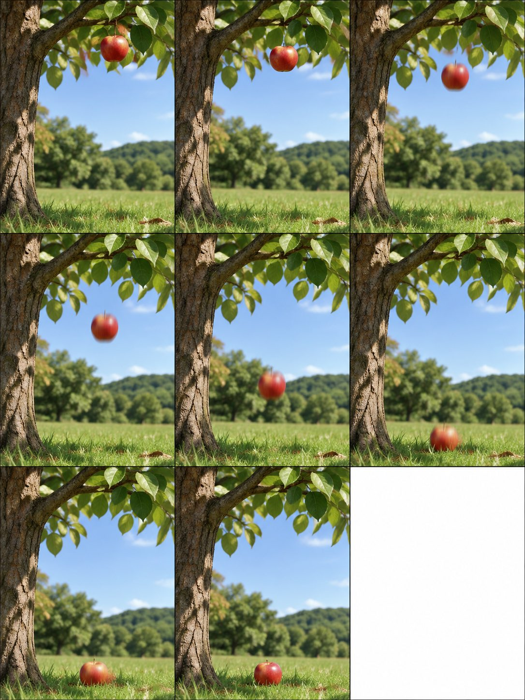
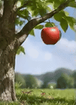
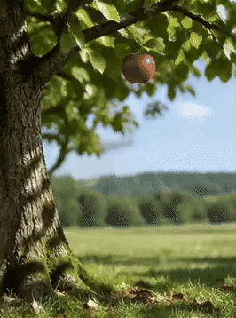

<!-- Generated by scripts/build_readme.py. Edit source data, locale catalogs and generator scripts. -->

# 苹果落下的GIF帧数对照

[← 返回全部案例](../../README.zh-CN.md#all-cases)

<a href="README.md"></a> <a href="README.zh-CN.md"></a>

**作者自报模型 · 仅核对来源；未独立复现**

同一苹果动画实验的64/32/8帧输出合并为一例；第二与第三段为作者公开的参数改动，沿用首段场景。作者对实现机制的推测不作为已验证事实。

## 图片 / 动画文件

[打开仓库内视频文件](../../assets/examples/social-falling-apple-frame-comparison/source-01.mp4)

- [苹果落下的GIF帧数对照](https://video.twimg.com/tweet_video/HWWErSWbsAEwvwQ.mp4) · video
  - 署名：rei_aitech
  - 使用条件：source-attributed. 公开来源附件，保留作者署名，未找到转载许可证；仓库MIT协议不覆盖此素材。
  - [来源 / 权利依据](https://x.com/rei_aitech/status/2118245102409908571)
[打开仓库内视频文件](../../assets/examples/social-falling-apple-frame-comparison/source-02.mp4)

- [苹果落下的GIF帧数对照](https://video.twimg.com/tweet_video/HWWErSWaQAAO2KF.mp4) · video
  - 署名：rei_aitech
  - 使用条件：source-attributed. 公开来源附件，保留作者署名，未找到转载许可证；仓库MIT协议不覆盖此素材。
  - [来源 / 权利依据](https://x.com/rei_aitech/status/2118245102409908571)
[打开仓库内视频文件](../../assets/examples/social-falling-apple-frame-comparison/source-03.mp4)

- [苹果落下的GIF帧数对照](https://video.twimg.com/tweet_video/HWWErSpbgAAtKyV.mp4) · video
  - 署名：rei_aitech
  - 使用条件：source-attributed. 公开来源附件，保留作者署名，未找到转载许可证；仓库MIT协议不覆盖此素材。
  - [来源 / 权利依据](https://x.com/rei_aitech/status/2118245102409908571)


- [苹果落下的GIF帧数对照](https://pbs.twimg.com/media/HWWErSobsAAdu5M?format=jpg&name=large) · image
  - 署名：rei_aitech
  - 使用条件：source-attributed. 通过原帖图片查看器的正常浏览器下载保存JPEG大图；单独记录HTTP直链返回403。保留作者署名，不声明已取得转载许可；MIT不覆盖此素材。
  - [来源 / 权利依据](https://x.com/rei_aitech/status/2118245102409908571)


- [苹果落下的GIF帧数对照——由原MP4转码的GIF展示副本](https://x.com/rei_aitech/status/2118245102409908571) · gif
  - 署名：rei_aitech
  - 使用条件：source-attributed. 由已存档原MP4转码的GIF展示副本，不冒充原始GIF附件；原MP4保持不变。
  - [来源 / 权利依据](https://x.com/rei_aitech/status/2118245102409908571)


- [苹果落下的GIF帧数对照——由原MP4转码的GIF展示副本](https://x.com/rei_aitech/status/2118245102409908571) · gif
  - 署名：rei_aitech
  - 使用条件：source-attributed. 由已存档原MP4转码的GIF展示副本，不冒充原始GIF附件；原MP4保持不变。
  - [来源 / 权利依据](https://x.com/rei_aitech/status/2118245102409908571)


- [苹果落下的GIF帧数对照——由原MP4转码的GIF展示副本](https://x.com/rei_aitech/status/2118245102409908571) · gif
  - 署名：rei_aitech
  - 使用条件：source-attributed. 由已存档原MP4转码的GIF展示副本，不冒充原始GIF附件；原MP4保持不变。
  - [来源 / 权利依据](https://x.com/rei_aitech/status/2118245102409908571)

## 原帖与素材获取状态

- 核对日期：2026-11-09 (UTC)
- 原帖：可打开. 已读取原帖及公开指令；模型归因为作者自报。
- 素材：已存入仓库. 本例选定的公开附件均已存档；原MP4与明确标注的GIF转码副本分别保存并记录哈希，查看器JPEG使用实际下载地址。
- [逐项尝试与结果](../../cases/social-falling-apple-frame-comparison/source.json)

## 原始提示词

**64 帧原始指令**

```text
3:4.
GIF生成
frame_count = 64
frame_duration_ms = 30
3:4で木からりんごが落ちる差分
```

[原始提示词 (.txt)](../../cases/social-falling-apple-frame-comparison/prompt-01.txt)

**32 帧参数改动**

```text
frame_count = 32
frame_duration_ms = 60
```

[原始提示词 (.txt)](../../cases/social-falling-apple-frame-comparison/prompt-02.txt)

**8 帧参数改动**

```text
frame_count = 8
frame_duration_ms = 120
```

[原始提示词 (.txt)](../../cases/social-falling-apple-frame-comparison/prompt-03.txt)

同一苹果动画实验的64/32/8帧输出合并为一例；第二与第三段为作者公开的参数改动，沿用首段场景。作者对实现机制的推测不作为已验证事实。

[原提示词见来源](https://x.com/rei_aitech/status/2118245102409908571)

## 来源与核对信息

- ID: social-falling-apple-frame-comparison
- 作者：rei_aitech
- [原始来源](https://x.com/rei_aitech/status/2118245102409908571)
- 模型：GPT Image 2.6
- 版本：版本未注明
- 依据：作者在原帖明确说明本作品使用GPT Image 2.6。原文摘录：ChatGPT Images 2.6 が登場しました🩵。依据为作者自报；本仓库未独立复现。
- 收录：2026-11-09 (UTC)
- 来源核对：2026-11-09 (UTC)

标注来源不等于取得素材许可。仓库 MIT 协议不覆盖第三方输出；本地素材逐项记录来源与使用状态，source-attributed 不代表开放许可。
