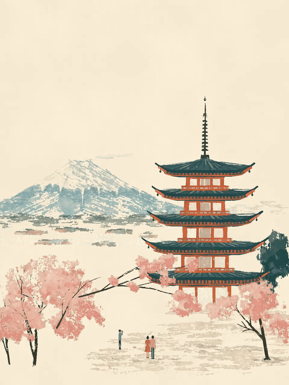

<!-- Generated by scripts/build_readme.py. Edit source data, locale catalogs and generator scripts. -->

# Mount Fuji gouache travel-poster loop

[← Back to all cases](../../README.md#all-cases)

<a href="README.md"></a> <a href="README.zh-CN.md"></a>

**Creator-reported model · Source-only; not independently reproduced**

Original prompt wording is preserved.

## Images / animation files

[Open local video file](../../assets/examples/social-fuji-gouache-loop/source-01.mp4)

- [Mount Fuji gouache travel-poster loop](https://video.twimg.com/tweet_video/HWW9tuiXoAATLhp.mp4) · video
  - Credit: devteamdrew
  - Reuse: source-attributed. Public source attachment with creator credit; no redistribution licence was located. Repository MIT terms do not cover this media.
  - [Provenance / rights evidence](https://x.com/devteamdrew/status/2118308538564989025)


- [Mount Fuji gouache travel-poster loop — derived GIF viewing copy](https://x.com/devteamdrew/status/2118308538564989025) · gif
  - Credit: devteamdrew
  - Reuse: source-attributed. Derived GIF viewing copy made from the archived source MP4. Not an original GIF attachment; source MP4 remains unchanged.
  - [Provenance / rights evidence](https://x.com/devteamdrew/status/2118308538564989025)

## Source-page and media access

- Checked: 2026-11-09 (UTC)
- Original page: Accessible. Read the original post and source-shared instructions; attribution remains creator-reported.
- Media: Archived locally. All selected public source attachments are archived. Original MP4s and separately labelled derived GIF viewing copies are stored with hashes. Viewer JPEGs use their actual download URLs.
- [Per-file attempts and results](../../cases/social-fuji-gouache-loop/source.json)

## Original prompt

```text
A living mid-century gouache travel-poster painting of Mount Fuji behind a five-storey Japanese pagoda, static locked-off camera, seamless looping animation. The pagoda is vermilion-orange with deep teal-slate tiled roofs, a slender spire, and a dark evergreen tree beside it. Fuji sits small and distant in dusty blue-grey with a snow-white cap and ragged dry-brush ridges, over a pale mist field. Foreground cherry trees in soft coral-pink blossom with dark trunks frame the bottom, and tiny figures stand on pale speckled ground. Warm cream paper-grain sky fills the upper half. Matte flat gouache with ragged, flaking edges, visible bristle marks and speckled holes. Subtle motion only: blossom petals drift down, branches sway faintly, tiny figures shift, a bell-like gentle shimmer on the light. Soft spring morning light, vertical 3:4, perfect loop.
```

[Original prompt (.txt)](../../cases/social-fuji-gouache-loop/prompt.txt)

Original prompt wording is preserved.

[Original prompt at source](https://x.com/devteamdrew/status/2118538745175503130)

## Attribution and verification

- ID: social-fuji-gouache-loop
- Author: devteamdrew
- [Original source](https://x.com/devteamdrew/status/2118308538564989025)
- Model: GPT Image 2.6
- Variant: Variant unspecified
- Evidence: The creator explicitly identifies GPT Image 2.6 for this work. Source excerpt: A few scenic GIFs made using ChatGPT Images 2.6 Creator-reported only; not independently reproduced.
- Collected: 2026-11-09 (UTC)
- Source checked: 2026-11-09 (UTC)

Attribution does not grant a media license. Repository MIT terms do not cover third-party outputs. Local files record provenance and reuse status; source-attributed does not mean open-licensed.
