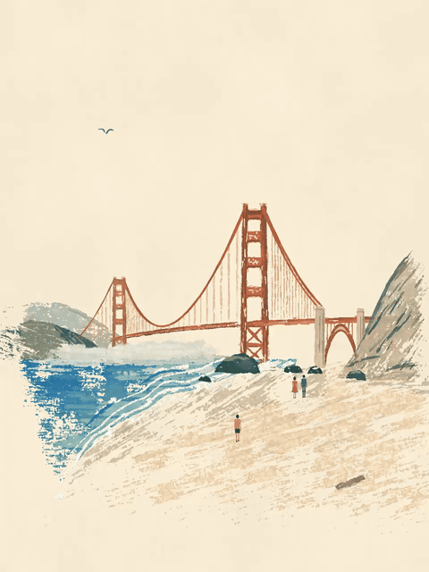

<!-- Generated by scripts/build_readme.py. Edit source data, locale catalogs and generator scripts. -->

# Golden Gate gouache travel-poster loop

[← Back to all cases](../../README.md#all-cases)

<a href="README.md"></a> <a href="README.zh-CN.md"></a>

**Creator-reported model · Source-only; not independently reproduced**

Original prompt wording is preserved.

## Images / animation files

[Open local video file](../../assets/examples/social-golden-gate-gouache-loop/source-01.mp4)

- [Golden Gate gouache travel-poster loop](https://video.twimg.com/tweet_video/HWW9tuiWsAArMUF.mp4) · video
  - Credit: devteamdrew
  - Reuse: source-attributed. Public source attachment with creator credit; no redistribution licence was located. Repository MIT terms do not cover this media.
  - [Provenance / rights evidence](https://x.com/devteamdrew/status/2118308538564989025)


- [Golden Gate gouache travel-poster loop — derived GIF viewing copy](https://x.com/devteamdrew/status/2118308538564989025) · gif
  - Credit: devteamdrew
  - Reuse: source-attributed. Derived GIF viewing copy made from the archived source MP4. Not an original GIF attachment; source MP4 remains unchanged.
  - [Provenance / rights evidence](https://x.com/devteamdrew/status/2118308538564989025)

## Source-page and media access

- Checked: 2026-11-09 (UTC)
- Original page: Accessible. Read the original post and source-shared instructions; attribution remains creator-reported.
- Media: Archived locally. All selected public source attachments are archived. Original MP4s and separately labelled derived GIF viewing copies are stored with hashes. Viewer JPEGs use their actual download URLs.
- [Per-file attempts and results](../../cases/social-golden-gate-gouache-loop/source.json)

## Original prompt

```text
A living mid-century gouache travel-poster painting of the Golden Gate Bridge seen from a beach, static locked-off camera, seamless looping animation. The bridge is rust-orange with two tall towers, fine suspension cables and vertical hangers, spanning to a hazy grey-blue headland on the left and a tan-grey rocky cliff on the right. In the foreground deep cobalt and teal surf rolls in with white foam lines onto a sweeping beach of sandy beige scratchy dry-brush strokes, with dark rocks, a driftwood log and tiny figures in coral, navy and mustard. Warm cream sky with fine paper grain fills the upper half. Matte opaque gouache, ragged flaking edges, visible bristle streaks, speckled worn texture. Gentle motion only: waves wash and recede, foam shimmers, seagulls glide across the sky, tiny people wander. Soft hazy daylight, vertical 3:4, perfect loop.
```

[Original prompt (.txt)](../../cases/social-golden-gate-gouache-loop/prompt.txt)

Original prompt wording is preserved.

[Original prompt at source](https://x.com/devteamdrew/status/2118538745175503130)

## Attribution and verification

- ID: social-golden-gate-gouache-loop
- Author: devteamdrew
- [Original source](https://x.com/devteamdrew/status/2118308538564989025)
- Model: GPT Image 2.6
- Variant: Variant unspecified
- Evidence: The creator explicitly identifies GPT Image 2.6 for this work. Source excerpt: A few scenic GIFs made using ChatGPT Images 2.6 Creator-reported only; not independently reproduced.
- Collected: 2026-11-09 (UTC)
- Source checked: 2026-11-09 (UTC)

Attribution does not grant a media license. Repository MIT terms do not cover third-party outputs. Local files record provenance and reuse status; source-attributed does not mean open-licensed.
