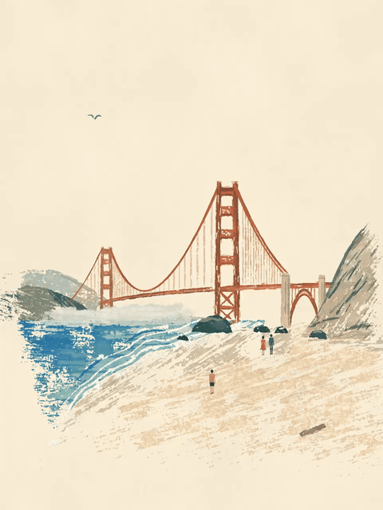

<!-- Generated by scripts/build_readme.py. Edit source data, locale catalogs and generator scripts. -->

# 金门大桥水粉旅行海报循环

[← 返回全部案例](../../README.zh-CN.md#all-cases)

<a href="README.md"></a> <a href="README.zh-CN.md"></a>

**作者自报模型 · 仅核对来源；未独立复现**

提示词按原文保存；同一工作流的多张结果与展示副本合并计数。

## 图片 / 动画文件

[打开仓库内视频文件](../../assets/examples/social-golden-gate-gouache-loop/source-01.mp4)

- [金门大桥水粉旅行海报循环](https://video.twimg.com/tweet_video/HWW9tuiWsAArMUF.mp4) · video
  - 署名：devteamdrew
  - 使用条件：source-attributed. 公开来源附件，保留作者署名，未找到转载许可证；仓库MIT协议不覆盖此素材。
  - [来源 / 权利依据](https://x.com/devteamdrew/status/2118308538564989025)


- [金门大桥水粉旅行海报循环——由原MP4转码的GIF展示副本](https://x.com/devteamdrew/status/2118308538564989025) · gif
  - 署名：devteamdrew
  - 使用条件：source-attributed. 由已存档原MP4转码的GIF展示副本，不冒充原始GIF附件；原MP4保持不变。
  - [来源 / 权利依据](https://x.com/devteamdrew/status/2118308538564989025)

## 原帖与素材获取状态

- 核对日期：2026-11-09 (UTC)
- 原帖：可打开. 已读取原帖及公开指令；模型归因为作者自报。
- 素材：已存入仓库. 本例选定的公开附件均已存档；原MP4与明确标注的GIF转码副本分别保存并记录哈希，查看器JPEG使用实际下载地址。
- [逐项尝试与结果](../../cases/social-golden-gate-gouache-loop/source.json)

## 原始提示词

```text
A living mid-century gouache travel-poster painting of the Golden Gate Bridge seen from a beach, static locked-off camera, seamless looping animation. The bridge is rust-orange with two tall towers, fine suspension cables and vertical hangers, spanning to a hazy grey-blue headland on the left and a tan-grey rocky cliff on the right. In the foreground deep cobalt and teal surf rolls in with white foam lines onto a sweeping beach of sandy beige scratchy dry-brush strokes, with dark rocks, a driftwood log and tiny figures in coral, navy and mustard. Warm cream sky with fine paper grain fills the upper half. Matte opaque gouache, ragged flaking edges, visible bristle streaks, speckled worn texture. Gentle motion only: waves wash and recede, foam shimmers, seagulls glide across the sky, tiny people wander. Soft hazy daylight, vertical 3:4, perfect loop.
```

[原始提示词 (.txt)](../../cases/social-golden-gate-gouache-loop/prompt.txt)

提示词按原文保存；同一工作流的多张结果与展示副本合并计数。

[原提示词见来源](https://x.com/devteamdrew/status/2118538745175503130)

## 来源与核对信息

- ID: social-golden-gate-gouache-loop
- 作者：devteamdrew
- [原始来源](https://x.com/devteamdrew/status/2118308538564989025)
- 模型：GPT Image 2.6
- 版本：版本未注明
- 依据：作者在原帖明确说明本作品使用GPT Image 2.6。原文摘录：A few scenic GIFs made using ChatGPT Images 2.6。依据为作者自报；本仓库未独立复现。
- 收录：2026-11-09 (UTC)
- 来源核对：2026-11-09 (UTC)

标注来源不等于取得素材许可。仓库 MIT 协议不覆盖第三方输出；本地素材逐项记录来源与使用状态，source-attributed 不代表开放许可。
