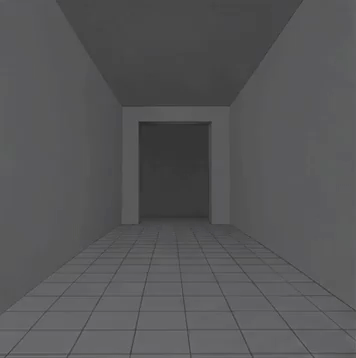

<!-- Generated by scripts/build_readme.py. Edit source data, locale catalogs and generator scripts. -->

# Gray Blender hallway camera draft

[← Back to all cases](../../README.md#all-cases)

<a href="README.md"></a> <a href="README.zh-CN.md"></a>

**Creator-reported model · Source-only; not independently reproduced**

Original prompt wording is preserved. Only the GPT Image 2.6 gray animation draft is included; the downstream H3 result is excluded. See the precise source and item-level media notes; requested parameters are not independently verified output properties.

## Images / animation files

[Open local video file](../../assets/examples/social-gray-blender-hallway-draft/source-01.mp4)

- [Gray Blender hallway camera draft](https://video.twimg.com/amplify_video/2118407099247968256/vid/avc1/356x358/NsjEP_nz4euG0NqP.mp4?tag=29) · video
  - Credit: cocktailpeanut
  - Reuse: source-attributed. Public source attachment with creator credit; no redistribution licence was located. Repository MIT terms do not cover this media.
  - [Provenance / rights evidence](https://x.com/cocktailpeanut/status/2118408795026043260)


- [Gray Blender hallway camera draft — derived GIF viewing copy](https://x.com/cocktailpeanut/status/2118408795026043260) · gif
  - Credit: cocktailpeanut
  - Reuse: source-attributed. Derived GIF viewing copy made from the archived source MP4. Not an original GIF attachment; source MP4 remains unchanged.
  - [Provenance / rights evidence](https://x.com/cocktailpeanut/status/2118408795026043260)

## Source-page and media access

- Checked: 2026-11-09 (UTC)
- Original page: Accessible. Read the original post and source-shared instructions; attribution remains creator-reported.
- Media: Archived locally. All selected public source attachments are archived. Original MP4s and separately labelled derived GIF viewing copies are stored with hashes. Viewer JPEGs use their actual download URLs.
- [Per-file attempts and results](../../cases/social-gray-blender-hallway-draft/source.json)

## Original prompt

```text
Generate a 5-second animated GIF consisting of 10 evenly spaced animation frames. Make it look like a crude gray Blender viewport animation, not cinematic footage. A single continuous shot inside a rectangular hallway with a tiled floor and simple gray walls. The camera slowly advances toward a doorway. A black humanoid mannequin with unusually long arms emerges from behind the doorway. The camera suddenly whips right, falls onto its side, and stops. The mannequin slowly walks toward and past the fallen camera. Maintain consistent 3D geometry, character proportions, doorway placement, and spatial relationships. No cuts, no teleportation, no scene changes, no added props. Focus on exact camera movement, depth, and timing. The animation should play once as a complete sequence, not return to its starting pose.
```

[Original prompt (.txt)](../../cases/social-gray-blender-hallway-draft/prompt.txt)

Original prompt wording is preserved. Only the GPT Image 2.6 gray animation draft is included; the downstream H3 result is excluded. See the precise source and item-level media notes; requested parameters are not independently verified output properties.

[Original prompt at source](https://x.com/cocktailpeanut/status/2118408801812643957)

## Attribution and verification

- ID: social-gray-blender-hallway-draft
- Author: cocktailpeanut
- [Original source](https://x.com/cocktailpeanut/status/2118408795026043260)
- Model: GPT Image 2.6
- Variant: Variant unspecified
- Evidence: The creator explicitly identifies GPT Image 2.6 for this work. Source excerpt: The GPT-Image 2.6 is a game changer for AI video generation, when combined with Minimax H3. I made a full 15 sec video by: Creator-reported only; not independently reproduced.
- Collected: 2026-11-09 (UTC)
- Source checked: 2026-11-09 (UTC)

Attribution does not grant a media license. Repository MIT terms do not cover third-party outputs. Local files record provenance and reuse status; source-attributed does not mean open-licensed.
