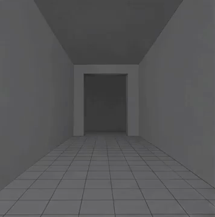

<!-- Generated by scripts/build_readme.py. Edit source data, locale catalogs and generator scripts. -->

# 灰色Blender走廊镜头动画草稿

[← 返回全部案例](../../README.zh-CN.md#all-cases)

<a href="README.md"></a> <a href="README.zh-CN.md"></a>

**作者自报模型 · 仅核对来源；未独立复现**

仅收录作者Step 1的GPT Image 2.6灰模动画原件。后续延长与H3生成的最终视频属于其他阶段，不作为本案例的2.6输出。

## 图片 / 动画文件

[打开仓库内视频文件](../../assets/examples/social-gray-blender-hallway-draft/source-01.mp4)

- [灰色Blender走廊镜头动画草稿](https://video.twimg.com/amplify_video/2118407099247968256/vid/avc1/356x358/NsjEP_nz4euG0NqP.mp4?tag=29) · video
  - 署名：cocktailpeanut
  - 使用条件：source-attributed. 公开来源附件，保留作者署名，未找到转载许可证；仓库MIT协议不覆盖此素材。
  - [来源 / 权利依据](https://x.com/cocktailpeanut/status/2118408795026043260)


- [灰色Blender走廊镜头动画草稿——由原MP4转码的GIF展示副本](https://x.com/cocktailpeanut/status/2118408795026043260) · gif
  - 署名：cocktailpeanut
  - 使用条件：source-attributed. 由已存档原MP4转码的GIF展示副本，不冒充原始GIF附件；原MP4保持不变。
  - [来源 / 权利依据](https://x.com/cocktailpeanut/status/2118408795026043260)

## 原帖与素材获取状态

- 核对日期：2026-11-09 (UTC)
- 原帖：可打开. 已读取原帖及公开指令；模型归因为作者自报。
- 素材：已存入仓库. 本例选定的公开附件均已存档；原MP4与明确标注的GIF转码副本分别保存并记录哈希，查看器JPEG使用实际下载地址。
- [逐项尝试与结果](../../cases/social-gray-blender-hallway-draft/source.json)

## 原始提示词

```text
Generate a 5-second animated GIF consisting of 10 evenly spaced animation frames. Make it look like a crude gray Blender viewport animation, not cinematic footage. A single continuous shot inside a rectangular hallway with a tiled floor and simple gray walls. The camera slowly advances toward a doorway. A black humanoid mannequin with unusually long arms emerges from behind the doorway. The camera suddenly whips right, falls onto its side, and stops. The mannequin slowly walks toward and past the fallen camera. Maintain consistent 3D geometry, character proportions, doorway placement, and spatial relationships. No cuts, no teleportation, no scene changes, no added props. Focus on exact camera movement, depth, and timing. The animation should play once as a complete sequence, not return to its starting pose.
```

[原始提示词 (.txt)](../../cases/social-gray-blender-hallway-draft/prompt.txt)

仅收录作者Step 1的GPT Image 2.6灰模动画原件。后续延长与H3生成的最终视频属于其他阶段，不作为本案例的2.6输出。

[原提示词见来源](https://x.com/cocktailpeanut/status/2118408801812643957)

## 来源与核对信息

- ID: social-gray-blender-hallway-draft
- 作者：cocktailpeanut
- [原始来源](https://x.com/cocktailpeanut/status/2118408795026043260)
- 模型：GPT Image 2.6
- 版本：版本未注明
- 依据：作者在原帖明确说明本作品使用GPT Image 2.6。原文摘录：The GPT-Image 2.6 is a game changer for AI video generation, when combined with Minimax H3. I made a full 15 sec video by:。依据为作者自报；本仓库未独立复现。
- 收录：2026-11-09 (UTC)
- 来源核对：2026-11-09 (UTC)

标注来源不等于取得素材许可。仓库 MIT 协议不覆盖第三方输出；本地素材逐项记录来源与使用状态，source-attributed 不代表开放许可。
