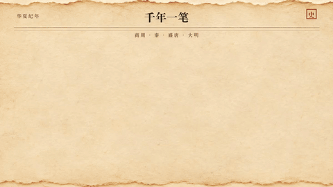

<!-- Generated by scripts/build_readme.py. Edit source data, locale catalogs and generator scripts. -->

# Ink-wash history timeline

[← Back to all cases](../../README.md#all-cases)

<a href="README.md"></a> <a href="README.zh-CN.md"></a>

**Creator-reported model · Source-only; not independently reproduced**

Original prompt wording is preserved.  See the precise source and item-level media notes; requested parameters are not independently verified output properties.

## Images / animation files

[Open local video file](../../assets/examples/social-ink-history-timeline-loop/source-01.mp4)

- [Ink-wash history timeline](https://video.twimg.com/amplify_video/2119050760508125184/vid/avc1/1200x676/a8l4Lb8hmzzgUW_Q.mp4?tag=29) · video
  - Credit: aiwarts
  - Reuse: source-attributed. Public source attachment with creator credit; no redistribution licence was located. Repository MIT terms do not cover this media.
  - [Provenance / rights evidence](https://x.com/aiwarts/status/2119435411667980473)


- [Ink-wash history timeline — derived GIF viewing copy](https://x.com/aiwarts/status/2119435411667980473) · gif
  - Credit: aiwarts
  - Reuse: source-attributed. Derived GIF viewing copy made from the archived source MP4. Not an original GIF attachment; source MP4 remains unchanged.
  - [Provenance / rights evidence](https://x.com/aiwarts/status/2119435411667980473)

## Source-page and media access

- Checked: 2026-11-09 (UTC)
- Original page: Accessible. Read the original post and source-shared instructions; attribution remains creator-reported.
- Media: Archived locally. All selected public source attachments are archived. Original MP4s and separately labelled derived GIF viewing copies are stored with hashes. Viewer JPEGs use their actual download URLs.
- [Per-file attempts and results](../../cases/social-ink-history-timeline-loop/source.json)

## Original prompt

```text
历史科普长卷动态时间轴，动态 GIF，泛黄水墨宣纸质感底纹，手绘水墨写意风格，一支饱蘸浓墨的毛笔自左向右极速扫过划出一条起伏有力的墨迹时间线，墨迹划过之处依次如盖章般晕染浮现出四个朝代关键节点的微缩手绘插画：商周青铜司母戊鼎、秦代陶俑战车、盛唐飞天壁画阁楼与大明宝船，节点带有毛笔小楷年代标注，墨韵流动，首尾相接无缝循环
```

[Original prompt (.txt)](../../cases/social-ink-history-timeline-loop/prompt.txt)

Original prompt wording is preserved.  See the precise source and item-level media notes; requested parameters are not independently verified output properties.

[Original prompt at source](https://x.com/aiwarts/status/2119435411667980473)

## Attribution and verification

- ID: social-ink-history-timeline-loop
- Author: aiwarts
- [Original source](https://x.com/aiwarts/status/2119435411667980473)
- Model: GPT Image 2.6
- Variant: Variant unspecified
- Evidence: The creator introduces this article as their GPT Image 2.6 experiment and pairs each selected workflow with a public instruction and attached demonstration. Creator-reported only; no independent reproduction.
- Collected: 2026-11-09 (UTC)
- Source checked: 2026-11-09 (UTC)

Attribution does not grant a media license. Repository MIT terms do not cover third-party outputs. Local files record provenance and reuse status; source-attributed does not mean open-licensed.
