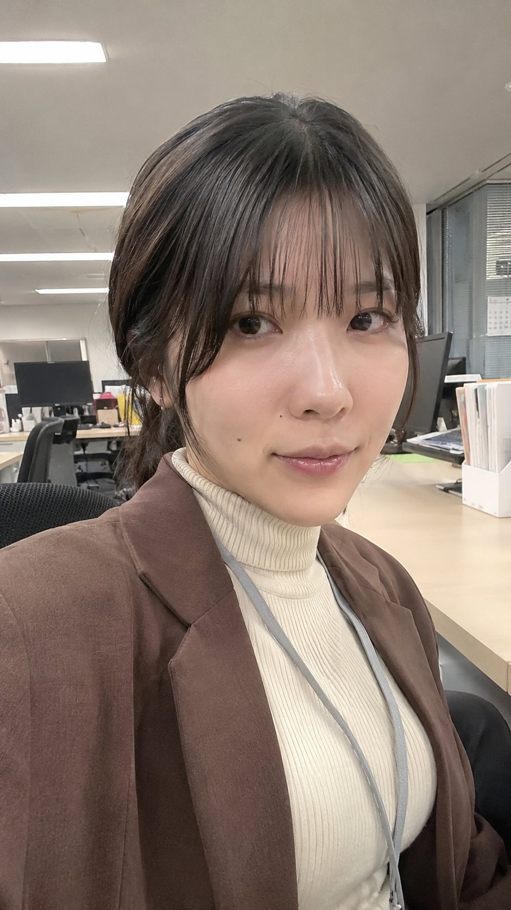

<!-- Generated by scripts/build_readme.py. Edit source data, locale catalogs and generator scripts. -->

# 日本办公室随拍的简短提示词对照

[← 返回全部案例](../../README.zh-CN.md#all-cases)

<a href="README.md"></a> <a href="README.zh-CN.md"></a>

**作者自报模型 · 仅核对来源；未独立复现**

两组简短指令对应原帖第1/2张与第3/4张；四张输出属于同一提示词对照实验，合并一例。

## 图片 / GIF


- [日本办公室随拍的简短提示词对照](https://pbs.twimg.com/media/HWaT17cbUAADHCj?format=jpg&name=large) · image
  - 署名：buusk4
  - 使用条件：source-attributed. 通过原帖图片查看器的正常浏览器下载保存JPEG大图；单独记录HTTP直链返回403。保留作者署名，不声明已取得转载许可；MIT不覆盖此素材。
  - [来源 / 权利依据](https://x.com/buusk4/status/2118543259257712714)


- [日本办公室随拍的简短提示词对照](https://pbs.twimg.com/media/HWaT2XqbIAAOT_N?format=jpg&name=large) · image
  - 署名：buusk4
  - 使用条件：source-attributed. 通过原帖图片查看器的正常浏览器下载保存JPEG大图；单独记录HTTP直链返回403。保留作者署名，不声明已取得转载许可；MIT不覆盖此素材。
  - [来源 / 权利依据](https://x.com/buusk4/status/2118543259257712714)


- [日本办公室随拍的简短提示词对照](https://pbs.twimg.com/media/HWaT2wha8AAk7st?format=jpg&name=large) · image
  - 署名：buusk4
  - 使用条件：source-attributed. 通过原帖图片查看器的正常浏览器下载保存JPEG大图；单独记录HTTP直链返回403。保留作者署名，不声明已取得转载许可；MIT不覆盖此素材。
  - [来源 / 权利依据](https://x.com/buusk4/status/2118543259257712714)


- [日本办公室随拍的简短提示词对照](https://pbs.twimg.com/media/HWaT3Nca0AEcwmP?format=jpg&name=large) · image
  - 署名：buusk4
  - 使用条件：source-attributed. 通过原帖图片查看器的正常浏览器下载保存JPEG大图；单独记录HTTP直链返回403。保留作者署名，不声明已取得转载许可；MIT不覆盖此素材。
  - [来源 / 权利依据](https://x.com/buusk4/status/2118543259257712714)

## 原帖与素材获取状态

- 核对日期：2026-11-09 (UTC)
- 原帖：可打开. 已读取原帖及公开指令；模型归因为作者自报。
- 素材：已存入仓库. 本例选定的公开附件均已存档；原MP4与明确标注的GIF转码副本分别保存并记录哈希，查看器JPEG使用实际下载地址。
- [逐项尝试与结果](../../cases/social-japanese-office-short-prompts/source.json)

## 原始提示词

```text
1,2枚目:縦長9:16の超写実的な実写写真。
成人日本人女性。日本の一般的なオフィス。

3,4枚目:縦長9:16の超写実的な実写写真スマホ画質のスナップショット。
成人日本人女性。日本の一般的なオフィス。
```

[原始提示词 (.txt)](../../cases/social-japanese-office-short-prompts/prompt.txt)

两组简短指令对应原帖第1/2张与第3/4张；四张输出属于同一提示词对照实验，合并一例。

[原提示词见来源](https://x.com/buusk4/status/2118543259257712714)

## 来源与核对信息

- ID: social-japanese-office-short-prompts
- 作者：buusk4
- [原始来源](https://x.com/buusk4/status/2118543259257712714)
- 模型：GPT Image 2.6
- 版本：版本未注明
- 依据：作者在原帖明确说明本作品使用GPT Image 2.6。原文摘录：なんかGPT image2.6のtipsみたいなのが流行ってたけど、もはや細かい指示とか要らないんだよね🙄。依据为作者自报；本仓库未独立复现。
- 收录：2026-11-09 (UTC)
- 来源核对：2026-11-09 (UTC)

标注来源不等于取得素材许可。仓库 MIT 协议不覆盖第三方输出；本地素材逐项记录来源与使用状态，source-attributed 不代表开放许可。
