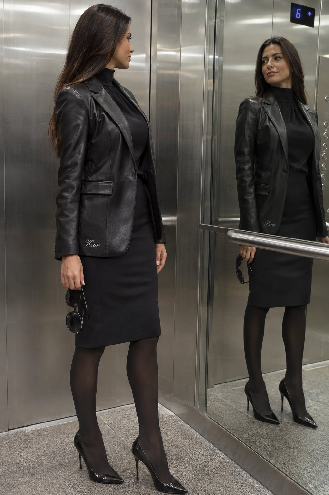

<!-- Generated by scripts/build_readme.py. Edit source data, locale catalogs and generator scripts. -->

# Keor outfit portrait in a mirrored elevator

[← Back to all cases](../../README.md#all-cases)

<a href="README.md"></a> <a href="README.zh-CN.md"></a>

**Creator-reported model · Source-only; not independently reproduced**

Original prompt wording is preserved.  See the precise source and item-level media notes; requested parameters are not independently verified output properties.

## Images / GIFs



- [Keor outfit portrait in a mirrored elevator](https://pbs.twimg.com/media/HWWoRJfacAA-lsG?format=jpg&name=large) · image
  - Credit: tadasgedgaudas
  - Reuse: source-attributed. JPEG provided by the original post image viewer, saved through the normal browser download flow. Direct HTTP retrieval returned 403. Creator credit retained; no redistribution licence asserted; MIT excludes this media.
  - [Provenance / rights evidence](https://x.com/tadasgedgaudas/status/2118284291381875124)

## Source-page and media access

- Checked: 2026-11-09 (UTC)
- Original page: Accessible. Read the original post and source-shared instructions; attribution remains creator-reported.
- Media: Archived locally. All selected public source attachments are archived. Original MP4s and separately labelled derived GIF viewing copies are stored with hashes. Viewer JPEGs use their actual download URLs.
- [Per-file attempts and results](../../cases/social-keor-elevator-mirror-portrait/source.json)

## Original prompt

```text
{"subject": {"description": "A beautiful young woman with long straight dark brown hair, tanned skin, and a confident expression. She has a toned, curvaceous figure.", "pose": "Standing in an elevator, looking at her reflection in the mirrored wall while holding a pair of black sunglasses. Her body is slightly turned toward the mirror.", "clothing": {"main": "Black leather-style crop top with deep V-neck, black mini skirt with chain details, black arm sleeves/gloves with cut-outs, black thigh-high stockings, and black high heels stilettos. Black choker necklace.", "modifications": "Add a small, elegant 'Keor' embroidery in refined script on the border or hem of her black top or skirt, subtly visible."}}, "setting": {"environment": "Modern elevator interior with mirrored walls, metal panels, and a digital display.", "lighting": "Bright indoor elevator lighting creating reflections on the metal and mirrors."}, "style": {"photography": "Realistic, high-resolution candid-style photograph with sharp details on skin, hair, leather textures, and reflections.", "mood": "Edgy, confident, and stylish.", "composition": "Medium full-body shot capturing the subject and her mirror reflection."}, "full_prompt": "Photorealistic image of a beautiful woman with long dark hair in a black leather crop top, mini skirt, thigh-high stockings, and boots, standing in an elevator looking at her reflection while holding sunglasses. Add small elegant 'Keor' embroidery on the border of her outfit. Bright elevator lighting with mirror reflections, highly detailed skin, hair, and fabric textures."}
```

[Original prompt (.txt)](../../cases/social-keor-elevator-mirror-portrait/prompt.txt)

Original prompt wording is preserved.  See the precise source and item-level media notes; requested parameters are not independently verified output properties.

[Original prompt at source](https://x.com/tadasgedgaudas/status/2118284291381875124)

## Attribution and verification

- ID: social-keor-elevator-mirror-portrait
- Author: tadasgedgaudas
- [Original source](https://x.com/tadasgedgaudas/status/2118284291381875124)
- Model: GPT Image 2.6
- Variant: Variant unspecified
- Evidence: The creator explicitly identifies GPT Image 2.6 for this work. Source excerpt: ChatGPT Images 2.5 (left) vs ChatGPT Images 2.6 (right) Creator-reported only; not independently reproduced.
- Collected: 2026-11-09 (UTC)
- Source checked: 2026-11-09 (UTC)

Attribution does not grant a media license. Repository MIT terms do not cover third-party outputs. Local files record provenance and reuse status; source-attributed does not mean open-licensed.
