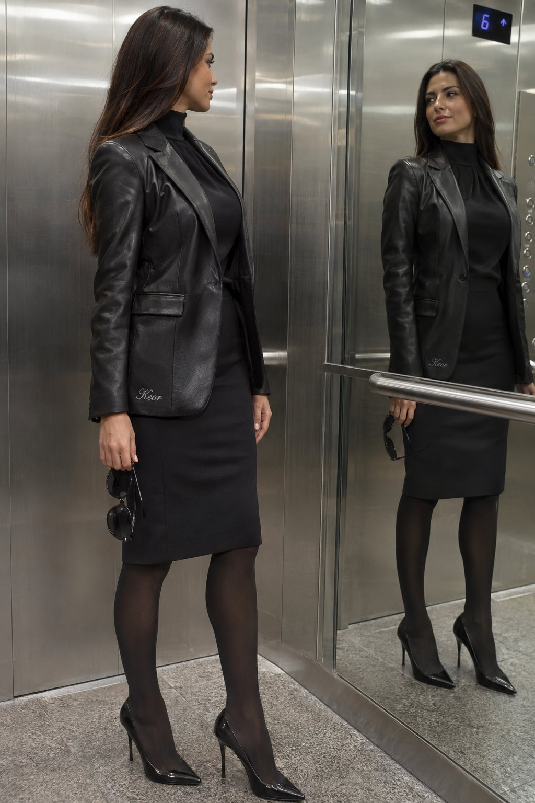

<!-- Generated by scripts/build_readme.py. Edit source data, locale catalogs and generator scripts. -->

# 镜面电梯中的Keor刺绣服装女子

[← 返回全部案例](../../README.zh-CN.md#all-cases)

<a href="README.md"></a> <a href="README.zh-CN.md"></a>

**作者自报模型 · 仅核对来源；未独立复现**

原帖明确左图2.5、右图2.6；仅保存右侧2.6结果。保留作者JSON指令中高跟鞋与靴子用词不一致的原文，不代改。

## 图片 / GIF



- [镜面电梯中的Keor刺绣服装女子](https://pbs.twimg.com/media/HWWoRJfacAA-lsG?format=jpg&name=large) · image
  - 署名：tadasgedgaudas
  - 使用条件：source-attributed. 通过原帖图片查看器的正常浏览器下载保存JPEG大图；单独记录HTTP直链返回403。保留作者署名，不声明已取得转载许可；MIT不覆盖此素材。
  - [来源 / 权利依据](https://x.com/tadasgedgaudas/status/2118284291381875124)

## 原帖与素材获取状态

- 核对日期：2026-11-09 (UTC)
- 原帖：可打开. 已读取原帖及公开指令；模型归因为作者自报。
- 素材：已存入仓库. 本例选定的公开附件均已存档；原MP4与明确标注的GIF转码副本分别保存并记录哈希，查看器JPEG使用实际下载地址。
- [逐项尝试与结果](../../cases/social-keor-elevator-mirror-portrait/source.json)

## 原始提示词

```text
{"subject": {"description": "A beautiful young woman with long straight dark brown hair, tanned skin, and a confident expression. She has a toned, curvaceous figure.", "pose": "Standing in an elevator, looking at her reflection in the mirrored wall while holding a pair of black sunglasses. Her body is slightly turned toward the mirror.", "clothing": {"main": "Black leather-style crop top with deep V-neck, black mini skirt with chain details, black arm sleeves/gloves with cut-outs, black thigh-high stockings, and black high heels stilettos. Black choker necklace.", "modifications": "Add a small, elegant 'Keor' embroidery in refined script on the border or hem of her black top or skirt, subtly visible."}}, "setting": {"environment": "Modern elevator interior with mirrored walls, metal panels, and a digital display.", "lighting": "Bright indoor elevator lighting creating reflections on the metal and mirrors."}, "style": {"photography": "Realistic, high-resolution candid-style photograph with sharp details on skin, hair, leather textures, and reflections.", "mood": "Edgy, confident, and stylish.", "composition": "Medium full-body shot capturing the subject and her mirror reflection."}, "full_prompt": "Photorealistic image of a beautiful woman with long dark hair in a black leather crop top, mini skirt, thigh-high stockings, and boots, standing in an elevator looking at her reflection while holding sunglasses. Add small elegant 'Keor' embroidery on the border of her outfit. Bright elevator lighting with mirror reflections, highly detailed skin, hair, and fabric textures."}
```

[原始提示词 (.txt)](../../cases/social-keor-elevator-mirror-portrait/prompt.txt)

原帖明确左图2.5、右图2.6；仅保存右侧2.6结果。保留作者JSON指令中高跟鞋与靴子用词不一致的原文，不代改。

[原提示词见来源](https://x.com/tadasgedgaudas/status/2118284291381875124)

## 来源与核对信息

- ID: social-keor-elevator-mirror-portrait
- 作者：tadasgedgaudas
- [原始来源](https://x.com/tadasgedgaudas/status/2118284291381875124)
- 模型：GPT Image 2.6
- 版本：版本未注明
- 依据：作者在原帖明确说明本作品使用GPT Image 2.6。原文摘录：ChatGPT Images 2.5 (left) vs ChatGPT Images 2.6 (right)。依据为作者自报；本仓库未独立复现。
- 收录：2026-11-09 (UTC)
- 来源核对：2026-11-09 (UTC)

标注来源不等于取得素材许可。仓库 MIT 协议不覆盖第三方输出；本地素材逐项记录来源与使用状态，source-attributed 不代表开放许可。
