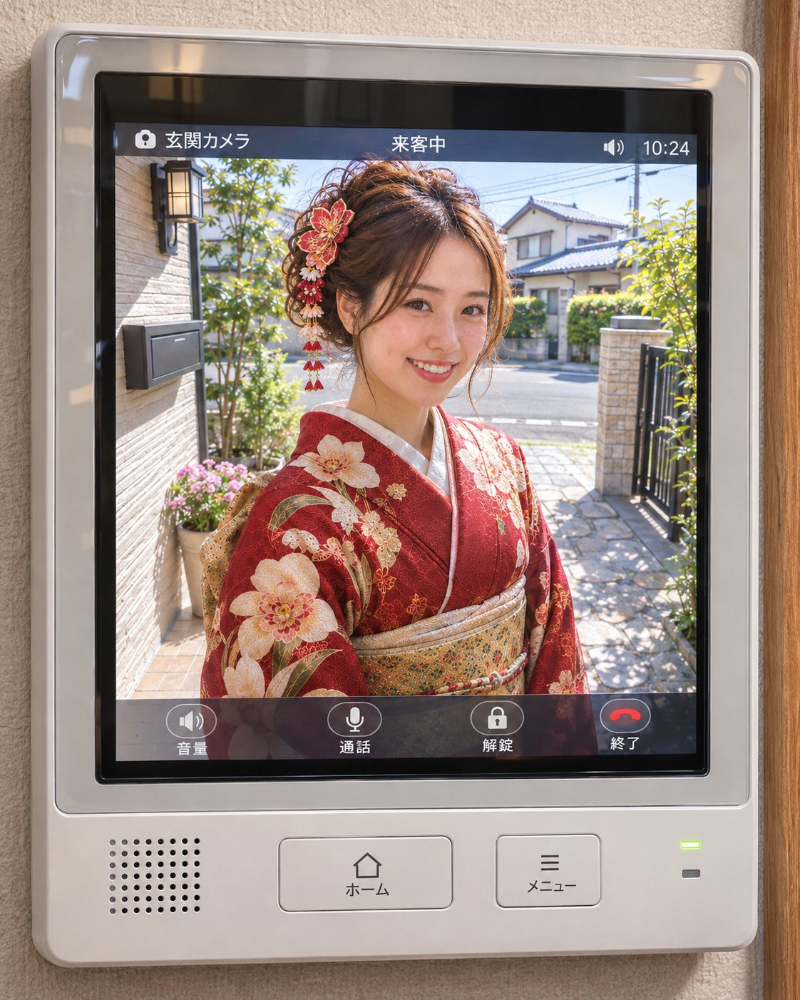

<!-- Generated by scripts/build_readme.py. Edit source data, locale catalogs and generator scripts. -->

# Kimono portrait through a door peephole

[← Back to all cases](../../README.md#all-cases)

<a href="README.md"></a> <a href="README.zh-CN.md"></a>

**Creator-reported model · Source-only; not independently reproduced**

Original prompt wording is preserved. The source offers two placeholder choices; inputs are not independently reconstructed. See the precise source and item-level media notes; requested parameters are not independently verified output properties.

## Images / GIFs


- [Kimono portrait through a door peephole](https://pbs.twimg.com/media/HWVt81KawAAbvYm?format=jpg&name=large) · image
  - Credit: kabumira862571
  - Reuse: source-attributed. JPEG provided by the original post image viewer, saved through the normal browser download flow. Direct HTTP retrieval returned 403. Creator credit retained; no redistribution licence asserted; MIT excludes this media.
  - [Provenance / rights evidence](https://x.com/kabumira862571/status/2118220107487051883)


- [Kimono portrait through a door peephole](https://pbs.twimg.com/media/HWVt9U_bsAAvXBm?format=jpg&name=large) · image
  - Credit: kabumira862571
  - Reuse: source-attributed. JPEG provided by the original post image viewer, saved through the normal browser download flow. Direct HTTP retrieval returned 403. Creator credit retained; no redistribution licence asserted; MIT excludes this media.
  - [Provenance / rights evidence](https://x.com/kabumira862571/status/2118220107487051883)

## Source-page and media access

- Checked: 2026-11-09 (UTC)
- Original page: Accessible. Read the original post and source-shared instructions; attribution remains creator-reported.
- Media: Archived locally. All selected public source attachments are archived. Original MP4s and separately labelled derived GIF viewing copies are stored with hashes. Viewer JPEGs use their actual download URLs.
- [Per-file attempts and results](../../cases/social-kimono-door-peephole-portrait/source.json)

## Original prompt

```text
玄関先でこちらを見るキャラ。
[＊＊＊]
キャラは、アップロード画像を参照。
顔・髪型・服装まで忠実に再現。
晴れた住宅街、自然光。
アスペクト比縦4:5。
```

[Original prompt (.txt)](../../cases/social-kimono-door-peephole-portrait/prompt.txt)

Original prompt wording is preserved. The source offers two placeholder choices; inputs are not independently reconstructed. See the precise source and item-level media notes; requested parameters are not independently verified output properties.

[Original prompt at source](https://x.com/kabumira862571/status/2118220107487051883)

## Attribution and verification

- ID: social-kimono-door-peephole-portrait
- Author: kabumira862571
- [Original source](https://x.com/kabumira862571/status/2118220107487051883)
- Model: GPT Image 2.6
- Variant: Variant unspecified
- Evidence: The creator explicitly identifies GPT Image 2.6 for this work. Source excerpt: GPT-Image 2.6 #PromptShare 遊んでね😸 Creator-reported only; not independently reproduced.
- Collected: 2026-11-09 (UTC)
- Source checked: 2026-11-09 (UTC)

Attribution does not grant a media license. Repository MIT terms do not cover third-party outputs. Local files record provenance and reuse status; source-attributed does not mean open-licensed.
