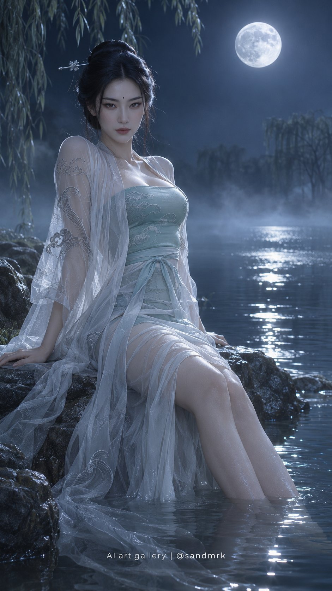

<!-- Generated by scripts/build_readme.py. Edit source data, locale catalogs and generator scripts. -->

# Woman seated in moonlit lake water

[← Back to all cases](../../README.md#all-cases)

<a href="README.md"></a> <a href="README.zh-CN.md"></a>

**Creator-reported model · Source-only; not independently reproduced**

Published by sandmrk on 2026-11-05T09:09:22+00:00. The original prompt is reproduced without rewriting.

## Images / GIFs



- [Woman seated in moonlit lake water](https://pbs.twimg.com/media/HWWazxiaMAAtplU.jpg) · image
  - Credit: sandmrk
  - Reuse: source-attributed. Original public post attachment, preserved with creator credit. No open licence is asserted; repository MIT terms do not cover this media.
  - [Provenance / rights evidence](https://x.com/sandmrk/status/2118269430014599535)

## Source-page and media access

- Checked: 2026-11-09 (UTC)
- Original page: Accessible. Read the original public social post, creator model statement and public prompt.
- Media: Archived locally. Original attachments are stored locally; file types, sizes and SHA-256 values were checked. Any GIF viewing copy is labelled separately.
- [Per-file attempts and results](../../cases/social-moonlit-lake-hanfu-portrait/source.json)

## Original prompt

```text
9:16竖版，超写实人像摄影，月夜湖畔清冷氛围。成年东亚女性侧坐于湖边湿润岩石上，双腿垂入浅水，身形高挑纤细，胸部饱满，腰身收束流畅。身穿月白色纱质褙子，内衬淡青色抹胸，纱质披帛垂入水中。月光从右上方照射，形成冷银色轮廓光。

【人物】
成年东亚女性，清冷孤傲气质。瓜子脸（下巴尖，额头宽，清冷孤傲），丹凤眼（细长上挑，眼尾飞扬，妩媚冷艳），剑眉（粗直上扬，英气飒爽），薄唇（纤薄精致，清冷克制），尖鼻（鼻尖尖锐，冷艳凌厉）。五官严格匀称，透视关系正确：双眼大小一致对称，两眼间距等于单眼宽度，鼻翼宽度等于眼距，嘴唇宽度等于瞳孔间距，面部中线左右对称。眉心一颗小痣（增加辨识度）。乌黑低髻，简单银簪，素雅淡妆。

【姿势】
侧坐于湖边湿润岩石上，身体微微后仰，双手撑在身后岩石上。双腿向前伸展，垂入浅水中，水面泛起微微涟漪。头部微微抬起，丹凤眼直视镜头，眼神清冷孤傲。

【服装】
月白色纱质褙子，半透明，绣有淡墨色水纹和云纹。内衬淡青色抹胸，贴合承托。纱质披帛从肩部垂落，末端垂入水中，被水浸湿。整体修长含蓄，简洁内敛。

【环境】
月夜湖畔：深蓝色夜空，明月高悬，月光洒在湖面上形成银色光路。湖边有湿润的黑色岩石，水面平静如镜，倒映着月亮和人物。远处有模糊的柳树剪影。薄雾弥漫在湖面上，营造空灵氛围。

【光影】
月光从右上方照射，形成冷银色轮廓光，照亮发丝和纱质服装边缘。面部使用柔和的月光补光，保持清冷色调。水面反射月光，形成银色光路。整体色调：深蓝+银白+月白+淡青。

【构图】
中景构图，人物占据画面中央，双腿垂入水中形成纵向线条。月亮位于画面上方1/4处。水面倒影和薄雾营造层次。

Negative: anime, CGI, plastic skin, over-smoothing, hard shadows, revealing clothing, wrong anatomy, extra fingers, text, watermark, logo, modern elements, Western fantasy, oversaturated, thick legs, chubby body, overweight, flat chest, asymmetric eyes, uneven facial features, distorted proportions, deformed face, warm lighting, golden hour, sunny day.

Add the exact watermark "AI art gallery | @sandmrk" at the bottom center. Montserrat Regular, pure white, slightly expanded letter spacing (+1.5px), medium-small size (2% of image height), maximum 25% image width, positioned 10% above the bottom edge. Crisp, elegant, consistent typography. No shadow, outline, glow or background.
```

[Original prompt (.txt)](../../cases/social-moonlit-lake-hanfu-portrait/prompt.txt)

[Original prompt at source](https://x.com/sandmrk/status/2118269433626124798)

## Attribution and verification

- ID: social-moonlit-lake-hanfu-portrait
- Author: sandmrk
- [Original source](https://x.com/sandmrk/status/2118269430014599535)
- Model: GPT Image 2.6
- Variant: Variant unspecified
- Evidence: The creator explicitly identifies GPT Image 2.6 in the original social post: 左图：gpt-image-2.6-sunburst Model attribution is creator-reported; this is not an independent reproduction.
- Collected: 2026-11-09 (UTC)
- Source checked: 2026-11-09 (UTC)

Attribution does not grant a media license. Repository MIT terms do not cover third-party outputs. Local files record provenance and reuse status; source-attributed does not mean open-licensed.
